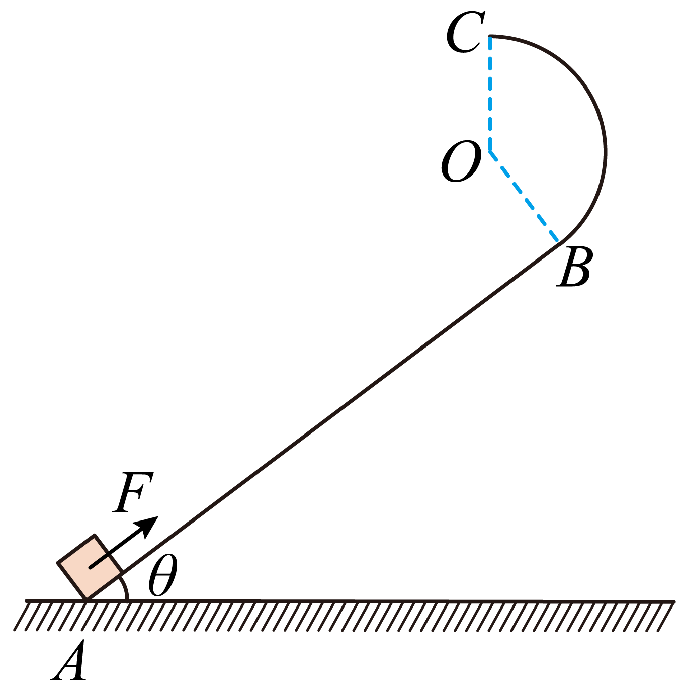

# Physics - 题目 839

**ID**: 854de3de11a9491494aee8c7e8fb9c85
**年级**: Grade 12
**难度**: Medium-Hard
**题型**: Calculation

## 题目
如图所示，倾角为 $θ=37{}\degree $ 的斜面 $AB$ 与半径为R的光滑圆弧轨道 $BC$ 在B点平滑连接，圆弧轨道 $BC$ 末端C点处的切线水平。​​​​​​​‌质量为 $m$ 的小滑块在沿斜面向上大小为 $\frac {5}{3}mg$ 的拉力作用下从A点由静止开始运动。已知斜面 $AB$ 的长度为 $10R$ ，小滑块与斜面间的动摩擦因数为 $μ=\frac {7}{12}$ ，整个运动过程中小滑块始终受到拉力的作用。最大静摩擦力等于滑动摩擦力，重力加速度为 ${\rm \mathit{g}，}{\rm{s}}{\rm{i}}{\rm{n}}37{}\degree =0.6$ ， ${\rm{c}}{\rm{o}}{\rm{s}}37{}\degree =0.8$ ，忽略空气阻力，求：（1）小滑块第一次经过B点时对圆弧轨道的压力 $F{{}_{{\rm{N}}1}}$ ；（2）小滑块对圆弧轨道的最大压力 $F{{}_{{\rm{N}}2}}$ ；（3）经过足够长时间，小滑块与斜面摩擦产生的总热量Q。

## 解答

1. （1）小滑块在斜面上由A点运动到B点的过程中，由动能定理得 $(F-mg\sin θ-{\rm μm}g{\cos}θ)\cdot 10R=\frac {1}{2}mv{{}_{B}^{2}}-0$ ，解得 $v{{}_{B}}=\sqrt {12gR}$ ，当小滑块运动到 $B$ 点时，根据牛顿第二定律可得 $F^{′}{{{}_{{\rm{N}}{{1}}}}}-mg{\cos}θ=m\frac {v{{}_{B}^{2}}}{R}$ ，解得 $F^{′}{{{}_{{\rm{N}}{{1}}}}}=12.8mg$ ，由牛顿第三定律得，小滑块对轨道的压力大小为 $F{{}_{{\rm{N}}{{1}}}}=F^{′}{{{}_{{\rm{N}}{{1}}}}}=12.8mg$ ，方向垂直AB指向右下方；
2. （2）当小滑块在圆弧轨道运动时，始终受到恒定的外力F和重力mg，二者的合力为 $F{{}_{合}}=\frac {4}{3}mg$ ，方向水平向右，因此D点是等效最低点，如图所示，
3. 
4. 小滑块在D点时，对圆弧轨道的压力最大，根据牛顿第二定律可得 $F^{′}{{{}_{{\rm{N}}{{2}}}}}-F{{}_{合}}=m\frac {v{{}_{D}^{2}}}{R}$ ，滑块由B点运动到D点的过程中，由动能定理得 $F{{}_{合}}\cdot R\left ({1-{\rm{s}}{\rm{i}}{\rm{n}}θ}\right )=\frac {1}{2}mv{{}_{D}^{2}}-\frac {1}{2}mv{{}_{B}^{2}}$ ，解得 $F^{′}{{{}_{{\rm{N}}{{2}}}}}=14.4mg$ ，由牛顿第三定律得，小滑块对圆弧轨道的压力大小为 $F{{}_{{\rm{N}}{{2}}}}=F^{′}{{{}_{{\rm{N}}{{2}}}}}=14.4mg$ ，方向水平向右；
5. （3）根据小滑块的受力分析和运动分析可知，小滑块在B、E两点之间做往复运动，在B、E两点处速度均为0，所以第一次经过B点时小滑块具有的动能全部转化为小滑块与斜面间的内能，有 $Q{{}_{1}}=\frac {1}{2}mv{{}_{B}^{2}}$ ，小滑块在斜面上由A点第一次运动到B点的过程中，有 $Q{{}_{2}}={\rm μm}gL{\rm{c}}{\rm{o}}{\rm{s}}θ$ ，所以小滑块与斜面间摩擦产生的总热量为 $Q=Q{{}_{1}}+Q{{}_{2}}$ ，解得 $Q=\frac {32}{3}mgR$ 。

## 知识点

**中文**:
  - 应用动能定理求解多阶段、多过程问题

**English**:
  - Multi-stage/Multi-process Problems

---
