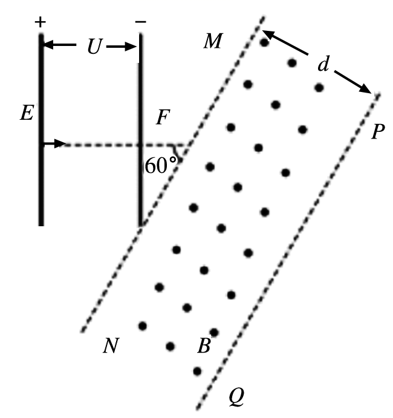

# Physics - 题目 2732

**ID**: 867345ba48654814a3b4588ad2360039
**年级**: Grade 12
**难度**: Medium-Hard
**题型**: Calculation

## 题目
如图所示，两平行金属板E、F之间电压为U，两足够长的平行边界MN、PQ区域内，有垂直纸面向外的匀强磁场，一质量为m、带电量为＋q的粒子(不计重力)，由E板中央处静止释放，经F板上的小孔射出后，垂直于磁场方向进入磁场，且与边界MN成60°角，磁场MN和PQ边界距离为d。​​​​​​​‌求：(1)若粒子垂直边界PQ离开磁场，求磁感应强度B；(2)若粒子最终从磁场边界MN离开磁场，求磁感应强度的范围。

## 解答

1. (1)粒子在电场中加速，由动能定理有
2. $qU=\frac {1}{2}mv{^{2}}$
3. 解得
4. $v=\sqrt {\frac {2qU}{m}}$
5. 粒子在磁场中做圆周运动，洛伦兹力提供向心力，粒子垂直边界PQ离开磁场时的运动轨迹如图所示
6. 
7. 由几何关系得
8. $r=2d$
9. 由牛顿第二定律得
10. $Bqv=m\frac {v{^{2}}}{r}$
11. 解得
12. $B=\frac {1}{2d}\sqrt {\frac {2mU}{q}}$
13. (2)粒子在磁场中的运动轨迹刚好与PQ相切时的轨道半径，是粒子从边界MN离开磁场最大轨道半径，
14. 
15. 由几何知识得
16. $d=r{{}_{1}}+r{{}_{1}}{\rm{s}}{\rm{i}}{\rm{n}}30{}^\circ $
17. 即有
18. $r{{}_{1}}=\frac {2}{3}d$
19. 粒子在磁场中做圆周运动，洛伦兹力提供向心力，由牛顿第二定律得
20. $Bqv=m\frac {v{^{2}}}{r{{}_{1}}}$
21. 解得
22. $B=\frac {3}{2d}\sqrt {\frac {2mU}{q}}$
23. 粒子最终从磁场边界MN离开磁场,磁感应强度
24. $B\geqslant \frac {3}{2d}\sqrt {\frac {2mU}{q}}$

## 知识点

**中文**:
  - 带电粒子在有界匀强磁场中的运动
  - 带电粒子在组合场中的运动

**English**:
  - Motion in Bounded Uniform Magnetic Field
  - Motion in Combined Fields

---
