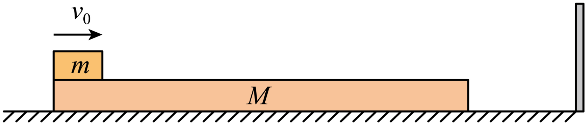

# Physics - 题目 1626

**ID**: 87c412f45eac4ee3a8e5968eaa878950
**年级**: Grade 12
**难度**: Medium-Hard
**题型**: Calculation

## 题目
如图所示，一长为 $L=3{\rm{m}}$ 、质量为 $M=2{\rm{k}}{\rm{g}}$ 的木板置于粗糙水平地面上，在木板右方有一墙壁，木板右端与墙壁的距离为 $s{{}_{0}}=0.33{\rm{m}}$ 。​​​​​​​‌某时刻一质量为 $m=1{\rm{k}}{\rm{g}}$ 小物块以 $v{{}_{0}}=4.5{\rm{m}}/{\rm{s}}$ 速度从板的左端滑上木板，木板与墙壁碰撞前后速度大小不变，方向相反。已知物块与木板、木板与地面间的动摩擦因数分别为 $μ{{}_{1}}=0.4$ 、 $μ{{}_{2}}=0.1$ ，最大静摩擦力等于滑动摩擦力，重力加速度g取 $10{\rm{m}}/{\rm{s}}{^{2}}$ 。求：（1）物块刚滑上木板时两者的加速度大小；（2）木板与墙壁碰前瞬间的速度大小；（3）物块与木板间因摩擦产生的总热量。

## 解答

1. （1）物块刚滑上木板时，以物块为对象，根据牛顿第二定律可得
2. $μ{{}_{1}}mg=ma{{}_{1}}$
3. 解得物块的加速度大小为
4. $a{{}_{1}}=4{\rm{m}}/{\rm{s}}{^{2}}$
5. 以木板为对象，根据牛顿第二定律可得
6. $μ{{}_{1}}mg-μ{{}_{2}}(M+m)g=Ma{{}_{2}}$
7. 解得木板的加速度大小为
8. $a{{}_{2}}=0.5{\rm{m}}/{\rm{s}}{^{2}}$
9. （2）设物块与木板共速时，木板与墙壁还未发生碰撞，则有
10. $v{{}_{共}}=v{{}_{0}}-a{{}_{1}}t{{}_{1}}=a{{}_{2}}t{{}_{1}}$
11. 解得
12. $t{{}_{1}}=1{\rm{s}}$ ， $v{{}_{共}}=0.5{\rm{m}}/{\rm{s}}$
13. 木板通过的位移为
14. $x{{}_{板}}=\frac {v{{}_{共}}}{2}t{{}_{1}}=0.25{\rm{m}}<s{{}_{0}}=0.33{\rm{m}}$
15. 物块与木板发生的相对位移为
16. $Δx{{}_{1}}=x{{}_{物}}-x{{}_{板}}=\frac {v{{}_{0}}+v{{}_{共}}}{2}t{{}_{1}}-\frac {v{{}_{共}}}{2}t{{}_{1}}=2.25{\rm{m}}<L={{3}}{\rm{m}}$
17. 假设成立；物块与木板共速后一起做匀减速运动的加速度大小
18. $a=\frac {μ{{}_{2}}(M+m)g}{M+m}=1{\rm{m}}/{\rm{s}}{^{2}}$
19. 根据运动学公式可得
20. $v{^{2}}-v{{}_{共}^{2}}=-2a(s{{}_{0}}-x{{}_{1}})$
21. 解得木板与墙壁碰前瞬间的速度大小为
22. $v=0.3{\rm{m}}/{\rm{s}}$
23. （3）木板与墙壁碰后向左做匀减速运动的加速度大小为
24. $a^{′}{{{}_{2}}}=\frac {μ{{}_{1}}mg+μ{{}_{2}}(M+m)g}{M}=3.5{\rm{m}}/{\rm{s}}{^{2}}$
25. 由于
26. $a^{′}{{{}_{2}}}=3.5{\rm{m}}/{\rm{s}}{^{2}}<a{{}_{1}}=4{\rm{m}}/{\rm{s}}{^{2}}$
27. 可知物块速度先减为0，之后物块反向加速到物块与木板再次共速，设此过程物块并不会从木板右端滑落，则有
28. $v^{′}{{{}_{共}}}=-v+a{{}_{1}}t{{}_{2}}=v-a^{′}{{{}_{2}}}t{{}_{2}}$
29. 解得
30. $t{{}_{2}}=\frac {2}{25}{\rm{s}}$ ， $v^{′}{{{}_{共}}}=\frac {1}{50}{\rm{m}}/{\rm{s}}$
31. 从碰撞后瞬间到第二次共速前，物块与木板发生的相对位移为
32. $Δx{{}_{2}}=x^{′}{{{}_{板}}}-x^{′}{{{}_{物}}}=\frac {v+v^{′}{{{}_{共}}}}{2}t{{}_{2}}-\frac {-v+v^{′}{{{}_{共}}}}{2}t{{}_{2}}=0.024{\rm{m}}$
33. 由于
34. $Δx{{}_{2}}=0.024{\rm{m}}<L-Δx{{}_{1}}$
35. 可知物块并不会从木板右端滑落，物块与木板再次共速后一起相对静止向左匀减速运动到停下来；则物块与木板间因摩擦产生的总热量为
36. $Q=μ{{}_{1}}mg(Δx{{}_{1}}+Δx{{}_{2}})=9.096{\rm{J}}$

## 知识点

**中文**:
  - 板块模型中的能量守恒问题

**English**:
  - Energy Conservation in Plate Models

---
