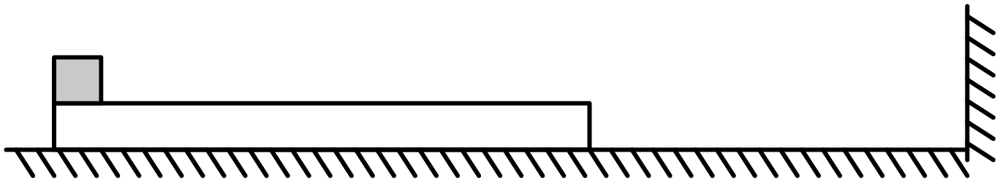

# Physics - 题目 1157

**ID**: 897567a3f05c4d0ebc31b44638e97b12
**年级**: Grade 12
**难度**: Medium-Hard
**题型**: Calculation

## 题目
如图所示，在光滑水平地面上有一长为L=2.5m的长木板，木板的质量为M=1kg，木板左端上放置一小滑块，小滑块的质量为m=2kg，在木板右方有一竖直墙壁。​​​​​​​‌某时刻木板和滑块一起以v_{0}=3m/s的初速度向右运动，木板与墙壁碰撞前后速度大小不变，方向相反。已知滑块与木板间的动摩擦因数为μ=0.3，重力加速度大小g取10m/s^{2}。求：（1）木板与墙壁第1次碰后木板向左运动的最远距离；（2）木板与墙壁第4次碰前瞬间木板的速度；（3）滑块最终停止运动时距离木板右端多远。

## 解答

1. (1)对木板根据动能定理
2. $-{\rm μm}gx=0-\frac {1}{2}Mv{{}_{0}^{2}}$
3. 代入数据可得
4. x=0.75m
5. (2)木板碰墙后，第一次与木块共速时的速度为v_{1}，根据动量守恒有
6. $mv{{}_{0}}-Mv{{}_{0}}=(m+M)v{{}_{1}}$
7. 第一次与木块共速时的速度为v_{2}，根据动量守恒有
8. $mv{{}_{1}}-Mv{{}_{1}}=(m+M)v{{}_{2}}$
9. 木板碰墙后，第一次与木块共速时的速度为v_{3}，根据动量守恒有
10. $mv{{}_{2}}-Mv{{}_{2}}=(m+M)v{{}_{3}}$
11. 联立可得
12. $v{{}_{3}}=v{{}_{0}}{\left({\frac {m-M}{m+M}}\right)^{3}}$
13. 代入数据可得
14. $v{{}_{3}}=\frac {1}{9}$ m/s
15. (3)根据动能定理
16. ${\rm μm}gx^{′}=\frac {1}{2}(m+M)v{{}_{0}^{2}}$
17. 代入数据可得
18. x′=2.25m
19. 滑块最终停止运动时距离木板右端的距离为
20. $Δx=L-x^{′}=0.25$ m

## 知识点

**中文**:
  - 动量守恒与板块模型相结合
  - 动量守恒中的多次碰撞问题
  - 板块模型中的能量守恒问题

**English**:
  - Momentum Conservation with Plate Models
  - Multiple Collisions in Momentum Conservation
  - Energy Conservation in Plate Models

---
