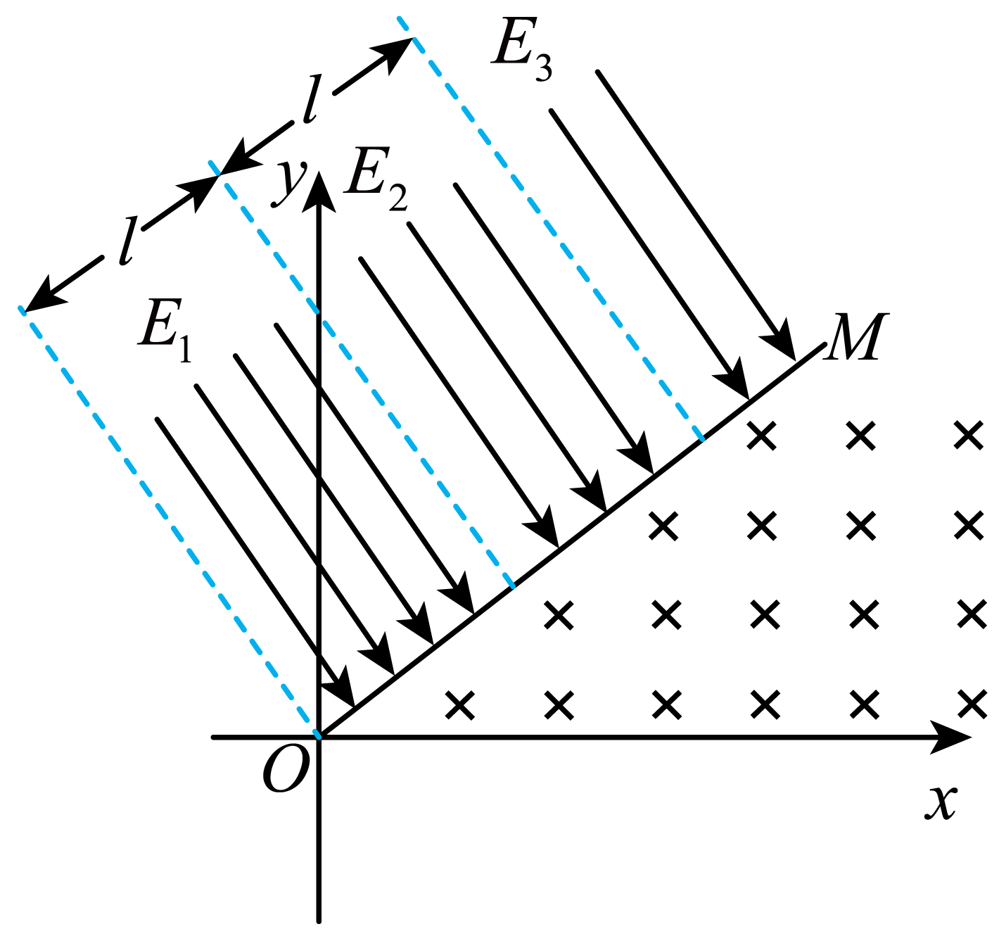

# Physics - 题目 464

**ID**: 89dc8df0e7844dfabbebbede385a1d91
**年级**: Grade 12
**难度**: Medium-Hard
**题型**: Calculation

## 题目
如图所示，平面直角坐标系 $xOy$ 内， $OM$ 为磁场、电场的分界线，与 $x$ 轴正方向的夹角为 $37{}\degree $ ，在 $xOM$ 区域内（含边界）存在垂直于 $xOy$ 平面向里的匀强磁场，在 $OM$ 线之上有范围足够大的电场，此电场由许多独立的匀强电场组成，电场强度方向均垂直于 $OM$ 向下，沿 $OM$ 的宽度均为 $l=\frac {3mv{{}_{0}^{2}}}{4qE{{}_{0}}}$ ，电场强度大小 $E{{}_{n}}=\frac {E{{}_{0}}}{n}\left ({n=1,2,3,\cdots }\right )$ ，每个电场区域包含右边界。​​​​​​​‌一质量为 ${\rm{m}}$ 、电荷量为 $+q(q>0)$ 的粒子以初速度 $v{{}_{0}}$ 从 $x$ 轴上的 $P$ 点（图中未画出）沿 $y$ 轴正方向射入匀强磁场，并恰好垂直 $OM$ 进入电场，粒子恰好到达 $y$ 轴，不计粒子的重力， ${\rm{s}}{\rm{i}}{\rm{n}}37{}\degree =0.6$ ， ${\rm{c}}{\rm{o}}{\rm{s}}37{}\degree =0.8$ 。求：（1）匀强磁场的磁感应强度大小；（2）粒子在第 $2n\left ({n=1,2,3,\cdots }\right )$ 次从 $OM$ 离开电场前瞬间的加速度大小；（3）粒子从第1次经过 $OM$ 到第50次到达 $OM$ 的过程运动的总路程。

## 解答

1. （1）带电粒子第一次经过 $OM$ 时恰好垂直于 $OM$ ，即 $OP$ 长即为粒子在磁场中的偏转半径，由洛伦兹力提供向心力有 $Bqv{{}_{0}}=\frac {mv{{}_{0}^{2}}}{r}$
2. 解得 $r=\frac {mv{{}_{0}}}{qB}$
3. 设粒子第一次进入的电场的电场强度大小 $E=\frac {E{{}_{0}}}{n}$
4. 粒子在电场中做匀减速直线运动，粒子恰好到达 $y$ 轴，则粒子沿电场线方向的位移大小 $d{{}_{1}}=\frac {4}{3}r$
5. 根据动能定理有 $Eqd{{}_{1}}=\frac {1}{2}mv{{}_{0}^{2}}$
6. 解得 $B=\frac {8E{{}_{0}}}{3nv{{}_{0}}}$
7. 则 $r=\frac {3nmv{{}_{0}^{2}}}{8qE{{}_{0}}}$
8. 若粒子第一次进入电场的电场强度大小为 $E{{}_{0}}$ ，则 $r<l$
9. 若粒子第一次进入电场的电场强度大小为 $\frac {E{{}_{0}}}{2}$ ，则 $l<r<2l$
10. 综上所述， $n=1$ ，则磁感应强度大小 $B=\frac {8E{{}_{0}}}{3v{{}_{0}}}$
11. （2）粒子在磁场中偏转的速率大小相同，半径相同，每次完成半个圆周，可知 $r=\frac {3mv{{}_{0}^{2}}}{8qE{{}_{0}}}$
12. 粒子再次垂直经过OM返回电场，沿OM运动的距离 $x=2r=\frac {3mv{{}_{0}^{2}}}{4qE{{}_{0}}}$
13. 根据题意可知，各电场的宽度 $l=\frac {3mv{{}_{0}^{2}}}{4qE{{}_{0}}}$
14. 所以粒子在OM上的途经点正好落在各个电场区域的中间位置。粒子第2n次经过OM的位置，即第n个途经点，电场强度大小 $E{{}_{n}}=\frac {E{{}_{0}}}{n}$
15. 根据牛顿第二定律有 $a{{}_{n}}=\frac {E{{}_{n}}q}{m}=\frac {E{{}_{0}}q}{nm}\left ({n=1,2,3,\cdots }\right )$
16. （3）粒子从第一次经过OM到第2n次到达OM的过程，粒子在电场中做匀变速运动，根据功能关系有 $E{{}_{1}}qd{{}_{1}}=\frac {1}{2}mv{{}_{0}^{2}},E{{}_{2}}qd{{}_{2}}=\frac {1}{2}mv{{}_{0}^{2}},E{{}_{n}}qd{{}_{n}}=\frac {1}{2}mv{{}_{0}^{2}}$
17. 则 $d{{}_{1}}=\frac {4}{3}r,d{{}_{2}}=2d{{}_{1}},d{{}_{n}}=nd{{}_{1}}$
18. 在电场中的运动路程 $s{{}_{1}}=\frac {8}{3}r\left ({1+2+\cdots +n}\right )=\frac {n\left ({n+1}\right )mv{{}_{0}^{2}}}{2qE{{}_{0}}}$
19. 在磁场中的运动路程 $s{{}_{2}}=\left ({n-1}\right )πr=\frac {3\left ({n-1}\right )πmv{{}_{0}^{2}}}{8qE{{}_{0}}}$
20. 所以总路程 $s=s{{}_{1}}+s{{}_{2}}=\frac {\left [4n\left ({n+1}\right )+3\left ({n-1}\right )π\right ]mv{{}_{0}^{2}}}{8qE{{}_{0}}}\left ({n=1,2,3,\cdots }\right )$
21. 当 $n=25$ 时， $s=\frac {\left ({325+9π}\right )mv{{}_{0}^{2}}}{qE{{}_{0}}}$

## 知识点

**中文**:
  - 带电粒子在磁场中做圆周运动的多解问题
  - 带电粒子在组合场中的运动

**English**:
  - Multi-solution Problems of Circular Motion in Magnetic Fields
  - Motion in Combined Fields

---
