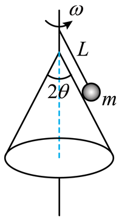

# Physics - 题目 74

**ID**: 8bf767ce6d7f4886953386f4830e4da9
**年级**: Grade 12
**难度**: Medium-Hard
**题型**: Calculation

## 题目
如图所示，竖直放置的圆锥顶角为2θ，侧壁光滑，可绕通过其中心的竖直轴匀速转动。​​​​​​​‌质量为m的小球通过长为L的轻绳拴在竖直轴线上，可随轴线和侧壁一起相对静止的转动。已知轻绳与圆锥侧壁平行，重力加速度大小为g，问：（1）当圆锥不转动，小球静止在侧壁时，小球对绳子的拉力T_{1}的大小；（2）试写出绳子的拉力T的大小和小球转动的角速度ω的函数关系（提示：需分类讨论）。

## 解答

1. （1）如图所示，小球静止在侧壁时，受到重力G、侧壁的支持力F_{N}和绳子的拉力T_{0}的作用处于平衡状态
2. 
3. 将力沿侧壁和垂直侧壁进行正交分解 $T{{}_{0}}=mg{\cos}θ$
4. 根据牛顿第三定律可得 $T{{}_{1}}=T{{}_{0}}=mg{\cos}θ$
5. （2）如图所示，
6. 
7. 当小球转动的角速度ω较小时，小球贴着侧壁在水平面内做匀速圆周运动，转动半径 $r=L{\rm{s}}{\rm{i}}{\rm{n}}θ$
8. 小球受重力G、侧壁的支持力F_{N}和绳子的拉力T的作用，将力沿水平和竖直方向进行正交分解 $T{\cos}θ+F{{}_{{\rm{N}}}}\sin θ=mg$ ， $T\sin θ-F{{}_{{\rm{N}}}}{\cos}θ=mω{^{2}}r$
9. 解得 $T=mg{\cos}θ+mω{^{2}}L\sin {^{2}}θ$
10. 小球刚要脱离侧壁时 $F{{}_{{\rm{N}}}}=0$
11. 代入上式，解得此时的角速度 $ω{{}_{0}}=\sqrt {\frac {g}{L{\cos}θ}}$
12. 如图所示
13. 
14. 当小球转动的角速度 $ω>ω{{}_{0}}=\sqrt {\frac {g}{1{\cos}θ}}$ 时，小球将脱离侧壁在水平面内做匀速圆周运动，设绳与竖直方向的夹角为α，转动半径r=Lsinα
15. 小球受重力G和绳子的拉力T的作用，将力沿水平和竖直方向进行正交分解 $F{{}_{{\rm{n}}}}=mg{\tan}α=mω{^{2}}r$ ， $T=\frac {mg}{{\cos}α}$
16. 解得 $T=mω{^{2}}L$
17. 拉力T和角速度ω的函数关系为 $T=mg{\cos}θ+mω{^{2}}L\sin {^{2}}θ$ ， $0⩽ω⩽\sqrt {\frac {g}{L{\cos}θ}}$ ； $T=mω{^{2}}L，ω>\sqrt {\frac {g}{L{\cos}θ}}$

## 知识点

**中文**:
  - 圆锥摆问题

**English**:
  - Conical Pendulum Problems

---
