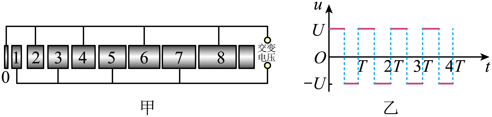

# Physics - 题目 2801

**ID**: 8c907df6da0d494fa177ae430411eb85
**年级**: Grade 12
**难度**: Medium-Hard
**题型**: Calculation

## 题目
如图装置为直线加速器原理，多个横截面积相同的金属圆筒依次排列，其中心轴线在同一直线上，序号为奇数的圆筒和交变电源的一个极相连，序号为偶数的圆筒和该电源的另一个极相连。​​​​​​​‌交变电源两极间电势差的变化规律如图乙所示。在 $t=0$ 时，奇数圆筒相对偶数圆筒的电势差为正值。此时位于和偶数圆筒相连的金属圆板（序号为0）中央有一个电子由静止开始加速，沿中心轴线进入圆筒1。为使电子运动到圆筒之间各个间隙中都能恰好使静电力的方向跟运动方向相同而不断加速，圆筒长度的设计必须遵照一定的规律。已知电子质量为 $m$ 、电荷量为e、电压绝对值为 $U$ 、周期为 $T$ ，电子通过圆筒间隙的时间可以忽略不计，求：（1）电子刚出第8个圆筒瞬间速度大小；（2）第8个圆筒长度；（3）若电子通过圆筒间隙的时间不可忽略，两圆筒间隙的电场为匀强电场，且圆筒间距为d，不考虑相对论效应，则在保持圆筒长度、交变电压的变化规律保持和（1）（2）完全相同的情况下，经过多少个圆筒可以让电子达到最大速度。

## 解答

1. （1）根据题意，由动能定理得 $8eU=\frac {1}{2}mv{^{2}}$ ，电子出第8个圆筒瞬间速度为 $v=4\sqrt {\frac {eU}{m}}$ 。
2. （2）电子在圆筒中做匀速直线运动，第8个圆筒长度为 $L{{}_{8}}=v\cdot \frac {T}{2}=\frac {2T}{m}\sqrt {eUm}$ 。
3. （3）由于保持圆筒长度、交变电压的变化规律和（2）中相同，若考虑电子在间隙中的加速时间，则粒子进入每级圆筒的时间都要比（2）中对应的时间延后一些，如果延后累计时间等于 $\frac {T}{2}$ ，则电子再次进入电场时将开始减速，此时的速度就是装置能够加速的最大速度。由于两圆筒间隙的电场为匀强电场，间距均为d，粒子在电场中后一个加速过程可以看为前一加速过程的延续部分，令经过N次加速，即经过N个圆筒达到最大速度，则有 $Nd=\frac {1}{2}v{{}_{{\rm{m}}}}(\frac {T}{2})$ ，根据动能定理有 $NeU=\frac {1}{2}mv{{}_{{\rm{m}}}^{2}}-0$ ，解得 $N=\frac {eUT{^{2}}}{8md{^{2}}}$ 。

## 知识点

**中文**:
  - 带电粒子在交变电场中的运动

**English**:
  - Motion in Alternating Electric Field

---
