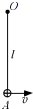

# Physics - 题目 483

**ID**: 8fe27710aba44013ac94d6b0019e059b
**年级**: Grade 12
**难度**: Medium-Hard
**题型**: Calculation

## 题目
如图所示，长度为l的绝缘细线将质量为m、电量为q的带正电小球悬挂于O点，整个空间中充满了匀强电场．（取sin37°＝0.​​​​​​​‌6，cos37°＝0.8）（1）当电场方向竖直向上时，若使小球在A点获得水平速度 $v{{}_{1}}=\sqrt {2gl}$ ，小球刚好能在竖直平面内做完整的圆周运动，求电场强度E_{1}；（2）当电场方向水平，且电场强度 $E{{}_{2}}=\frac {4mg}{3q}$ 时，要不能让细线松弛，求小球在A点获得的水平速度v_{2}应该满足的条件．

## 解答

1. （1）当电场力qE_{1}＜mg时，小球在最高点的速度v最小，若小球刚好能通过最高点，
2. 则在最高点有：mg﹣qE_{1}＝m$\frac {v{^{2}}}{l}$
3. 从最低点到最高点，由动能定理得：﹣（mg﹣qEl）•2l＝ $\frac {1}{2}mv{^{2}}-\frac {1}{2}mv{{}_{1}^{2}}$
4. 解得 $E{{}_{1}}=\frac {3mg}{5q}$
5. 当电场力qE_{1}＞mg时，小球在最低点的速度v最小，若小球刚好能通过最低点，则在最低点有：qE_{1}﹣mg＝m$\frac {v{^{2}}}{l}$
6. 解得 $E{{}_{1}}=\frac {3mg}{q}$
7. 联立可得要使小球做完整的圆周运动，电场强度应满足： $\frac {3mg}{5q}\leqslant E{{}_{1}}\leqslant \frac {3mg}{q}$ ．
8. （2）当电场方向水平，且 $E{{}_{2}}=\frac {4mg}{3q}$ 时，小球所受重力为mg、电场力qE_{2}的合力大小为
9. 
10. $F=\sqrt {(mg){^{2}}+(qE{{}_{2}}){^{2}}}=\frac {5}{3}mg$ ，与水平方向的夹角θ满足tanθ＝ $\frac {mg}{qE{{}_{2}}}=\frac {3}{4}$
11. 如果小球获得水平速度v_{2}后刚好能做完整的圆周运动，在速度最小的位置B（如图）满足
12. F＝m$\frac {v{{}_{B}^{2}}}{l}$
13. 
14. 小球从A点运动到B点，由动能定理得：
15. ﹣mgl（1+sinθ）﹣qE_{2}lcosθ＝ $\frac {1}{2}mv{{}_{B}^{2}}-\frac {1}{2}mv{{}_{2}^{2}}$
16. 联立解得v_{2}＝ $\sqrt {7gl}$
17. 如果小球获得水平速度v_{2}后来回摆动，则小球刚好能到达C点或D点（如上图），则小球从A点运动到C点，由动能定理得：
18. ﹣mgl（1+cosθ）+qE_{2}lsinθ＝0﹣ $\frac {1}{2}mv{{}_{2}^{2}}$
19. 或小球从A点运动到D点，由动能定理得：
20. ﹣mgl（1﹣cosθ）﹣qE_{2}lsinθ＝0﹣ $\frac {1}{2}mv{{}_{2}^{2}}$
21. 解得v_{2}＝ $\sqrt {2gl}$
22. 综合可得，v_{2}≥ $\sqrt {7gl}$ 或v_{2}≤ $\sqrt {2gl}$ 细线均不会松弛

## 知识点

**中文**:
  - 带电粒子（物体）在重力场和电场组成的复合场中的运动

**English**:
  - Motion in Gravity and Electric Composite Fields

---
