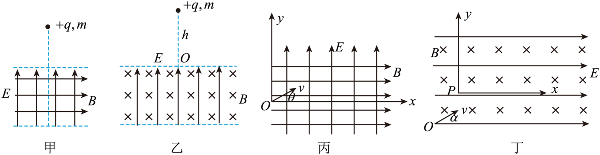

# Physics - 题目 2672

**ID**: 90c5b385faa24e0d88c42afff220564c
**年级**: Grade 12
**难度**: Medium-Hard
**题型**: Calculation

## 题目
如图所示，两水平虚线之间的空间内存在着相互垂直的匀强电场E和匀强磁场B（如图甲示），有一个带正电的油滴（电荷量为+q，质量为m）从该电磁复合场上方某一高度自由下落恰好做匀速圆周运动；现保持电场大小方向和磁场大小不变，磁场方向变为垂直于纸面向里（如图乙示），油滴从复合场上方高度为h位置静止释放，空间中电磁场横向范围足够大。​​​​​​​‌（1）求带电油滴第n次穿出磁场的位置与O点的距离和带电油滴在电磁场中运动的时间 $t{{}_{n}}$ 。（2）若带电油滴以初速度v与x轴线成θ角从O点进入电磁场（如图丙示），电磁场强度仍然保持不变，问油滴将做什么运动并求进入电磁场后油滴第一次回到x轴的时间 $t{{}_{1}}$ 。（3）若带电油滴以初速度v与水平方向成α角从 $O^{′}$ 点进入电磁场（如图丁示），当油滴沿着直线运动到P点时撤掉磁场（不考虑磁场消失引起的电磁感应现象），求撤掉磁场后油滴第一次穿过x轴的时间 $t{{}_{2}}$ 。

## 解答

1. （1）图甲中，油滴在电磁复合场中做匀速圆周运动，则有 $qE=mg$ ，现保持电场大小方向和磁场大小不变，磁场方向变为垂直于纸面向里，由于电场力与重力平衡，油滴仍然做匀速圆周运动，则有 $qv{{}_{0}}B=m\frac {v{{}_{0}^{2}}}{R{{}_{1}}}$ ， $T{{}_{1}}=\frac {2{\rm{π}}R{{}_{1}}}{v{{}_{0}}}$ ，解得 $T{{}_{1}}=\frac {2{\rm{π}}m}{qB}$ ，油滴从高度为h位置静止释放，根据动能定理有 $mgh=\frac {1}{2}mv{{}_{0}^{2}}$ ，带电油滴第n次穿出磁场的位置与O点的距离和带电油滴在电磁场中运动的时间分别为 $x{{}_{n}}=2nR{{}_{1}}$ ， $t{{}_{n}}=n\cdot \frac {T}{2}$ （n=1，2，3…），解得 $x{{}_{n}}=\frac {2n}{B}\sqrt {\frac {2hmE}{q}}$ ， $t{{}_{n}}=\frac {n{\rm{π}}m}{qB}$ （n=1，2，3…）。
2. （2）结合上述可知，电场力与重力平衡，将速度沿x轴与y轴分解为 $v{{}_{x}}=v{\cos}θ$ ， $v{{}_{y}}=v\sin θ$ ，油滴在沿x轴方向做匀速直线运动，垂直于纸面方向做匀速圆周运动，即油滴向右做螺旋运动，则有 $qv{{}_{y}}B=m\frac {v{{}_{y}^{2}}}{R{{}_{2}}}$ ， $T{{}_{2}}=\frac {2{\rm{π}}R{{}_{2}}}{v{{}_{y}}}$ ，解得 $T{{}_{2}}=\frac {2{\rm{π}}m}{qB}$ ，结合螺旋运动的周期性，进入电磁场后油滴第一次回到x轴的时间 $t{{}_{1}}=T{{}_{2}}=\frac {2{\rm{π}}m}{qB}$ 。
3. （3）油滴沿着直线运动到P点，油滴受到重力、电场力与洛伦兹力，可知，油滴做匀速直线运动，到达P点后，撤去磁场，粒子做类抛体运动，水平方向做匀加速直线运动，竖直方向做竖直上抛运动，则有 $-v\sin α=v\sin α-gt{{}_{2}}$ ，解得 $t{{}_{2}}=\frac {2v\sin α}{g}$ 。

## 知识点

**中文**:
  - 带电粒子在叠加场中的运动

**English**:
  - Motion in Superimposed Fields

---
