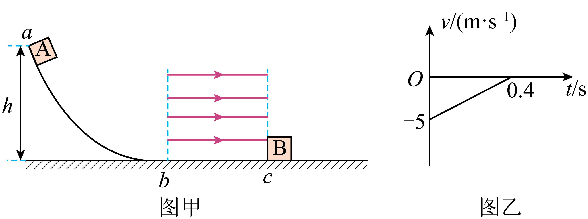

# Physics - 题目 2704

**ID**: 92c522f680164adca78d0059c7d69acc
**年级**: Grade 12
**难度**: Medium-Hard
**题型**: Calculation

## 题目
如图所示，曲面轨道与水平轨道平滑连接，轨道足够长且光滑，水平轨道bc间存在水平向右的匀强电场， $L{{}_{{\rm{b}}{\rm{c}}}}=1.2{\rm{m}}$ ，c点处静置一质量 $M=11.0{\rm{k}}{\rm{g}}$ 的绝缘物块B。​​​​​​​‌将质量 $m=1.0{\rm{k}}{\rm{g}}$ 、电荷量 $q=5.0\times 10{^{-6}}{\rm{C}}$ 的带正电的物块A从曲面轨道上的a点由静止释放，A到达c点时与B发生弹性碰撞，碰后0.4s内A运动的v-t图像如图乙所示（向右为正）。A、B均可视为质点，不考虑A、B的碰撞时间且A的电荷量始终保持不变，重力加速度g取 $10{\rm{m}}/{\rm{s}}{^{{\rm{2}}}}$ 求：（1）a点与水平轨道的高度差；（2）A与B每次碰撞时的位置距c点的距离。

## 解答

1. （1）由图乙可知物块A由c向左运动过程 $a{{}_{1}}=12.5{\rm{m}}/{\rm{s}}{^{2}},v{{}_{a1}}=-5{\rm{m}}/{\rm{s}}$ ，根据 $qE=ma{{}_{1}}$ ，得 $E=2.5\times 10{^{6}}{\rm{N}}/{\rm{C}}$ ，物块A与物块B发生弹性碰撞 $mv{{}_{0}}=mv{{}_{a1}}+Mv{{}_{b1}}$ ， $\frac {1}{2}mv{{}_{0}^{2}}=\frac {1}{2}mv{{}_{a1}^{2}}+\frac {1}{2}Mv{{}_{b1}^{2}}$ ，解得 $v{{}_{0}}=6{\rm{m}}/{\rm{s}},v{{}_{b1}}=1{\rm{m}}/{\rm{s}}$ ，物块A从静止释放到与物块B碰撞前瞬间 $mgh+qEL{{}_{bc}}=\frac {1}{2}mv{{}_{0}^{2}}$ ，解得 $h=0.3{\rm{m}}$
2. （2）物块A与物块B第一次碰撞发生在c点，A、B碰撞后，A由c点运动到最左端 $t{{}_{1}}=0.4{\rm{s}}$ ，自A、B碰撞后A第二次经过c点的速度 $v{{}_{a2}}=5{\rm{m}}/{\rm{s}}$ ，A与B由第一次碰撞到第二次碰撞的过程中发生的位移 $L{{}_{1}}=v{{}_{a2}}t{{}_{2}}$ ， $L{{}_{1}}=v{{}_{b1}}\left ({2t{{}_{1}}+t{{}_{2}}}\right )$ ，解得 $t{{}_{2}}=0.2{\rm{s}},L{{}_{1}}=1{\rm{m}}$A与B第二次碰撞发生在c点右侧1m处，A与B第二次碰撞 $mv{{}_{a2}}+Mv{{}_{b1}}=mv{{}_{a3}}+Mv{{}_{b2}}$ ， $\frac {1}{2}mv{{}_{a2}^{2}}+\frac {1}{2}Mv{{}_{b1}^{2}}=\frac {1}{2}mv{{}_{a3}^{2}}+\frac {1}{2}Mv{{}_{b2}^{2}}$ ，可得 $v{{}_{a3}}=-\frac {7}{3}{\rm{m}}/{\rm{s}},v{{}_{b2}}=\frac {5}{3}{\rm{m}}/{\rm{s}}$ ，同理，物块A从最左端运动到第4次经过c点时 $v{{}_{a4}}=\frac {7}{3}{\rm{m}}/{\rm{s}},v{{}_{a4}}>v{{}_{b2}}$A与B发生第三次碰撞，A与B自第二次碰撞到第三次碰撞过程 $L{{}_{1}}=v{{}_{a4}}t{{}_{3}}$ ， $qEt{{}_{4}}=mv{{}_{a4}}-mv{{}_{a3}}$ ， $L{{}_{2}}=v{{}_{a4}}t{{}_{5}}$ ， $L{{}_{2}}=L{{}_{1}}+v{{}_{b2}}\left ({t{{}_{3}}+t{{}_{4}}+t{{}_{5}}}\right )$ ，解得 $t{{}_{5}}=\frac {368}{105}{\rm{s}},L{{}_{2}}=\frac {368}{45}{\rm{m}}$A与B第三次碰撞位置距离c点右侧 $\frac {368}{45}{\rm{m}}$ ，同理，A与B第三次碰撞后，A的速度 $v{{}_{a5}}=\frac {10}{9}{\rm{m}}/{\rm{s}},v{{}_{b3}}=\frac {176}{99}{\rm{m}}/{\rm{s}}>v{{}_{a5}}$ ，不会发生第四次碰撞。

## 知识点

**中文**:
  - 动量守恒中的多次碰撞问题

**English**:
  - Multiple Collisions in Momentum Conservation

---
