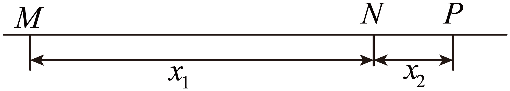

# Physics - 题目 1029

**ID**: 940eae3b8be64cccad2eea27339118d1
**年级**: Grade 12
**难度**: Medium-Hard
**题型**: 计算题（本大题共3小题，共48分）

## 题目
如图所示，运动员在水平冰面上将冰壶A推到M点放手，此时A的速度 $v{{}_{0}}=2{\rm{m}}/{\rm{s}}$ ，匀减速滑行 $x{{}_{1}}=$  $16.8{\rm{m}}$ 到达 $N$ 点时，队友用毛刷开始擦A运动前方的冰面，使A与 $NP$ 间冰面的动摩擦因数减小，A继续匀减速滑行 $x{{}_{2}}=3.5{\rm{m}}$ ，与静止在 $P$ 点的冰壶 $B$ 发生正碰，碰后瞬间 $A、B$ 的速度分别为 $v{{}_{A}}=0.05{\rm{m}}/{\rm{s}}$ 和 $v{{}_{B}}=0.55{\rm{m}}/{\rm{s}}$ ，已知 $A、B$ 质量相同，A与 $MN$ 间冰面的动摩擦因数 $μ{{}_{1}}=0.01$ ，重力加速度 $g$ 取 $10{\rm{m}}/{\rm{s}}{^{2}}$ ，运动过程中两冰壶均视为质点， $A、B$ 碰撞时间极短。​​​​​​​‌（1）求冰壶A在 $N$ 点的速度 $v{{}_{1}}$ 的大小：（2）求冰壶A与 $NP$ 间冰面的动摩擦因数 $μ{{}_{2}}$ 。

## 解答

1. （1）设冰壶 $A、B$ 质量均为 $m$ ，冰壶 $A$ 受到的冰面支持力为 $F{{}_{{\rm{N}}}}$ ，
2. 竖直方向上满足 $F{{}_{{\rm{N}}}}=mg$ ,
3. 设冰壶 $A$ 在 $MN$ 间受到的滑动摩擦力为 $F{{}_{{\rm{f}}}}$ ,
4. 满足 $F{{}_{{\rm{f}}}}=μ{{}_{1}}F{{}_{{\rm{N}}}}$ ,
5. 设冰壶 $A$ 在 $MN$ 间的加速度为 $a$ ,
6. 由牛顿第二定律有 $F{{}_{{\rm{f}}}}=ma$ ,
7. 由速度与位移的关系式，有 $v{{}_{1}^{2}}-v{{}_{0}^{2}}=-2ax{{}_{1}}$ ,
8. 联立解得 $v{{}_{1}}=0.8{\rm{m}}/{\rm{s}}$ 。
9. （2）设碰撞前瞬间冰壶 $A$ 的速度为 $v{{}_{2}}$ ，
10. 由动量守恒定律，有 $mv{{}_{2}}=mv{{}_{{\rm{A}}}}+mv{{}_{{\rm{B}}}}$ ，
11. 设冰壶 $A$ 在 $NP$ 间受到的滑动摩擦力为 $F{{}_{{\rm{f}}}}{^{\prime }}$ ，
12. 满足 $F{{}_{{\rm{f}}}}{^{\prime }}$  $=μ{{}_{2}}F{{}_{{\rm{N}}}}$ ，
13. 由动能定理，有 $-F{{}_{{\rm{f}}}}{^{\prime }}$  $x{{}_{2}}=\frac {1}{2}mv{{}_{2}^{2}}-\frac {1}{2}mv{{}_{1}^{2}}$ ，
14. 联立解得 $μ{{}_{2}}=0.004$ 。

## 知识点

**中文**:
  - 动量与牛顿定律的综合考查
  - 动量和能量的综合应用

**English**:
  - Integration of Momentum and Newton's Laws
  - Integration of Momentum and Energy

---
