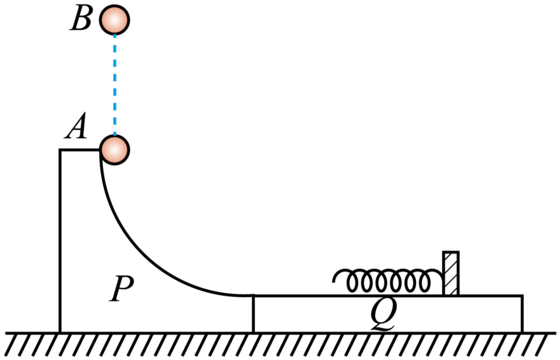

# Physics - 题目 1853

**ID**: 948ee0235746481a8025505e1eb9f007
**年级**: Grade 12
**难度**: Medium-Hard
**题型**: Calculation

## 题目
如图，物块P固定在水平面上，其上表面有半径为R的 $\frac {1}{4}$ 圆弧轨道。​​​​​​​‌P右端与薄板Q连在一起，圆弧轨道与Q上表面平滑连接。一轻弹簧的右端固定在Q上，另一端自由。质量为m的小球自圆弧顶端A点上方的B点自由下落，落到A点后沿圆弧轨道下滑，小球与弹簧接触后，当速度减小至刚接触时的 $\frac {1}{3}$ 时弹簧的弹性势能为2mgR，此时断开P和Q的连接，从静止开始向右滑动。g为重力加速度大小，忽略空气阻力，圆弧轨道及Q的上、下表面均光滑，弹簧长度的变化始终在弹性限度内。（1）求小球从落入圆弧轨道至离开圆弧轨道，重力对其做的功；（2）求小球与弹簧刚接触时速度的大小及B、A两点间的距离；（3）欲使P和Q断开后，弹簧的最大弹性势能等于2.2mgR，Q的质量应为多大？（4）欲使P和Q断开后，Q的最终动能最大，Q的质量应为多大？

## 解答

1. （1）小球从落入圆弧轨道至离开圆弧轨道，重力对其做的功为 $W{{}_{{\rm{G}}}}=mgR$ 。
2. （2）设小球与弹簧刚接触时速度的大小为v_{0}，由机械能守恒定律可知 $\frac {1}{2}mv{{}_{0}^{2}}=E{{}_{{\rm{p}}}}+\frac {1}{2}m{\left({\frac {v{{}_{0}}}{3}}\right)^{2}}$ ，其中 $E{{}_{{\rm{p}}}}=2mgR$ ，
3. 同时有 $mg\left ({h+R}\right )=\frac {1}{2}mv{{}_{0}^{2}}$ ，
4. 联立解得 $v{{}_{0}}=\frac {3\sqrt {2gR}}{2}$ ， $h=\frac {5}{4}R$ 。
5. （3）弹簧达到最大弹性势能时，小球与Q共速，设Q的质量为M，根据动量守恒定律和机械能守恒定律有 $m\cdot \frac {1}{3}v{{}_{0}}=\left ({m+M}\right )v{{}_{共}}$ ， $\frac {1}{2}mv{{}_{0}^{2}}=E{{}_{{\rm{p}}2}}+\frac {1}{2}\left ({m+M}\right )v{{}_{共}^{2}}$ ，其中 $E{{}_{{\rm{p}}2}}=2.2mgR$ ，
6. 联立解得 $M=4m$ 。
7. （4）对Q和小球整体根据机械能守恒可知要使Q的最终动能最大，需满足小球的速度刚好为零时，此时弹簧刚好恢复原长；设此时Q的质量为M′，Q的最大速度为v_{m}，根据动量守恒和机械能守恒有 $m\cdot \frac {1}{3}v{{}_{0}}=M^{′}v{{}_{{\rm{m}}}}$ ， $\frac {1}{2}mv{{}_{0}^{2}}=\frac {1}{2}M^{′}v{{}_{{\rm{m}}}^{2}}$ ，
8. 解得 $M^{′}=\frac {1}{9}m$ 。

## 知识点

**中文**:
  - 动量守恒与弹簧相结合
  - 机械能守恒及其判断
  - 动量守恒与板块模型相结合

**English**:
  - Momentum Conservation with Springs
  - Judgment of Mechanical Energy Conservation
  - Momentum Conservation with Plate Models

---
