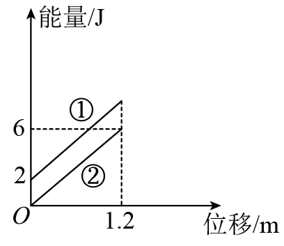

# Physics - 题目 498

**ID**: 96cff90775e24d09b316ad685b5ec3a9
**年级**: Grade 12
**难度**: Medium-Hard
**题型**: Calculation

## 题目
质量m=1kg的小物块在沿光滑斜面向上的力F作用下，从长斜面底端以一定初速度沿斜面向上运动。​​​​​​​‌经过0.4s沿斜面上滑了1.2m，以斜面底端为零势能面，其动能E_{k}和重力势能E_{p}随位移的变化关系如图线①和②所示。g取10m/s^{2}。求：(1)物块的初速度和斜面的倾角；(2)力F的大小；(3)试通过计算证明：机械能改变量等于除重力以外其他力做的功；(4)若经过0.4s后撤去拉力F，在图中画出小物块沿斜面上滑过程中动能和重力势能随位移的变化图线。（标出关键点的坐标）

## 解答

1. (1)根据
2. E_{k0}= $\frac {1}{2}$mv_{0}^{2}
3. 得初速度
4. v_{0}=2m/s
5. 根据
6. E_{p}=mgh=mgssinθ
7. 得斜面倾角
8. θ=30°
9. (2)由匀变速运动规律
10. s=v_{0}t+ $\frac {1}{2}$at^{2}
11. 代入数据，得
12. a=5m/s^{2}
13. 物块受力如图所示
14. 
15. 根据牛顿第二定律，得
16. F-mgsinθ=ma
17. 解得
18. F=10N
19. (3)除了重力仅F对物体做功
20. W_{F}=Fs=10×1.2J=12J
21. 初始位置机械能
22. E_{0}=E_{k0}+E_{p0}=(2+0)J=2J
23. 0.4s末时
24. v_{1}=v_{0}+at=4m/s
25. 即动能
26. E_{k1}= $\frac {1}{2}$mv_{1}^{2}=8J
27. 0.4s末位置机械能
28. E_{1}=E_{k1}+E_{p1}=(8+6)J=14J
29. 机械能改变量
30. ΔE=E_{1}-E_{0}=12J
31. 即得
32. ΔE=W_{F}
33. (4)0.4s后，受力分析，根据牛顿第二定律得
34. $mg{\sin}θ=ma^{′}$
35. 由位移速度公式得
36. $0-v{{}_{1}^{2}}=-2a^{′}x$
37. 解得
38. $x=1.6{\rm{m}}$
39. 则位移为
40. $s+x=2.8{\rm{m}}$
41. 由机械能守恒得
42. $E{{}_{{\rm{p}}{\rm{2}}}}=E{{}_{2}}=E{{}_{1}}=14{\rm{J}}$
43. 根据以上数据作图如下
44. 

## 知识点

**中文**:
  - 应用动能定理求解与图像相关的动能问题

**English**:
  - Graph-related Kinetic Energy Problems

---
