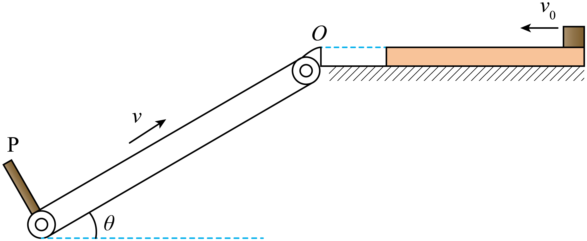

# Physics - 题目 2937

**ID**: 977da2608c464b3684e186f3ee153456
**年级**: Grade 12
**难度**: Medium-Hard
**题型**: Calculation

## 题目
如图所示，一长 $l=4{\rm{m}}$ 的倾斜传送带，传送带与水平面的夹角 $θ=30{}\degree $ ，传送带以的速率 $v=1{\rm{m}}{\rm{/}}{\rm{s}}$ 沿顺时针匀速运行。​​​​​​​‌在一光滑水平面上有质量为 $M=2{\rm{k}}{\rm{g}}$ ，长 $L=10.3{\rm{m}}$ 的木板，在其右端放一质量为 $m=1{\rm{k}}{\rm{g}}$ 的滑块。木板左端离传送带足够远，地面上有一与木板等高的小挡片O可以粘住木板使其停止运动，小挡片O与传送带轮子边缘有一小断光滑小圆弧（尺寸忽略不计），从而使滑块离开木板后可以无能量损失地滑上传送带。现滑块以初速度 $v{{}_{0}}=1{{2}}{\rm{m}}{\rm{/}}{\rm{s}}$ 开始向左运动，滑块与木板之间的动摩擦因数 $μ{{}_{1}}=0.5$ ，滑块与传送带间的动摩擦因数 $μ{{}_{2}}=\frac {\sqrt {3}}{5}$ ，传送带的底端垂直传送带放一挡板P，滑块到达传送带底端时与挡板P发生碰撞，滑块与挡板P碰撞前、后的速率不变，滑块可视为质点，取重力加速度 $g=10{\rm{m}}{\rm{/}}{\rm{s}}{^{2}}$ 。求：(1)滑块与木板相对静止时的速度 $v{{}_{1}}$ ；(2)滑块第一次与挡板P碰后沿传送带向上运动的最大位移；(3)滑块沿传送带向上减速过程中速度大于v阶段的总路程。

## 解答

1. （1）木板左端离传送带足够远，设在长木板与小挡片O碰前，滑块与长木板已经相对静止，根据动量守恒和能量守恒
2. $mv{{}_{0}}=\left ({M+m}\right )v{{}_{1}}$
3. $μ{{}_{1}}mgL{{}_{相}}=\frac {1}{2}mv{{}_{0}^{2}}-\frac {1}{2}\left ({M+m}\right )v{{}_{1}^{2}}$
4. 解得
5. $v{{}_{1}}=4{\rm{m}}/{\rm{s}}$ ， $L{{}_{相}}=9.6{\rm{m}}$
6. 根据 $L{{}_{相}}<L$ 可知，在长木板与小挡片O碰前，滑块没有滑出长木板，碰前滑块与长木板已经相对静止，所以滑块与木板相对静止时的速度
7. $v{{}_{1}}=4{\rm{m}}/{\rm{s}}$
8. （2）滑块滑上传送带时速度为 $v{{}_{2}}$ ，根据动能定理
9. $-μ{{}_{1}}mg\left ({L-L相}\right )=\frac {1}{2}mv{{}_{2}^{2}}-\frac {1}{2}mv{{}_{1}^{2}}$
10. 解得
11. $v{{}_{2}}=3{\rm{m}}{\rm{/}}{\rm{s}}$
12. 滑块沿传送带向下匀加速运动至传送带的底端，该过程中滑块的加速度大小为
13. $a{{}_{1}}=\frac {mg\sin θ-μ{{}_{2}}mg{\cos}θ}{m}=2{\rm{m}}{\rm{/}}{\rm{s}}{^{{{2}}}}$
14. 设滑块到达传送带底端时的速率为 $v{{}_{3}}$
15. $v{{}_{3}^{2}}-v{{}_{2}^{2}}=2al$
16. 解得
17. $v{{}_{3}}=5{\rm{m}}{\rm{/}}{\rm{s}}$
18. 滑块第一次与挡板P碰后先沿传送带向上运动直到减速为1m/s，加速度大小
19. $a{{}_{2}}=\frac {mg\sin θ+μ{{}_{2}}mg{\cos}θ}{m}=8{\rm{m}}{\rm{/}}{\rm{s}}{^{{{2}}}}$
20. 位移
21. $x{{}_{1}}=\frac {v{^{2}}-v{{}_{3}^{2}}}{2\left ({-a{{}_{2}}}\right )}=1.5{\rm{m}}$
22. 然后继续减速至零，加速度大小为 $a{{}_{1}}$ ，位移
23. $x{{}_{2}}=\frac {v{^{2}}}{2a{{}_{1}}}=0.25{\rm{m}}$
24. 故滑块第一次与挡板P碰后沿传送带向上运动的最大位移
25. $x=x{{}_{1}}+x{{}_{2}}=1.75{\rm{m}}$
26. （3）经分析可知，因
27. $mg\sin θ>μ{{}_{2}}mg{\cos}θ$
28. 经足够长时间，滑块与挡板P多次碰撞后，最终将以速率v反弹，此后滑块在距传送带底端某恒定范围内往复运动，由动能定理可知，在滑块从第一次反弹后瞬间至到达传送带底端最终的速率第一次为v的过程中，摩擦力做的总功为
29. $W=\frac {1}{2}mv{^{2}}-\frac {1}{2}mv{{}_{3}^{2}}=-12{\rm{J}}$
30. 在滑块从第一次反弹后瞬间至到达传送带底端的速率第一次为v的过程中，滑块每次反弹后均先沿传送带向上以加速度 $a{{}_{2}}$ 做匀减速运动至速率为v（过程1）；再以加速度 $a{{}_{1}}$ 沿传送带向上做匀减速运动至速度为零，然后沿传送带向下以加速度 $a{{}_{1}}$ 做匀加速运动至速率为v（过程2）；最后沿传送带向下以加速度 $a{{}_{1}}$ 做匀加速运动至传送带的底端（过程3），根据对称性，在过程1与过程3中滑块运动的距离相等，因在过程2中摩擦力对滑块做的功为零，故整个过程中，摩擦力做的总功为
31. $W=-μ{{}_{2}}mg{\cos}θ\times 2s$
32. 解得
33. $s=2{\rm{m}}$

## 知识点

**中文**:
  - 传送带模型中的能量守恒问题

**English**:
  - Energy Conservation in Conveyor Belt Models

---
