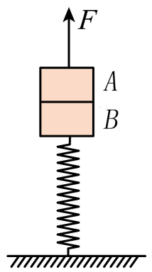

# Physics - 题目 339

**ID**: 97d7c2e2a4504080a34e5a29594d68b6
**年级**: Grade 12
**难度**: Medium-Hard
**题型**: Calculation

## 题目
A、B两个木块叠放在竖直轻弹簧上，如图所示，已知m_{A}＝m_{B}＝1 kg，轻弹簧的劲度系数为100 N/m。​​​​​​​‌若在木块A上作用一个竖直向上的力F，使木块A由静止开始以2 m/s^{2}的加速度竖直向上做匀加速运动。取g＝10 m/s^{2}。（1）求使木块A竖直向上做匀加速运动的过程中，力F的最大值是多少？（2）若木块A竖直向上做匀加速运动，直到A、B分离的过程中，弹簧的弹性势能减少了1.28 J，则在这个过程中力F对木块做的功是多少？

## 解答

1. （1）当F=0（即不加竖直向上力F时），设A、B叠放在弹簧上处于平衡时弹簧的压缩量为x_{1}，有 $kx{{}_{1}}=\left ({m{{}_{A}}+m{{}_{B}}}\right )g$ ，
2. 解得： $x{{}_{1}}=\frac {(m{{}_{A}}+m{{}_{B}})g}{k}=0.2{\rm{m}}$ ，
3. 当F≠0时，对B研究，受有重力、弹簧的弹力F_{T}和A对B的压力F_{N}，根据牛顿第二定律有： $F{{}_{{\rm{T}}}}-F{{}_{{\rm{N}}}}-m{{}_{B}}g=m{{}_{B}}a{{}_{B}}$ ，
4. 以木块A为研究对象进行受力分析，在重力、B对A的支持力和拉力F作用下做匀加速运动，由牛顿第二定律得： $F-m{{}_{A}}g+F{{}_{{\rm{N}}}}=m{{}_{A}}a$ ，
5. 当F_{N}≠0时，A、B有共同加速度a_{B}=a，欲使木块A由静止开始以2m/s^{2}的加速度竖直向上做匀加速运动，随F_{T}减小，F_{N}减小，F逐渐增大，当F_{N}=0时，F有最大值，于是 $F{{}_{{\rm{m}}}}=m{{}_{A}}g+m{{}_{A}}a=12{\rm{N}}$ 。
6. （2）由（1）知当F_{N}=0时，A、B开始分离，由 $F{{}_{{\rm{T}}}}-F{{}_{{\rm{N}}}}-m{{}_{B}}g=m{{}_{B}}a{{}_{B}}$ 知，此时，弹簧压缩量为 $x{{}_{2}}=\frac {m{{}_{B}}(a+g)}{k}=0.12{\rm{m}}$ ，
7. 设A、B开始分离时共同速度为v，由运动学公式得： $v{^{2}}=2a\left ({x{{}_{1}}-x{{}_{2}}}\right )$ ，
8. 解得： $v=\sqrt {\frac {8}{25}}{\rm{m}}{\rm{/}}{\rm{s}}$ ，
9. 由题知，此过程弹性势能减少了 $E{{}_{{\rm{p}}}}=1.28{\rm{J}}$
10. 设F力做的功为W_{F}，对这一过程应用动能定理得 $W{{}_{F}}+E{{}_{{\rm{p}}}}-(m{{}_{A}}+m{{}_{B}})g(x{{}_{1}}-x{{}_{2}})=\frac {1}{2}(m{{}_{A}}+m{{}_{B}})v{^{2}}$
11. 代入数据解得：W_{F}=0.64J。

## 知识点

**中文**:
  - 功能关系与能量守恒定律的综合应用

**English**:
  - Comprehensive Applications of Work-Energy Relation and Energy Conservation

---
