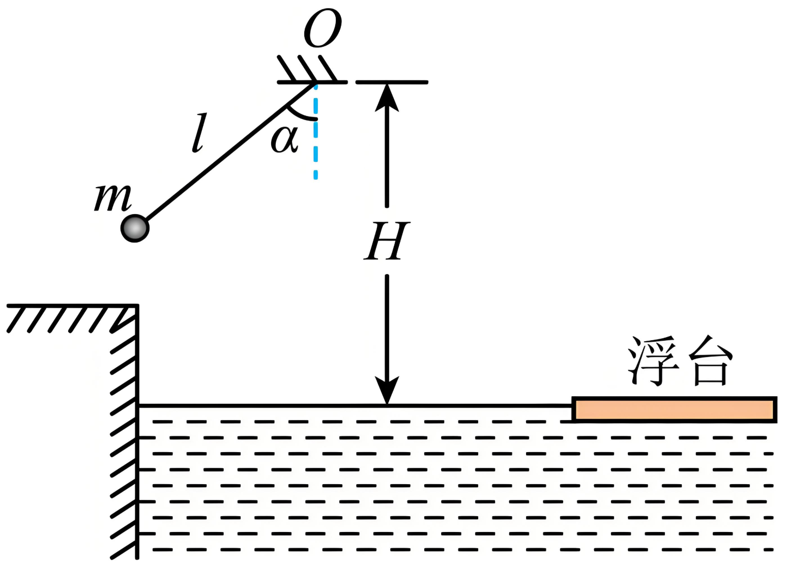

# Physics - 题目 272

**ID**: 9aa679df78fd490f934b551a2981f89b
**年级**: Grade 12
**难度**: Medium-Hard
**题型**: Calculation

## 题目
在游乐节目中，选手需借助悬挂在高处的绳飞越到水面的浮台上，如图所示，将选手简化为质量 $m=60{\rm{k}}{\rm{g}}$ 的质点，选手抓住绳由静止开始摆动，选手到O点的距离为l，此时绳与竖直方向夹角53°，绳的悬挂点O距水面的高度为 $H=3{\rm{m}}$ 。​​​​​​​‌不考虑空气阻力和绳的质量，浮台露出水面的高度不计，水足够深。取重力加速度 $g=10{\rm{m}}/{\rm{s}}{^{2}}$ ， $\sin 53{}\degree =0.8$ ， ${\cos}53{}\degree =0.6$ 。（1）求选手摆到最低点时，受到绳拉力的大小F；（2）选手摆到最低点时松手，可以通过改变绳子的长度，使得选手在浮台上的落点距岸边最远，求绳子的长度l。（3）当绳与竖直方向夹角37°时，选手的加速度大小a。

## 解答

1. （1）选手摆到最低点过程，由动能定理得 $mgl-mgl{\cos}53{}\degree =\frac {1}{2}mv{^{2}}$
2. 选手摆到最低点时，根据牛顿第二定律 $F-mg=m\frac {v{^{2}}}{l}$
3. 联立，解得受到绳拉力的大小为 $F=1080{\rm{N}}$
4. （2）选手在最低点松手后做平抛运动，则 $H-l=\frac {1}{2}gt{^{2}}$ ， $x=vt$
5. 整理可得 $x=\sqrt {2gl\left ({1-{\cos}53{}\degree }\right )}\sqrt {\frac {2(H-l)}{g}}=\sqrt {1.6l(H-l)}$
6. 所以，当 $l=\frac {H}{2}$ 时，选手在浮台上的落点到岸边的距离 $x$ 最远，此时 $l=\frac {H}{2}=1.5{\rm{m}}$
7. （3）选手摆到当绳与竖直方向夹角 $37{}\degree $ 过程，由动能定理得 $mg\left ({l{\cos}37{}\degree -l{\cos}53{}\degree }\right )=\frac {1}{2}mv{^{2}}$
8. 选手向心加速度大小为 $a{{}_{{\rm{n}}}}=\frac {v{^{2}}}{l}$
9. 选手切向加速度大小为 $a{{}_{{\rm{τ}}}}=g\sin 37{}\degree $
10. 选手加速度大小为 $a=\sqrt {a{{}_{{\rm{n}}}^{2}}+a{{}_{{\rm{τ}}}^{2}}}$
11. 联立，解得 $a=2\sqrt {13}{\rm{m}}{\rm{/}}{\rm{s}}{^{{{2}}}}$

## 知识点

**中文**:
  - 应用动能定理求解连接体问题
  - 求解平抛运动、类平抛运动问题
  - 绳、杆类圆周运动问题

**English**:
  - Solving Connected Body Problems
  - Solving Horizontal and Quasi-Horizontal Projectile Problems
  - String and Rod Circular Motion Problems

---
