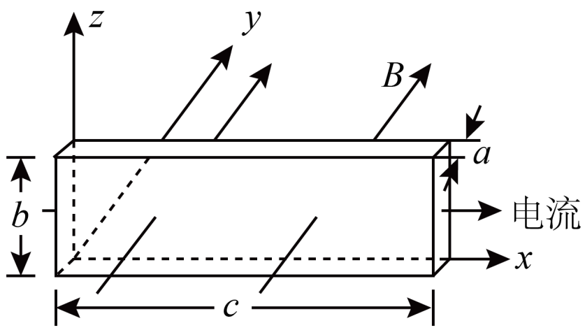

# Physics - 题目 904

**ID**: 9e9725ed33634a5f8f74a82c07bc3105
**年级**: Grade 12
**难度**: Medium-Hard
**题型**: 计算题（本大题共4小题，共48分）

## 题目
霍尔元件是一种重要的磁传感器，可用在多种自动控制系统中。​​​​​​​‌长方体半导体材料厚为 $a、$ 宽为 $b、$ 长为 $c$ ，以长方体三边为坐标轴建立坐标系 $xyz$ ，如图所示。半导体中有电荷量均为 $e$ 的自由电子与空穴两种载流子，空穴可看作带正电荷的自由移动粒子，单位体积内自由电子和空穴的数目分别为 $n$ 和 $p$ 。当半导体材料通有沿 $+x$ 方向的恒定电流后，某时刻在半导体所在空间加一匀强磁场，磁感应强度的大小为 $B$ ，沿 $+y$ 方向，于是在 $z$ 方向上很快建立稳定电场，称其为霍尔电场，已知电场强度大小为 $E$ ，沿 ${{-}}{\rm{z}}$ 方向。（1）判断刚加磁场瞬间自由电子受到的洛伦兹力方向：（2）若自由电子定向移动在沿 $+x$ 方向上形成的电流为 $I{{}_{n}}$ ，求单个自由电子由于定向移动在 $z$ 方向上受到洛伦兹力和霍尔电场力的合力大小 $F{{}_{nz}}$ ；（3）霍尔电场建立后，自由电子与空穴在 $z$ 方向定向移动的速率分别为 $v{{}_{nz}},v{{}_{pz}}$ ，求 $Δt$ 时间内运动到半导体 $z$ 方向的上表面的自由电子数与空穴数，并说明两种载流子在 $z$ 方向上形成的电流应满足的条件。

## 解答

1. （1）自由电子受到的洛伦兹力沿 $+z$ 方向；
2. （2）设 $t$ 时间内流过半导体垂直于 $x$ 轴某一横截面自由电子的电荷量为 $q$ ，
3. 由电流定义式，有 $I{{}_{n}}=\frac {q}{t}$ ，
4. 设自由电子在 $x$ 方向上定向移动速率为 $v{{}_{nx}}$ ，
5. 可导出自由电子的电流微观表达式为 $I{{}_{n}}=neabv{{}_{nx}}$ ，
6. 单个自由电子所受洛伦兹力大小为 $F{{}_{洛}}=ev{{}_{nx}}B$ ，
7. 霍尔电场力大小为 $F{{}_{电}}=eE$ ，
8. 自由电子在 $z$ 方向上受到的洛伦兹力和霍尔电场力方向相同，联立上式，其合力大小为 $F{{}_{{\rm{n}}{\rm{x}}}}=F{{}_{洛}}+F{{}_{电}}$  $=e\left ({\frac {I{{}_{n}}B}{neab}+E}\right )$ 。
9. （3）设 $Δt$ 时间内在 $z$ 方向上运动到半导体上表面的自由电子数为 $N{{}_{n}}$ 、空穴数为 $N{{}_{p}}$ ，
10. 则 $N{{}_{n}}=nacv{{}_{nx}}Δt$ ， $N{{}_{p}}=pacv{{}_{px}}Δt$ ，
11. 霍尔电场建立后，半导体 $z$ 方向的上表面的电荷量就不再发生变化，则应 $N{{}_{n}}=N{{}_{p}}$ ，即在任何相等时间内运动到上表面的自由电子数与空穴数相等，这样两种载流子在 $z$ 方向形成的电流应大小相等、方向相反。

## 知识点

**中文**:
  - 电流的形成、理解与微观表达式
  - 霍尔元件

**English**:
  - Formation, Understanding, and Microscopic Expression of Current
  - Hall Element

---
