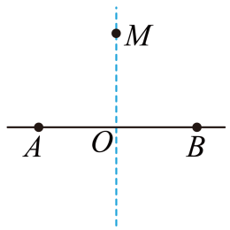

# Physics - 题目 1221

**ID**: 9fd325ebe6354b7eb957c7283fe9b1be
**年级**: Grade 12
**难度**: Medium-Hard
**题型**: Calculation

## 题目
将电荷量均为+Q的两电荷固定在相距为2d的A、B两点，O为AB连线中点，AB连线中垂线上有一点M，到O的距离为A，已知静电力常量为k。​​​​​​​‌（1）求M点的场强。（2）将一质量为m、带电荷量为-q的粒子从M点由静止释放，不考虑粒子的重力。①若A远小于d，可略去 ${\left({\frac {A}{d}}\right)^{n}}(n⩾2)$ 项的贡献，试证明粒子的运动为简谐运动；②简谐运动可视为某一匀速圆周运动沿直径方向上的投影运动，请描述与该粒子所做简谐运动相对应的圆周运动，并求该粒子做简谐运动的周期及动能的最大值。

## 解答

1. （1）证明；两个等量正电荷在M处产生的电场强度并合成如下图所示
2. 
3. M点的场强为 $E{{}_{M}}=2\times \frac {kQ}{d{^{2}}+A{^{2}}}\times {\cos}α=\frac {2kQ}{d{^{2}}+A{^{2}}}\times \frac {A}{\sqrt {d{^{2}}+A{^{2}}}}=\frac {2kQA}{\left ({d{^{2}}+A{^{2}}}\right ){^{\frac {3}{2}}}}$
4. 方向为O指向M。
5. （2）①粒子运动过程中，O点为平衡位置，可知当发生位移x时，粒子受到的电场力为 $F=-\frac {2kQqx}{\left ({d{^{2}}+x{^{2}}}\right ){^{\frac {3}{2}}}}=-\frac {2kQqx}{\left [d{^{2}}\left ({1+\frac {x{^{2}}}{d{^{2}}}}\right )\right ]{^{\frac {3}{2}}}}\approx -\frac {2kQq}{d{^{3}}}x$
6. 即粒子的运动为简谐运动。
7. ②简谐运动可视为某一匀速圆周运动沿直径方向上的投影运动，二者周期相同，此时圆周运动以O点为圆心，圆面与纸面垂直，由牛顿第二定律可得 $F=\frac {2kQqA}{d{^{3}}}=m\frac {4{\rm{π}}{^{2}}}{T{^{2}}}A$
8. 解得 $T=\sqrt {\frac {2{\rm{π}}{^{2}}md{^{3}}}{kQq}}$
9. 又 $E{{}_{{\rm{k}}{\rm{m}}}}=\frac {1}{2}k^{′}A{^{2}}$
10. 其中 $k^{′}=\frac {2kQq}{d{^{3}}}$
11. 联立，可得 $E{{}_{{\rm{k}}{\rm{m}}}}=\frac {kQqA{^{2}}}{d{^{3}}}$

## 知识点

**中文**:
  - 带电粒子在点电荷电场中的运动
  - 简谐运动的回复力和加速度

**English**:
  - Motion in Point Charge Field
  - Restoring Force and Acceleration in SHM

---
