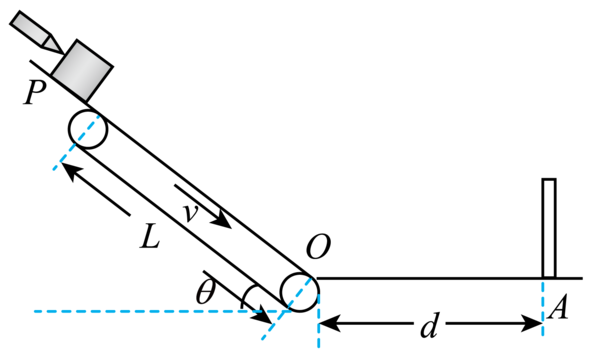

# Physics - 题目 1613

**ID**: a4242c2029b946538995a1b0f63417b2
**年级**: Grade 12
**难度**: Medium-Hard
**题型**: Calculation

## 题目
如图所示，一长度 $L=3.15{\rm{m}}$ 、与水平方向的夹角 $θ=37{^{\circ }}$ 的传送带以 $v=2{\rm{m}}/{\rm{s}}$ 的速度顺时针匀速转动，传送带与左右两侧的平面平滑连接，左侧斜面与水平方向的夹角也为 $θ$ ，右侧平面水平。​​​​​​​‌距传送带底端 $O$ 点 $d=1.5{\rm{m}}$ 处有一固定弹性挡板，一质量 $m=0.01{\rm{k}}{\rm{g}}$ 的子弹，以 $v{{}_{0}}=100{\rm{m}}/{\rm{s}}$ 的速度射入放在 $P$ 点的质量 $M=0.99{\rm{k}}{\rm{g}}$ 的物块（视为质点）且留在物块中，子弹相对物块运动的时间极短，可忽略不计， $P$ 点与传送带上端的距离可忽略不计，物块与传送带之间的动摩擦因数 $μ{{}_{1}}=0.5$ ，物块与右侧水平面间的动摩擦因数 $μ{{}_{2}}=0.2$ 。已知物块与弹性挡板碰撞前后速度大小不变，取重力加速度大小 $g=10{\rm{m}}/{\rm{s}}{^{2}},{\rm{s}}{\rm{i}}{\rm{n}}37{^{\circ }}=0.6,{\rm{c}}{\rm{o}}{\rm{s}}37{^{\circ }}=0.8$ 。求：(1)物块第一次通过传送带所用的时间 $t$ ；(2)物块沿传送带向上运动的最大距离 $x{{}_{1}}$ ；(3)物块停止运动时到 $O$ 点的距离 $x{{}_{2}}$ 。

## 解答

1. （1）子弹射入物块，由动量守恒定律有
2. $mv{{}_{0}}=\left ({m+M}\right )v{{}_{1}}$
3. 得
4. $v{{}_{1}}=1{\rm{m}}/{\rm{s}}$
5. 由于 $v{{}_{1}}<v$ ，物块先受到沿传送带向下的滑动摩擦力，物块先向下做加速直线运动，由牛顿第二定律
6. $\left ({M+m}\right )g\sin θ+μ{{}_{1}}(M+m)g{\cos}θ=(M+m)a{{}_{1}}$
7. 有
8. $a{{}_{1}}=10{\rm{m}}/{\rm{s}}{^{2}}$
9. 设时间 $t{{}_{1}}$ 与传送带共速，有
10. $v{{}_{1}}+a{{}_{1}}t{{}_{1}}=v$
11. 得
12. $t{{}_{1}}=0.1{\rm{s}}$
13. 此时物块的位移为
14. $s{{}_{1}}=v{{}_{1}}t{{}_{1}}+\frac {1}{2}a{{}_{1}}t{{}_{1}}{^{2}}=0.15{\rm{m}}$
15. 此后由于 $μ{{}_{1}}<{\tan}θ$ ，所以物块受到沿传送带向上的滑动摩擦力，由牛顿第二定律有
16. $(M+m)g\sin θ-μ{{}_{1}}(M+m)g{\cos}θ=(M+m)a{{}_{2}}$
17. 有
18. $a{{}_{2}}=2{\rm{m}}{\rm{/}}{\rm{s}}{^{{{2}}}}$
19. 设还需 $t{{}_{2}}$ 滑到传送带底端，由位移与时间关系式
20. $L-s{{}_{1}}=vt{{}_{2}}+\frac {1}{2}a{{}_{2}}t{{}_{2}^{2}}$
21. 得
22. $t{{}_{2}}=1{\rm{s}}$ （舍去负值）
23. 物块第一次通过传送带所用的时间
24. $t=t{{}_{1}}+t{{}_{2}}=0.1+1=1.1{\rm{s}}$
25. （2）物块第一次到达传送带的底部的速度为
26. $v{{}_{2}}=v+a{{}_{2}}t{{}_{2}}=4{\rm{m}}{\rm{/}}{\rm{s}}$
27. 因为物块与弹性挡板碰撞前后速度大小不变，所以可以对物块在右侧水平面上运动的全过程分析，则有
28. $-μ{{}_{2}}(M+m)g\cdot 2d=\frac {1}{2}(M+m)v{{}_{3}^{2}}-\frac {1}{2}(M+m)v{{}_{2}^{2}}$
29. 其中 $v{{}_{3}}$ 为物块第二次滑上传送带的初速度
30. 解得
31. $v{{}_{3}}=2{\rm{m}}{\rm{/}}{\rm{s}}$
32. 对物体第二次滑上传送带，向上运动过程进行受力分析，由牛顿第二定律有此时的加速度
33. $a{{}_{3}}=a{{}_{1}}=10{\rm{m}}{\rm{/}}{\rm{s}}$
34. 则有
35. $-2a{{}_{3}}x{{}_{1}}=0{^{2}}-v{{}_{3}^{2}}$
36. 解得
37. $x{{}_{1}}=0.2{\rm{m}}$
38. （3）当物块沿传送带向上运动到最大距离之后物块还是以 $10{\rm{m}}{\rm{/}}{\rm{s}}{^{{{2}}}}$ 做加速运动，因为 $v{{}_{3}}=v$ ，则物块再一次到达传送带的最底端时速度为
39. $v{{}_{4}}=v=2{\rm{m}}{\rm{/}}{\rm{s}}$
40. 则对物块滑上右侧水平面到停止运动的过程有
41. $-μ{{}_{2}}(M+m)g\cdot x{{}_{2}}=0-\frac {1}{2}(M+m)v{{}_{4}^{2}}$
42. 解得
43. $x{{}_{2}}=1{\rm{m}}$

## 知识点

**中文**:
  - 子弹-木块模型

**English**:
  - Bullet-Block Model

---
