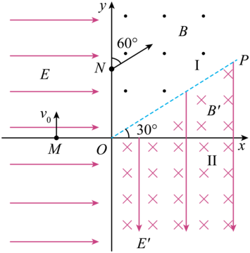

# Physics - 题目 1702

**ID**: a489ac903a8b4e6a9e608c0c14c5eb0b
**年级**: Grade 12
**难度**: Medium-Hard
**题型**: Calculation

## 题目
如图所示，在xOy坐标系x<0区域内存在平行于x轴、电场强度大小为E（E未知）的匀强电场，分界线OP将x>0区域分为区域I和区域II，区域I存在垂直纸面向外、磁感应强度大小为B（B未知）的匀强磁场，区域II存在垂直直面向里、磁感应强度大小为 $B^{′}=\frac {1}{2}B$ 的匀强磁场及沿y轴负方向、电场强度大小为 $E{^{\prime }}=\frac {2}{3}E$ 的匀强电场。​​​​​​​‌一质量为m、电荷量为q的带正电粒子从M（-d，0）点以初速度v_{0}垂直电场方向进入第二象限，经N点进入区域I，此时速度与y轴正方向的夹角为60°，经区域I后由分界线OP上的A点（图中未画出）垂直分界线进入区域II，不计粒子重力及电磁场的边界效应。求：(1)电场强度E的大小；(2)带电粒子从M点运动到A点的时间t；(3)粒子在区域II中运动时，第1次和第5次经过x轴的位置之间的距离s。

## 解答

1. （1）粒子在电场中做类平抛运动，则
2. ${\tan}60{}\degree =\frac {v{{}_{x}}}{v{{}_{0}}}=\frac {at{{}_{1}}}{v{{}_{0}}}$
3. $v{{}_{x}^{2}}=2ad$
4. $a=\frac {Eq}{m}$
5. 联立可得
6. $t{{}_{1}}=\frac {2\sqrt {3}d}{3v{{}_{0}}}$ ， $E=\frac {3mv{{}_{0}^{2}}}{2qd}$
7. （2）粒子在电场中做类平抛运动，则
8. $ON=v{{}_{0}}t{{}_{1}}=\frac {2\sqrt {3}d}{3}$
9. 粒子进入区域I后做匀速圆周运动，轨迹如图所示
10. 
11. 粒子运动的速度大小为
12. $v=\frac {v{{}_{0}}}{{\cos}60{}\degree }=2v{{}_{0}}$
13. 根据洛伦兹力提供向心力有
14. $qvB=m\frac {v{^{2}}}{r}$
15. 根据几何关系可得
16. $r=ON\sin 60{}\degree =d$
17. 联立解得
18. $B=\frac {2mv{{}_{0}}}{qd}$
19. 粒子从N运动到A的时间为
20. $t{{}_{2}}=\frac {T}{4}=\frac {1}{4}\cdot \frac {2πm}{qB}=\frac {πm}{2qB}=\frac {πd}{4v{{}_{0}}}$
21. 所以带电粒子从M点运动到A点的时间为
22. $t=t{{}_{1}}+t{{}_{2}}=\frac {8\sqrt {3}+3π}{12v{{}_{0}}}d$
23. （3）粒子进入区域II，受到电场力和洛伦兹力，由于
24. $q(v\sin 30{}\degree )B^{′}=\frac {qv{{}_{0}}B}{2}=\frac {mv{{}_{0}^{2}}}{d}=E^{′}q=\frac {2}{3}Eq$
25. 所以粒子的运动可以看成沿x轴正方向做匀速直线运动和xOy平面的匀速圆周运动的合运动，轨迹如图所示
26. 
27. 匀速圆周运动的速度大小为
28. $v^{′}=v{\cos}30{}\degree =\sqrt {3}v{{}_{0}}$
29. 根据洛伦兹力提供向心力有
30. $qv^{′}B^{′}=m\frac {v^{′}{{^{2}}}}{r^{′}}$
31. 解得
32. $r^{′}=\sqrt {3}d$
33. 粒子从第1次到第5次经过x轴运动的总时间为2Tʹ，所以
34. $s=v\sin 30{}\degree \cdot 2T^{′}$
35. $T^{′}=\frac {2πr^{′}}{v^{′}}=\frac {2πd}{v{{}_{0}}}$
36. 解得
37. $s=4πd$

## 知识点

**中文**:
  - 带电粒子在叠加场中的运动
  - 带电粒子在组合场中的运动

**English**:
  - Motion in Superimposed Fields
  - Motion in Combined Fields

---
