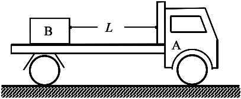

# Physics - 题目 1825

**ID**: a49115f7ad1b46aaa01654716bf6ffcb
**年级**: Grade 12
**难度**: Medium-Hard
**题型**: Calculation

## 题目
一质量为m的载重卡车A的水平车板上载有一质量为m的重物B，在水平直公路上以速度v_{0}做匀速直线运动，重物与车厢前壁间的距离为L（L>0）_{o}因发生紧急情况，卡车突然紧急制动（可近似认为车轮被“抱死”）。​​​​​​​‌已知，重物与车厢底板间的动摩擦因数为µ，卡车车轮与地面间的动摩擦因数为2µ，设最大静摩擦等于滑动摩擦。如果重物与车厢前壁发生碰撞，则假定碰撞时间极短，碰后重物与车厢前壁不分开。重力加速度大小为g。(1)若重物和车厢前壁在紧急制动时不发生碰撞，则v_{0}、µ、L应该满足什么条件？(2)若重物和车厢前壁在紧急制动时发生碰撞，求卡车从制动开始到卡车和重物都停止的过程卡车走过的路程。

## 解答

1. (1)紧急制动时，B相对A向右滑动，设A的加速度为 $a{{}_{1}}$ ，B的加速度为 $a{{}_{2}}$ ，则：
2. 对于A，根据牛顿第二定律有
3. ${\rm{2}}μ(m+m)g-{\rm μm}g=ma{{}_{1}}$
4. 解得 $a{{}_{1}}={\rm{3}}μg$
5. 对于B，根据牛顿第二定律有
6. ${\rm μm}g=ma{{}_{2}}$
7. 解得 $a{{}_{2}}=μg$
8. A、B初速度均为 $v{{}_{0}}$ ，加速度 $a{{}_{1}}>a{{}_{2}}$ ，故A先停止，B后停止，设停止前的位移分别为 $x{{}_{1}}、x{{}_{2}}$ ，根据速度位移公式有
9. $x{{}_{1}}=\frac {v{{}_{0}^{2}}}{2a{{}_{1}}}$ ， $x{{}_{2}}=\frac {v{{}_{0}^{2}}}{2a{{}_{2}}}$
10. A、B恰好相碰时，则有
11. $x{{}_{2}}=x{{}_{1}}+L$
12. 由以上各式解得 $v{{}_{0}}=\sqrt {3μgL}$
13. 故当 $v{{}_{0}}<\sqrt {3μgL}$ 时，B与A不会相碰。
14. (2)分两种情形讨论；
15. 情形1：重物B与A碰撞前，均在运动，则有
16. $v{{}_{0}}t-\frac {1}{2}a{{}_{2}}t{^{2}}=v{{}_{0}}t-\frac {1}{2}a{{}_{1}}t{^{2}}+L$
17. 解得 $t=\sqrt {\frac {L}{μg}}$
18. 此时A、B物体的速度为
19. $v{{}_{A}}=v{{}_{0}}-a{{}_{1}}t=v{{}_{0}}-3\sqrt {μgL}$ ， $v{{}_{B}}=v{{}_{0}}-a{{}_{2}}t=v{{}_{0}}-\sqrt {μgL}$
20. 为确保A、B两物体均未停止运动，需要满足 $v{{}_{B}}>0，v{{}_{A}}>0$
21. 解得 $v{{}_{0}}>3\sqrt {μgL}$
22. 即当 $v{{}_{0}}>3\sqrt {μgL}$ 时，A、B碰撞前均未停止运动。
23. 设A、B碰撞结束时的速度为 $v$ ，由动量守恒得
24. $mv{{}_{A}}+mv{{}_{B}}={\rm{2}}mv$
25. 解得 $v=v{{}_{0}}-2\sqrt {μgL}$
26. A、B碰撞后一起匀减速，加速度为 $a{{}_{3}}$ ，根据牛顿第二定律有
27. ${\rm{2}}μ\times {\rm{2}}mg=2ma{{}_{3}}$
28. 解得 $a{{}_{3}}=2μg$
29. A与B碰撞前后的位移分别为，根据速度位移公式有
30. $x{{}_{A1}}=\frac {v{{}_{0}^{2}}-v{^{2}}}{2a{{}_{1}}}$ ， $x{{}_{A2}}=\frac {v{^{2}}}{2a{{}_{3}}}$
31. 故A全过程的总路程为
32. $s=x{{}_{A1}}+x{{}_{A2}}=\frac {v{{}_{0}^{2}}}{4μg}-\frac {1}{2}L$
33. 情形2：重物B与A碰撞前，A运动，B已经停止；
34. 由情形1的分析可知，此过程应满足 $\sqrt {3μgL}<v{{}_{0}}<3\sqrt {μgL}$
35. B碰撞时满足
36. $\frac {v{{}_{0}^{2}}}{2a{{}_{1}}}+L=\frac {v{{}_{0}^{2}}-v{{}_{B}^{2}}}{2a{{}_{2}}}$
37. 解得
38. $v{{}_{B}^{2}}=\frac {2}{3}v{{}_{0}^{2}}-2μgL$
39. 设A、B碰撞结束时的速度为 $v$ ，由动量守恒得
40. $mv{{}_{B}}={\rm{2}}mv$
41. 解得 $v=\frac {{\rm{1}}}{{\rm{2}}}v{{}_{B}}$
42. A与B碰撞前后的位移分别为
43. $x{{}_{A1}}=\frac {v{{}_{0}^{2}}}{2a{{}_{1}}}$ ， $x{{}_{A2}}=\frac {v{^{2}}}{2a{{}_{3}}}$
44. 故A全过程的总路程为
45. $s=x{{}_{A1}}+x{{}_{A2}}=\frac {{\rm{5}}v{{}_{0}^{2}}}{{\rm{2}}4μg}-\frac {1}{{\rm{8}}}L$

## 知识点

**中文**:
  - 动量与牛顿定律的综合考查
  - 动量守恒与板块模型相结合
  - 动量守恒中的临界问题
  - 动量和能量的综合应用

**English**:
  - Integration of Momentum and Newton's Laws
  - Momentum Conservation with Plate Models
  - Critical Problems in Momentum Conservation
  - Integration of Momentum and Energy

---
