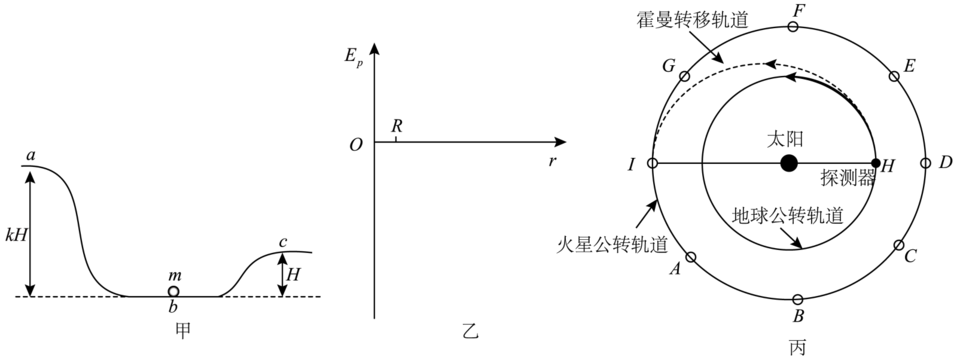

# Physics - 题目 1721

**ID**: a65d649b43814864858388d333f8750a
**年级**: Grade 12
**难度**: Medium-Hard
**题型**: Calculation

## 题目
“势阱”是量子力学中的常见概念，在经典力学中也有体现。​​​​​​​‌当粒子在某力场中运动，其势能函数曲线在空间某范围内存在最小值，形如陷阱，粒子很难跑出来。各种形式的势能函数只要具有这种特点，我们都可以称它为势阱，比如重力势阱、引力势阱、弹力势阱等。(1)如图甲所示，光滑轨道abc固定在竖直平面内形成一重力势阱，两侧高分别为kH和H。一可视为质点的质量为m的小球，静置于水平轨道b处。已知重力加速度为g；①以a处所在平面为重力势能面，写出该小球在b处机械能的表达式；②使小球由b处开始运动，从右侧处脱离该重力势阱，至少需要给小球提供多少动能？(2)我国首个火星探测器命名为“天问一号”。为了简化问题，可以认为地球和火星在同一平面上绕匀速圆周运动，火星轨道半径约为地球轨道半径的1.5倍。从地球表面向火星发射火星探测器，简单又比较节省能量的发射过程可简化为：先在地球表面使探测器加速并获得足够的动能，从而摆脱地球引力势阱的束缚，经过一系列调整使探测器成为一颗沿地球公转轨道近似为圆形运行的人造卫星；然后使探测器在适当的位置加速，经过椭圆轨道（霍曼转移轨道）到达火星；①已知取无限远处为引力势能零点，间距为r、质量分别为m_{1}和m_{2}的两质点组成的系统具有的引力势能可表示为 ${\rm \mathit{E}\mathit{_{p}}=-}G\frac {m{{}_{1}}m{{}_{2}}}{r}$ ，式中G为引力常量且大小已知。已知地球质量为M、半径为R，在如图乙所示的坐标系中，纵轴表示引力势能，横轴表示质量为m的探测器到地心的距离r（r≥R）。请在该坐标系中定性画出地球与探测器组成的系统具有的引力势能函数曲线。静置于地面处的该探测器，至少需要获得多大速度（相对于地心，不考虑地球的自转和空气阻力及其他天体的影响），才能摆脱地球引力势阱的束缚；②由开普勒定律可知：所有行星绕太阳运动的轨道都是椭圆，太阳处在椭圆的一个焦点上；所有行星的轨道的半长轴的三次方距它的公转周期的二次方的比值都相等。如图丙所示，请经过计算，判断当火星运行到哪个位置（A、B、C、D、E、F、G）附近时，在地球公转轨道上H点的探测器开始发射（即瞬间加速，加速时间可忽略），此后探测器仅在太阳引力作用下，可经过霍曼转移轨道在I点到达火星。（可能需要用到的数据： $\sqrt {1.25{^{3}}}\approx 1.40$ ， $\sqrt {1.5{^{3}}}\approx 1.84$ 。

## 解答

1. (1)①小球在b处的机械能E=-kmgH，
2. ②要使小球b从c点脱离，则根据机械能守恒得-kmgH+E_{k}=-mg(kH-H)，解得E_{k}=mgH。
3. (2)①地球与探测器组成的系统具有的引力势能函数曲线如图所示
4. 
5. 当r=R时，引力势能大小 ${\rm \mathit{E}\mathit{_{p}}=}-G\frac {Mm}{R}$ ，随着r的增大，引力势能的绝对值逐渐减小，引力势能逐渐增大，设静置于地面处的探测器，至少需要速度v才能摆脱地球引力势阱的束缚，由机械能守恒得 $-G\frac {Mm}{R}{\rm +}$  $\frac {{{1}}}{{{2}}}{\rm \mathit{mv}^{2}=0}$ ，解得 ${\rm \mathit{v}=}\sqrt {\frac {2GM}{R}}$
6. ②设地球的公转半径为R，则火星的公转半径为1.5R，探测器的半长轴为 $\frac {R+1.5R}{{{2}}}{\rm =1.25\mathit{R}\mathit{，}}$ 对于地球和探测器而言，根据开普勒第三定律 $\frac {R{^{3}}}{T{{}_{地}}{^{2}}}=\frac {（1.25R）{^{3}}}{T{{}_{探}}{^{2}}}$ ，T_{探}=1.40T_{地}_{，}对于地球和火星而言，根据开普勒第三定律 $\frac {R{^{3}}}{T{{}_{地}}{^{2}}}=\frac {（1.5R）{^{3}}}{T{{}_{火}}{^{2}}}$ ，T_{火}=1.84T_{地}，T_{探}= $\frac {1.4}{1.84}$T_{火}=0.76T_{火}≈ $\frac {6}{8}$T_{火}，所以当探测器从H点飞行到I点时的时间为探测器的半个周期，即 ${\rm \mathit{t}=}\frac {{{1}}}{{{2}}}$T_{探}= $\frac {3}{8}$T_{火}，即当火星运行到E点附近时，可以使探测器与火星在I点相遇。

## 知识点

**中文**:
  - 开普勒三大定律及其应用

**English**:
  - Kepler's Three Laws and Applications

---
