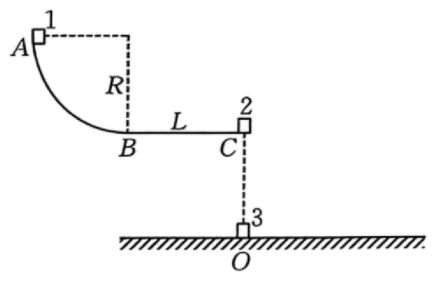

# Physics - 题目 199

**ID**: a6694b8fa81042fcb7b993906236e73a
**年级**: Grade 12
**难度**: Medium-Hard
**题型**: Calculation

## 题目
如图所示，滑块1、2的质量分别为m和4m，滑块1在半径为R的固定在竖直平面内的四分之一光滑圆弧轨道的最高点A处，滑块2置于粗糙水平轨道BC的端点C处，B、C间的距离为L。​​​​​​​‌水平轨道与圆弧轨道相切于B点。在C点正下方的水平地面上的O处有一质量为m的滑块3。由静止释放滑块1，滑块1与滑块2发生弹性碰撞（时间极短），碰撞后滑块1向B点运动，最后恰好停在C点。在滑块2被碰后瞬间给滑块3一个水平向右的初速度 $v{{}_{0}}$ （未知），一段时间后，滑块2恰好与滑块3发生碰撞。水平轨道BC与水平地面间的高度差为h，不计空气阻力，重力加速度大小为g，求：(1)滑块1与水平轨道BC间的动摩擦因数 $μ{{}_{1}}$ ；(2)滑块1第二次经过圆弧轨道底端B时，受到的支持力大小 $F{{}_{{\rm{N}}}}$ ；(3)滑块3的初速度 $v{{}_{0}}$ 和滑块3与水平地面间的动摩擦因数 $μ{{}_{2}}$ 的关系。

## 解答

1. （1）设滑块1与滑块2碰前滑块1的速度大小为 $v{{}_{1}}$ ，由动能定理有 $mgR-μ{{}_{1}}mgL=\frac {1}{2}mv{{}_{1}^{2}}$
2. 设碰后两者的速度大小分别为 $v{{}_{1}}{^{\prime }}$ 和 $v{{}_{2}}{^{\prime }}$ ，根据动量守恒定律和机械能守恒定律有 $mv{{}_{1}}=-mv{{}_{1}}{^{\prime }}+4mv{{}_{2}}{^{\prime }}$ ， $\frac {1}{2}mv{{}_{1}^{2}}=\frac {1}{2}mv{{}_{1}}{^{\prime }}{^{2}}+\frac {1}{2}\times 4mv{{}_{2}}{^{\prime }}{^{2}}$
3. 解得 $v{{}_{1}}{^{\prime }}=0.6v{{}_{1}}$ ， $v{{}_{2}}{^{\prime }}=0.4v{{}_{1}}$
4. 最后滑块1恰好停在C点，由动能定理有 $-2μ{{}_{1}}mgL=0-\frac {1}{2}mv{{}_{1}}{^{\prime }}{^{2}}$
5. 解得 $v{{}_{1}}{^{\prime }}=6\sqrt {\frac {gR}{59}}$ ， $v{{}_{2}}{^{\prime }}=4\sqrt {\frac {gR}{59}}$ ， $μ{{}_{1}}=\frac {9R}{59L}$
6. （2）设滑块1第二次经过圆弧轨道底端B时的速度大小为 $v{{}_{B2}}$ ，由动能定理有 $-μ{{}_{1}}mgL=\frac {1}{2}mv{{}_{B2}^{2}}-\frac {1}{2}mv{{}_{1}}{^{\prime }}{^{2}}$
7. 解得 $v{{}_{B2}}=3\sqrt {\frac {2gR}{59}}$
8. 由牛顿第二定律有 $F{{}_{{\rm{N}}}}-mg=m\frac {v{{}_{B2}^{2}}}{R}$
9. 解得 $F{{}_{{\rm{N}}}}=\frac {77mg}{59}$
10. （3）碰撞后，滑块2做平抛运动，有 $h=\frac {1}{2}gt{^{2}}$
11. 在水平方向上有 $x=v{{}_{2}}{^{\prime }}t$
12. 滑块3在水平地面上做匀减速直线运动，加速度大小 $a=μ{{}_{2}}g$
13. 由运动学公式有 $x=v{{}_{0}}t-\frac {1}{2}μ{{}_{2}}gt{^{2}}$
14. 解得 $v{{}_{0}}=\sqrt {\frac {gh}{2}}μ{{}_{2}}+4\sqrt {\frac {gR}{59}}$

## 知识点

**中文**:
  - 求解弹性碰撞问题

**English**:
  - Solving Elastic Collision Problems

---
