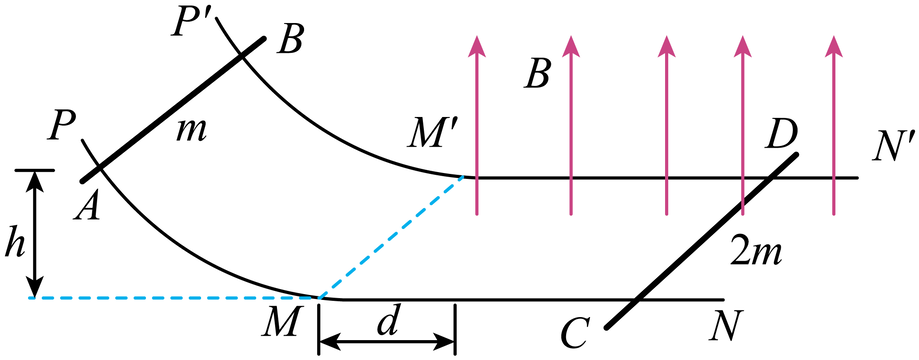

# Physics - 题目 1401

**ID**: a66cc96a379747f3a3dba17de2787541
**年级**: Grade 12
**难度**: Medium-Hard
**题型**: Calculation

## 题目
如图所示，PMN和 $P^{′}M^{′}N^{′}$ 是两条足够长、相距为L的平行金属导轨， $MM^{′}$ 左侧圆弧轨道表面光滑，右侧水平轨道表面粗糙，并且 $MM^{′}$ 右侧空间存在一竖直向下、磁感应强度大小为B的匀强磁场。​​​​​​​‌在左侧圆弧轨道上高为h处垂直导轨放置一导体棒AB，在右侧水平轨道上某位置垂直导轨放置另一导体棒CD。已知AB棒和CD棒的质量分别为m和2m，接入回路部分的电阻均为R，AB棒与水平轨道间的动摩擦因数为 $μ$ ，圆弧轨道与水平轨道平滑连接且电阻不计。现将AB棒由静止释放，让其沿轨道下滑并进入磁场区域，最终在棒CD左侧距 $MM^{′}$ 为d处停下，此过程中CD棒因摩擦一直处于静止状态。重力加速度为g，求：（1）AB棒刚进入磁场时AB两端的电压U；（2）AB棒从进入磁场到最终停止运动的过程中流过CD棒的电荷量q；（3）若水平轨道光滑，为使两棒不相碰，求棒CD初始位置与 $MM^{′}$ 的最小距离 $x{{}_{{\rm \min }}}$ 。

## 解答

1. （1）AB棒下滑过程，根据动能定理有 $mgh=\frac {1}{2}mv{^{2}}$
2. AB棒刚进入磁场时，产生的电动势为 $E=BLv$
3. AB棒两端的电压大小为 $U=\frac {1}{2}E$
4. 联立解得 $U=\frac {1}{2}BL\sqrt {2gh}$
5. （2）从AB棒进入磁场到停止运动过程中，感应电动势的平均值 ${\overline{E}}=\frac {ΔΦ}{\Delta t}=\frac {BLd}{\Delta t}$
6. 根据闭合电路欧姆定律有 ${\overline{I}}=\frac {{\overline{E}}}{2R}$
7. 根据电流的定义式有 ${\overline{I}}=\frac {q}{Δt}$
8. 解得 $q=\frac {BLd}{2R}$
9. （3）若水平轨道光滑，AB棒与CD棒构成的系统动量守恒，最终达到共速，设其为 $v{{}_{共}}$ ，则有 $mv=(m+2m)v{{}_{共}}$
10. 双棒均运动时，感应电动势的平均值 ${\overline{E{{}_{1}}}}=BL{\overline{v{{}_{AB}}}}-BL{\overline{v{{}_{CD}}}}$
11. 感应电流的平均值 ${\overline{I{{}_{1}}}}=\frac {{\overline{E{{}_{1}}}}}{2R}$
12. 对CD棒进行分析，根据动量定理有 $B{\overline{I{{}_{1}}}}Lt=2mv{{}_{共}}$
13. 结合上述解得 $\frac {B{^{2}}L{^{2}}\left ({{\overline{v{{}_{AB}}}}-{\overline{v{{}_{CD}}}}}\right )}{2R}t=2mv{{}_{共}}$
14. 为使两棒不相碰，棒CD初始位置与 $MM^{′}$ 的最小距离 $x{{}_{{\rm \min }}}=\left ({{\overline{v{{}_{AB}}}}-{\overline{v{{}_{CD}}}}}\right )t$
15. 解得 $x{{}_{{\rm \min }}}=\frac {4mR\sqrt {2gh}}{3B{^{2}}L{^{2}}}$

## 知识点

**中文**:
  - 动量守恒的判定与应用
  - 导体切割磁感线产生感应电动势（电流）的分析与计算
  - 双杆模型
  - 动量定理及其应用

**English**:
  - Judgment and Application of Momentum Conservation
  - Analysis and Calculation of Cutting Magnetic Field Lines
  - Double Rod Model
  - Applications of Impulse-Momentum Theorem

---
