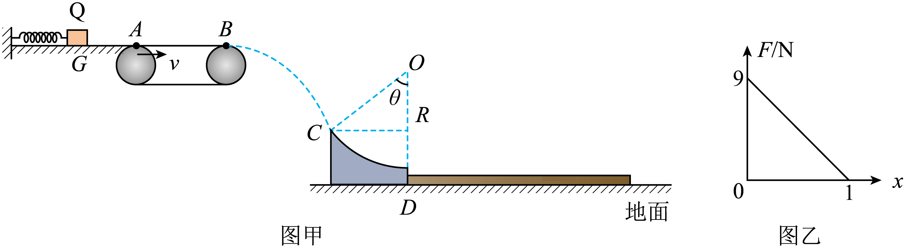

# Physics - 题目 943

**ID**: a829e78edc5d49d18e1a08ea67b39a21
**年级**: Grade 12
**难度**: Medium-Hard
**题型**: Calculation

## 题目
如图甲所示、在光滑水平面上放有一左端固定在墙壁上的轻质弹簧，弹簧处于原长时右端恰好位于 $\mathrm{A}$ 点，弹簧所在的光滑水平面与水平传送带在 $\mathrm{A}$ 点平滑连接。​​​​​​​‌传送带长 $L$  $=1.75{\rm{m}}$ ，且以 $v=5{\rm{m}}{\rm{/}}{\rm{s}}$ 的速率沿顺时针方向匀速转动，传送带右下方有一固定在光滑地面上半径为 $R=4{\rm{m}}$ 、圆心角 $θ=60{^{\circ }}$ 的粗糙圆弧轨道，圆弧轨道右侧紧挨着一个与轨道等高，质量 $M=3{\rm{k}}{\rm{g}}$ 的长禾板（木板厚度不计）。现将一质量 $m=1{\rm{k}}{\rm{g}}$ 的滑块 ${\rm{Q}}$ （ ${\rm{Q}}$ 视为质点且与弹簧未拴接）向左压缩弹簧至图中 $G$ 点后由静止释放，滑块 ${\rm{Q}}$ 从 $\mathrm{A}$ 点滑上传送带，并从传送带右端 $B$ 点离开，恰好沿 $C$ 点的切线方向进入与传送带在同一竖直面的圆弧轨道 $CD$ ，然后无动能损失滑上长木板。已知弹簧弹力与滑块 ${\rm{Q}}$ 在 $GA$ 段的位移关系如图乙所示，滑块 ${\rm{Q}}$ 与传送带、长木板间的动摩擦因数均为 $μ=0.2$ ，重力加速度大小 $g=10{\rm{m}}{\rm{/}}{\rm{s}}{^{{{2}}}}$ 。（1）求滑块 ${\rm{Q}}$ 刚滑上传送带时的速度大小 $v{{}_{{\rm{Q}}}}$ ；（2）若滑块 ${\rm{Q}}$ 运动至圆弧轨道最低点 $D$ 时，轨道对其的支持力为 $F{{}_{{\rm{N}}}}=14{\rm{N}}$ ，且滑块恰好未滑离长木板，求长木板的长度 $L^{′}$ ；（3）若去掉圆弧轨道和长木板，滑块 ${\rm{Q}}$ 从传送带上滑落地面并与地面发生碰撞，每次碰撞前后水平方向速度大小不变，且每次反弹的高度是上一次的三分之二，不计空气阻力。求滑块 ${\rm{Q}}$ 与地面发生 $n$ 次碰撞后前 $n$ 次损失的机械能 $ΔE$ 与 $n$ 的函数关系式。

## 解答

1. （1）滑块Q第一次从G点到A点时与弹簧分离，从A点滑上传送带，对滑块Q由动能定理得 $W{{}_{{\rm{F}}}}=\frac {1}{2}mv{{}_{{\rm{Q}}}^{2}}$
2. $F-x$ 图可知该过程弹力做功 $W{{}_{{\rm{F}}}}=\frac {9\times 1}{2}{\rm{J}}=4.{{5}}{\rm{J}}$
3. 联立解得 $v{{}_{{\rm{Q}}}}=3{\rm{m}}{\rm{/}}{\rm{s}}$
4. （2）滑块Q在D点，由牛顿第二定律可知 $F{{}_{{\rm{N}}}}-mg=m\frac {v{{}_{D}^{2}}}{R}$
5. Q滑上长木板后，以Q和长木板为系统动量守恒，恰好没滑离，则滑到长木板右端时达到共同速度 $v{{}_{1}}$ ，则有 $mv{{}_{D}}=\left ({m+M}\right )v$
6. 由能量守恒定律可知 ${\rm μm}gL^{′}=\frac {1}{2}mv{{}_{D}^{2}}-\frac {1}{2}\left ({m+M}\right )v{{}_{1}^{2}}$
7. 代入数据，联立解得 $L{^{\prime }}=3{\rm{m}}$
8. （3）设BC的竖直高度为h，传送带离地面高为H，则 $H=h+R\left ({1-{\cos}θ}\right )$
9. Q滑上传送带时 $v{{}_{{\rm{Q}}}}<v$ ，则Q在传送带上匀加速运动，加速度大小为a，则 ${\rm μm}g=ma$
10. 假设滑块Q在传送带上一直匀加速运动到右端离开传送带，到B点时的速度为 $v{{}_{B}}$ ，有 $v{{}_{B}^{2}}-v{{}_{{\rm{Q}}}^{2}}=2aL$
11. 代入数据得 $v{{}_{B}}=4{\rm{m}}{\rm{/}}{\rm{s}}{\rm{<}}{{5}}{\rm{m}}{\rm{/}}{\rm{s}}$
12. 假设成立，即 $v{{}_{B}}=4{\rm{m}}{\rm{/}}{\rm{s}}$
13. 从B点离开传送带恰好沿C点切线滑入CD轨道中，可知 $h=\frac {{\left({v{{}_{B}}{\tan}θ}\right)^{2}}}{2g}=2.4{\rm{m}}$
14. 滑块与地面发生碰撞前后水平方向速度不变，竖直方向速度减小。所以第一次碰撞后损失的机械能 ${\rm{Δ}}E{{}_{1}}=\left ({1-\frac {2}{3}}\right )mgH=\frac {1}{3}mgH$
15. 第二次碰撞后损失的机械能 ${\rm{Δ}}E{{}_{2}}=\left ({\frac {2}{3}-\frac {2{^{2}}}{3{^{2}}}}\right )mgH=\frac {2}{3}\times \frac {1}{3}mgH$
16. 第三次碰撞损失的机械能 ${\rm{Δ}}E{{}_{3}}=\left ({\frac {2{^{2}}}{3{^{2}}}-\frac {2{^{3}}}{3{^{3}}}}\right )mgH=\frac {2{^{2}}}{3{^{2}}}\times \frac {1}{3}mgH$
17. 以此类推发生第n次碰撞损失的机械能为 ${\rm{Δ}}E{{}_{n}}={\left({\frac {2}{3}}\right)^{n-1}}\times \frac {1}{3}mgH$
18. 发生n次碰撞后前n次滑块总共损失的机械能为 $ΔE=ΔE{{}_{1}}+ΔE{{}_{2}}+ΔE{{}_{3}}+...+ΔE{{}_{n}}$
19. 联立解得 ${\rm{Δ}}E=\left ({1-\frac {2{^{n}}}{3{^{n}}}}\right )mgH$
20. 代入数据得 ${\rm{Δ}}E=44\left ({1-\frac {2{^{n}}}{3{^{n}}}}\right ){\rm{J}}$

## 知识点

**中文**:
  - 动量守恒中的多次碰撞问题

**English**:
  - Multiple Collisions in Momentum Conservation

---
