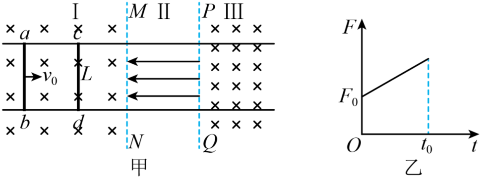

# Physics - 题目 2599

**ID**: a8f19ed4308c4407a3210a70211bca39
**年级**: Grade 12
**难度**: Medium-Hard
**题型**: Calculation

## 题目
一小型风洞实验室内水平桌面上放两根足够长的平行导轨，导轨间距为L，如图甲（俯视）所示。​​​​​​​‌虚线MN左侧区域I有竖直向下的匀强磁场B_{1}，虚线PQ右侧区域Ⅲ有竖直向下的匀强磁场B_{3}，中间区域Ⅱ有水平向左的匀强磁场B_{2}，B_{1}=B_{2}=B，B_{3}=2B。中间区域处于一向上的风洞中，当棒经过此区域时会受到竖直向上的恒定风力F＝mg的作用。长度均为L的导体棒ab、cd与导轨接触良好，两棒质量均为m，棒ab电阻为 $\frac {R}{2}$ ，棒cd电阻为R，其余电阻不计。两棒最初静止，现给棒ab一个水平向右的瞬间冲量使得其获得初速度v_{0}，已知棒cd到达MN前两棒不相碰且均已匀速。当棒cd刚进入区域Ⅱ时，对棒ab施加一水平向右的外力使棒ab向右做匀加速直线运动，外力随时间变化的图像如图乙所示。已知直线斜率为k，t_{0}时刻棒cb恰好进入区域Ⅲ，棒cd进入区域Ⅲ后瞬间撤去棒ab上的外力。区域Ⅰ、Ⅲ导轨光滑，中间区域导轨粗糙且与棒cd的动摩擦因数为μ，两棒在运动过程中始终与导轨垂直且接触良好，棒ab始终在区域Ⅰ运动。已知 $t{{}_{0}}=\frac {B{{}^{2}}L{{}^{2}}v{{}_{0}}}{kR}$ ， $μ=\frac {2mkR{{}^{2}}}{5B{{}^{4}}L{{}^{4}}v{{}_{0}}}$ ，重力加速度为g。求：（1）棒ab刚开始运动时，棒两端的电势差U_{ab}；（2）图乙中t=0时刻外力F_{0}多大，t_{0}时刻棒ab的速度多大；（3）棒cd进入区域Ⅲ后的过程中闭合回路产生的焦耳热多大。

## 解答

1. （1）棒ab的感应电动势为
2. $E=BLv{{}_{0}}$
3. $I=\frac {E}{\frac {R}{2}+R}$
4. $U{{}_{ab}}=IR$
5. 联立得
6. $U{{}_{ab}}=\frac {2}{3}BLv{{}_{0}}$
7. （2）棒ab开始运动到两棒匀速过程两棒动量守恒，有
8. $mv{{}_{0}}=2mv{{}_{共}}$
9. 得
10. $v{{}_{共}}=\frac {v{{}_{0}}}{2}$
11. 施加外力后任一时刻，对棒ab，有
12. $F-BIL=ma$
13. $I=\frac {E}{\frac {1}{2}R+R}$
14. $E=BLv$
15. 棒ab做匀加速直线运动
16. $v=v{{}_{共}}+at=\frac {v{{}_{0}}}{2}+at$
17. 联立得
18. $F=\frac {B{{}^{2}}L{{}^{2}}v{{}_{0}}}{3R}+ma+\frac {2B{{}^{2}}L{{}^{2}}a}{3R}t$
19. 其中
20. $k=\frac {2B{{}^{2}}L{{}^{2}}a}{3R}$
21. 可得
22. $F{{}_{0}}=\frac {B{{}^{2}}L{{}^{2}}v{{}_{0}}}{3R}+\frac {3kmR}{2B{{}^{2}}L{{}^{2}}}$
23. t_{0}时刻棒ab的速度
24. $v{{}_{1}}=\frac {v{{}_{0}}}{2}+at{{}_{0}}=2v{{}_{0}}$
25. （3）棒cd所受摩擦力
26. $f=μBIL=\frac {4mkR}{15B{{}^{2}}L{{}^{2}}v{{}_{0}}}\left ({\frac {v{{}_{0}}}{2}+at}\right )$
27. $t=0$ 时刻
28. $f{{}_{1}}=\frac {2mkR}{15B{{}^{2}}L{{}^{2}}}$
29. $t=t{{}_{0}}$ 时刻
30. $f{{}_{2}}=\frac {8mkR}{15B{{}^{2}}L{{}^{2}}}$
31. 对棒cd在区域Ⅱ运动过程由动量定理，得
32. $-\frac {f{{}_{1}}+f{{}_{2}}}{2}t{{}_{0}}=mv{{}_{2}}-m\frac {v{{}_{0}}}{2}$
33. 联立得
34. $v{{}_{2}}=\frac {1}{6}v{{}_{0}}$
35. 棒cd进入区域Ⅲ后，对棒ab，有
36. $-BILt=mv{{}_{3}}-mv{{}_{1}}$
37. 对棒cd，有
38. $2BILt=mv{{}_{4}}-mv{{}_{2}}$
39. 稳定时，有
40. $BLv{{}_{3}}=2BLv{{}_{4}}$
41. 联立得
42. $v{{}_{3}}=\frac {5}{3}v{{}_{0}}$ ， $v{{}_{4}}=\frac {5}{6}v{{}_{0}}$
43. 对两棒能量守恒，有
44. $\frac {1}{2}mv{{}_{1}^{2}}+\frac {1}{2}mv{{}_{2}^{2}}=Q+\frac {1}{2}mv{{}_{3}^{2}}+\frac {1}{2}mv{{}_{4}^{2}}$
45. 联立得
46. $Q=\frac {5}{18}mv{{}_{0}^{2}}$

## 知识点

**中文**:
  - 动量守恒的判定与应用
  - 导体切割磁感线产生感应电动势（电流）的分析与计算
  - 双杆模型

**English**:
  - Judgment and Application of Momentum Conservation
  - Analysis and Calculation of Cutting Magnetic Field Lines
  - Double Rod Model

---
