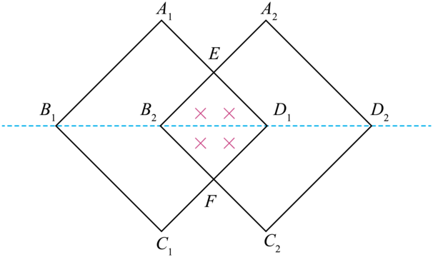

# Physics - 题目 2068

**ID**: a93919417e11440bb96cfa5085efa643
**年级**: Grade 12
**难度**: Medium-Hard
**题型**: Calculation

## 题目
如图所示，两个光滑刚性正方形金属线框A_{1}B_{1}C_{1}D_{1}和A_{2}B_{2}C_{2}D_{2}交叠固定在光滑水平面上，交叠点E和F恰好为两边中点，且彼此相互绝缘。​​​​​​​‌在两线框交叠区域存在着垂直纸面向里、磁感应强度为B_{0}的匀强磁场（交叠的金属线框在磁场边缘以内）。已知两线框质量均为m，边长均为a，单位长度电阻均为r_{0}。现将匀强磁场在极短的时间内减小为零，不计线框电感。(1)判断线框A_{1}B_{1}C_{1}D_{1}中感应电流方向（“顺时针”或“逆时针”），并求流过截面的电量；(2)求线框A_{2}B_{2}C_{2}D_{2}受到安培力冲量的大小和方向；(3)若线框A_{1}B_{1}C_{1}D_{1}不固定，交叠点E和F不彼此绝缘（接触电阻不计），而且线框所在平面整个区域都存在着匀强磁场B_{0}，求匀强磁场减小为零时线框A_{1}B_{1}C_{1}D_{1}速度的大小。（忽略磁场减小过程中线框的移动）

## 解答

1. （1）根据楞次定律可知，线框A_{1}B_{1}C_{1}D_{1}中感应电流的方向：顺时针；
2. 由法拉第电磁感应定律和闭合回路欧姆定律 $E=\frac {{\rm{Δ}}{\rm{Φ}}}{{\rm{Δ}}t}=\frac {S{\rm{Δ}}B}{{\rm{Δ}}t}=\frac {B{{}_{0}}a{^{2}}}{4{\rm{Δ}}t}$ ， $I=\frac {E}{R}=\frac {E}{4ar{{}_{0}}}$
3. 流过截面的电量 $q=I{\rm{Δ}}t=\frac {B{{}_{0}}a}{16r{{}_{0}}}$
4. （2）线框A_{2}B_{2}C_{2}D_{2}受到安培力冲量的方向：向左；
5. 设某时刻线框的电流为i，则 $i=\frac {e}{R}=\frac {a}{16r{{}_{0}}}\frac {{\rm{Δ}}B}{{\rm{Δ}}t}$
6. 线框受到安培力的冲量 $I{{}_{安}}=\sum BiL{{}_{{\rm{E}}{\rm{F}}}}{\rm{Δ}}t$
7. 则 $I{{}_{安}}=\sum B\cdot \frac {a}{16r{{}_{0}}}\cdot \frac {{\rm{Δ}}B}{{\rm{Δ}}t}\cdot \frac {\sqrt {2}}{2}a\cdot {\rm{Δ}}t=\frac {\sqrt {2}a{^{2}}}{32r{{}_{0}}}\sum B\cdot {\rm{Δ}}B$
8. 得 $I{{}_{安}}=\frac {\sqrt {2}a{^{2}}B{{}_{0}^{2}}}{64r{{}_{0}}}$
9. （3）根据两环对称性，设某时刻两线框电流i_{1}和i_{2}如图所示。
10. 
11. 设回路A_{1}EA_{2}D_{2}C_{2}FC_{1}B_{1}中的电动势为E_{1}，则 $E{{}_{1}}=\frac {{\rm{Δ}}B}{{\rm{Δ}}t}\frac {7a{^{2}}}{4}=i{{}_{1}}\cdot 6ar{{}_{0}}$
12. 得 $i{{}_{1}}=\frac {{\rm{Δ}}B}{{\rm{Δ}}t}\frac {7a}{24r{{}_{0}}}$
13. 设回路ED_{1}FB_{2}中的电动势为E_{2}，则 $E{{}_{2}}=\frac {{\rm{Δ}}B}{{\rm{Δ}}t}\frac {a{^{2}}}{4}=i{{}_{2}}\cdot 2ar{{}_{0}}$
14. 得 $i{{}_{2}}=\frac {{\rm{Δ}}B}{{\rm{Δ}}t}\frac {a}{8r{{}_{0}}}$
15. 【或：对于A_{1}B_{1}C_{1}D_{1}： $E{{}_{1}}=\frac {{\rm{Δ}}B}{{\rm{Δ}}t}a{^{2}}=i{{}_{1}}\cdot 3ar{{}_{0}}+i{{}_{2}}\cdot ar{{}_{0}}$】
16. 由于 $i{{}_{1}}>i{{}_{2}}$ ，线框A_{1}B_{1}C_{1}D_{1}所受安培力的合力方向向左，速度方向向左；
17. 设线框A_{1}B_{1}C_{1}D_{1}获得速度大小为v，利用动量定理 $\sum B\left ({i{{}_{1}}-i{{}_{2}}}\right )\frac {\sqrt {2}}{2}a{\rm{Δ}}t=mv-0$ ， $\sum B\cdot \frac {{\rm{Δ}}B}{{\rm{Δ}}t}\frac {a}{6r{{}_{0}}}\frac {\sqrt {2}}{2}a{\rm{Δ}}t=mv-0$
18. 可得 $\frac {\sqrt {2}a{^{2}}}{12r{{}_{0}}}\sum B\cdot {\rm{Δ}}B=mv$
19. 解得 $v=\frac {\sqrt {2}B{{}_{0}^{2}}a{^{2}}}{24r{{}_{0}}m}$

## 知识点

**中文**:
  - 电磁感应定律的应用

**English**:
  - Applications of Faraday's Law

---
