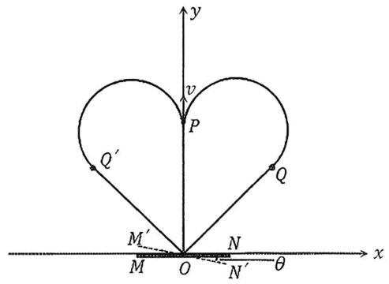

# Physics - 题目 1362

**ID**: abd2282fb05545aea96ad7665e9ec193
**年级**: Grade 12
**难度**: Medium-Hard
**题型**: Calculation

## 题目
在x轴上方的部分区域存在垂直于纸面的匀强磁场（未画出），磁场区域关于y轴对称，MN是放在x轴上的绝缘挡板，MN的中点O在y轴上从P点沿y轴正方向发射速度大小不同的带电粒子，不计带电粒子间的相互作用，其中速度为v的带电粒子从P点进入磁场后做圆周运动，其轨道半径为r，从Q点离开磁场进入无磁场区域做匀速直线运动，随后在O点与挡板碰撞，粒子与挡板碰撞前后，平行挡板的分速度方向不变，垂直挡板的分速度反向，速度大小均不变，最终回到P点。​​​​​​​‌其轨迹如图所示，其中∠POQ=45°。若所有初速度小于v的带电粒子均能与挡板的O点碰撞一次后返回到P点，且整个过程带电粒子仅出入磁场各一次。带电粒子的质量为m，电荷量为q（q>0），不计重力，粒子的电荷量始终保持不变。（1）求匀强磁场的大小及方向；（2）求OP的距离L及x轴上方无磁场区域的最小面积S；（3）对于初速度为v的粒子，当挡板绕O点顺时针转动角 $θ\left ({0⩽θ⩽7.5{^{\circ }}}\right )$ 时，如图中虚线所示。讨论以下两种情况：a.求带电粒子从P点出发后第一次回到P点的时间；b.若 $θ=7.5{^{\circ }}，$ 且粒子与挡板碰撞时有能量损失，平行挡板的分速度方向不变，垂直挡板的分速度反向，速度大小均变为原来的k倍（（0<k<1），带粒子与挡板碰撞一次后恰能沿y轴负方向从P点离开磁场，求k的大小。

## 解答

1. （1）由 $qvB=\frac {mv{^{2}}}{r}$ ，可得 $B=\frac {mv}{qr}$
2. 由左手定则可知磁场的方向垂直于纸面向外
3. （2）如图所示
4. 
5. 由几何知识可得 $L=PP^{′}=r+\sqrt {2}r$
6. 改变粒子的入射速度，离开磁场后粒子沿直线的切线打到O点，可知无磁场的最小区域为OQPQ′所围的扇形面积。则 $S=\frac {πL{^{2}}}{4}$
7. 将 $L=r+\sqrt {2}r$ 代入可得 $S=\frac {3+2\sqrt {2}}{4}{\rm{r}}{^{2}}$
8. （3）a．如图
9. 
10. 由几何知识可得，粒子经过2次碰撞后从O点沿y轴正方向经过P点，粒子在磁场中做圆周运动的路程 $x{{}_{1}}=2\times \frac {5}{8}\times 2πr=\frac {5}{2}πr$
11. 运动时间 $t{{}_{1}}=\frac {x{{}_{1}}}{v}=\frac {5πr}{2v}$
12. 粒子做直线运动时 $x{{}_{2}}=4L=4\left ({\sqrt {2}+1}\right )r$
13. 运动时间 $t{{}_{2}}=\frac {x{{}_{2}}}{v}=\frac {4\left ({\sqrt {2}+1}\right )r}{v}$
14. 粒子在后续的运动中再次经过P点的时间 $t=t{{}_{1}}+t{{}_{2}}=\frac {\left ({5π+8\sqrt {2}+8}\right )r}{2v}$
15. b．如图
16. 
17. 设粒子经过碰撞后再次进入磁场中做圆周运动的半径为R，则有 $\sqrt {3}\left ({R+\frac {2\sqrt {3}R}{3}}\right )=L$
18. 其中 $L=r+\sqrt {2}r$ ，可得 $\frac {R}{r}=\frac {\sqrt {2}+1}{\sqrt {3}+2}$
19. 由 $R=\frac {mv{{}_{1}}}{qB}$ ，可得 $k=\frac {v{{}_{1}}}{v}=\frac {\sqrt {2}+1}{\sqrt {3}+2}$

## 知识点

**中文**:
  - 带电粒子在有界磁场中运动的临界极值问题

**English**:
  - Critical Extremum Problems in Bounded Magnetic Fields

---
