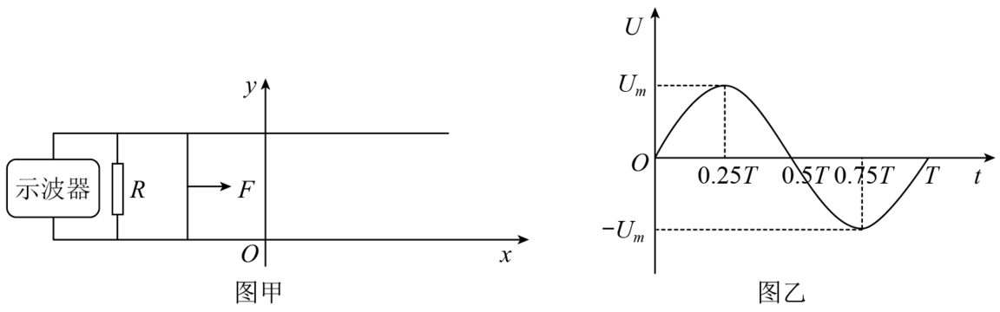

# Physics - 题目 2505

**ID**: aca95afd6c3541aa834d5d3c8e718a7c
**年级**: Grade 12
**难度**: Medium-Hard
**题型**: Calculation

## 题目
如图甲所示，在 $xOy$ 水平面内，固定放置着间距为l的两平行金属直导轨，其间连接有阻值为R的电阻，电阻两端连接示波器（内阻可视为无穷大），可动态显示电阻R两端的电压。​​​​​​​‌两导轨间存在大小为B、方向垂直导轨平面的匀强磁场。 $t=0$ 时一质量为m、长为l的导体棒在外力F作用下从 $x=x{{}_{0}}$ 。位置开始做简谐运动，观察到示波器显示的电压随时间变化的波形是如图乙所示的正弦曲线。取 $x{{}_{0}}=-\frac {U{{}_{m}}T}{2πBl}$ ，则简谐运动的平衡位置在坐标原点O。不计摩擦阻力和其它电阻，导体棒始终垂直导轨运动。（提示：可以用 $F-x$ 图象下的“面积”代表力F所做的功）（1）求导体棒所受到的安培力 $F{{}_{A}}$ 随时间t的变化规律；（2）求在0至0.25T时间内外力F的冲量；（3）若 $t=0$ 时外力 $F{{}_{0}}=1{\rm{N}},l=1{\rm{m}},T=2π{\rm{s}},m=1{\rm{k}}{\rm{g}},R=1{\rm{Ω}},U{{}_{{\rm{m}}}}=0.5{\rm{V}},B=0.5{\rm{T}}$ ，求外力与安培力大小相等时棒的位置坐标和速度。

## 解答

1. （1）由显示的波形可得
2. $U=U{{}_{{\rm{m}}}}{\sin}\frac {2π}{T}t$
3. $I=\frac {U{{}_{{\rm{m}}}}}{R}{\sin}\frac {2π}{T}t$
4. 安培力随时间变化规律：
5. $F{{}_{A}}=-BIl=-\frac {BlU{{}_{m}}}{R}{\sin}\frac {2π}{T}t$
6. （2）安培力的冲量：
7. $I{{}_{A}}=-BlΔq=-\frac {B{^{2}}\left |{x{{}_{0}}}\right |l{^{2}}}{R}$
8. 由动量定理，有：
9. $I{{}_{F}}+I{{}_{A}}=mv{{}_{{\rm{m}}}}$
10. 解得： $I{{}_{F}}=\frac {BlU{{}_{{\rm{m}}}}T}{2πR}+\frac {mU{{}_{{\rm{m}}}}}{Bl}$
11. （3）棒做简谐运动，有：
12. $F{{}_{A}}+F=-kx$
13. 当 $F{{}_{A}}=-F$ 时：
14. $x=0$
15. $v=\pm v{{}_{{\rm{m}}}}=\pm 1{\rm{m}}{\rm{/}}{\rm{s}}$
16. 当 $F{{}_{A}}=F$ 时，设 $x=x{^{\prime }}$ ， $v=v{^{\prime }}$
17. $F{{}_{A}}=-\frac {1}{2}kx{^{\prime }}$
18. $F{{}_{{\rm{0}}}}=-kx{{}_{{\rm{0}}}}$
19. $2x{^{\prime }}=v{^{\prime }}$
20. 根据动能定理：
21. $\frac {1}{2}mv{^{\prime 2}}=\frac {1}{2}k\left ({x{{}_{0}^{2}}-x{^{\prime 2}}}\right )$
22. 解得： $x{{}_{1}^{\prime }}=\frac {1}{\sqrt {5}}{\rm{m}}$ 和 $v{{}_{1}^{\prime }}=\frac {2}{\sqrt {5}}{\rm{m}}/{\rm{s}}$ ； $x{{}_{2}^{\prime }}=-\frac {1}{\sqrt {5}}{\rm{m}}$ 和 $v{{}_{2}^{\prime }}=-\frac {2}{\sqrt {5}}{\rm{m}}$

## 知识点

**中文**:
  - 安培力作用下的运动问题

**English**:
  - Motion under Ampere Force

---
