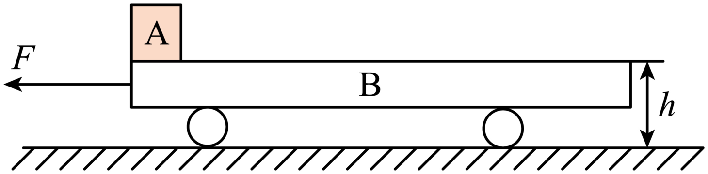

# Physics - 题目 1720

**ID**: b00bc6fbf7b04bc08295ba44a88311d4
**年级**: Grade 12
**难度**: Medium-Hard
**题型**: Calculation

## 题目
如图所示，质量为m_{A}=2kg的物块A和质量为m_{B}=4kg的小车B叠放在光滑的水平地面上，左边缘对齐，处于静止状态，A与B间的动摩擦因数为μ=0.​​​​​​​‌2．某时刻对小车B施加水平向左的恒力F．已知物块A可看作质点，小车长为L=2m，上表面距地面高度为h=0.2m，重力加速度g=10m/s^{2}.问：（1）水平恒力F_{0}至少为多大，物块A才能相对小车B滑动？（2）若恒力F_{1}=6N，物块A所受摩擦力f大小为多少？（3）若恒力F_{2}=16N，物块A落地时距小车B右边缘的水平距离s为多大？

## 解答

1. （1）物块A在小车B上即将发生相对滑动时，物块A所受摩擦力达到最大静摩擦力，对A由牛顿第二定律有： ${\rm μm}{{}_{{\rm{A}}}}g=m{{}_{{\rm{A}}}}a$
2. 代入数据得：a=2m/s^{2}；对A、B整体分析由牛顿第二定律有： $F{{}_{0}}=(m{{}_{{\rm{A}}}}+m{{}_{{\rm{B}}}})a$
3. 代入数据得：F_{0}=12N
4. （2）因为：F_{1}=6N<F_{0}
5. 所以此时物块A在小车B上没有发生相对滑动，A、B保持相对静止一起加速，物块A所受摩擦力为静摩擦力对A、B整体分析由牛顿第二定律有： $F{{}_{1}}=(m{{}_{{\rm{A}}}}+m{{}_{{\rm{B}}}})a{{}_{1}}$
6. 代入数据得：a_{1}=1m/s^{2}；对A分析由牛顿第二定律有： $f=m{{}_{{\rm{A}}}}a{{}_{1}}=2\times 1{\rm{N}}=2{\rm{N}}$
7. （3）因为：F_{2}=16N>F_{0}
8. 所以此时物块A在小车B上发生相对滑动，物块A和小车B都做匀加速直线运动，对A分析由牛顿第二定律有： $a{{}_{{\rm{A}}}}=\frac {{\rm μm}{{}_{{\rm{A}}}}g}{m{{}_{{\rm{A}}}}}=μg=2{\rm{m}}{\rm{/}}{\rm{s}}{^{{{2}}}}$
9. 对B分析由牛顿第二定律有： $F{{}_{2}}-{\rm μm}{{}_{{\rm{A}}}}g=m{{}_{{\rm{B}}}}a{{}_{{\rm{B}}}}$
10. 代入数据得：a_{B}=3m/s^{2}
11. 设物块A经时间t_{1}滑到小车B最右端，此时物块A和小车B的速度分别为v_{A}、v_{B}，在这个过程中物块A和小车B通过的位移分别为x_{A}、x_{B}，则有： $x{{}_{{\rm{A}}}}=\frac {1}{2}a{{}_{{\rm{A}}}}t{{}_{1}^{2}}$ ， $x{{}_{{\rm{B}}}}=\frac {1}{2}a{{}_{{\rm{B}}}}t{{}_{1}^{2}}$ ， $x{{}_{{\rm{B}}}}-x{{}_{{\rm{A}}}}=L$
12. 代入数据解得：t_{1}=2s，所以： $v{{}_{{\rm{A}}}}=a{{}_{{\rm{A}}}}t{{}_{1}}=2\times 2{\rm{m}}{\rm{/}}{\rm{s}}=4{\rm{m}}{\rm{/}}{\rm{s}}$ ， $v{{}_{{\rm{B}}}}=a{{}_{{\rm{B}}}}t{{}_{1}}=3\times 2{\rm{m}}{\rm{/}}{\rm{s}}=6{\rm{m}}{\rm{/}}{\rm{s}}$
13. 当物块A滑离小车B后，物块A做平抛运动，小车B以加速度 $a^{′}{{{}_{B}}}$ 继续做匀加速运动，物块A做平抛运动的时间由： $h=\frac {1}{2}gt{{}_{2}^{2}}$
14. 可得： $t{{}_{2}}=\sqrt {\frac {2h}{g}}=\sqrt {\frac {2\times 0.2}{10}}{\rm{s}}=0.2{\rm{s}}$
15. 所以物块A做平抛运动的水平位移： $x^{′}{{{}_{{\rm{A}}}}}=v{{}_{{\rm{A}}}}t{{}_{2}}=4\times 0.2{\rm{m}}=0.8{\rm{m}}$
16. 小车B的加速度： $a^{′}{{{}_{{\rm{B}}}}}=\frac {F{{}_{2}}}{m{{}_{{\rm{B}}}}}=\frac {16}{4}{\rm{m}}{\rm{/}}{\rm{s}}{^{{{2}}}}=4{\rm{m}}{\rm{/}}{\rm{s}}{^{{{2}}}}$
17. 小车B加速的位移： $x^{′}{{{}_{{\rm{B}}}}}=v{{}_{{\rm{B}}}}t{{}_{2}}+\frac {1}{2}a^{′}{{{}_{{\rm{B}}}}}t{{}_{2}^{2}}=6\times 0.2+\frac {1}{2}\times 4\times 0.2{^{2}}{\rm{m}}=1.28{\rm{m}}$
18. 物块A落地时距小车B右边缘的水平距离为： $s=x^{′}{{{}_{{\rm{B}}}}}-x^{′}{{{}_{{\rm{A}}}}}=1.28{\rm{m}}-0.8{\rm{m}}=0.48{\rm{m}}$
19. 答：（1）水平恒力F_{0}至少为12N，物块A才能相对小车B滑动.
20. （2）若恒力F_{1}=6N，物块A所受摩擦力f大小为2N.
21. （3）若恒力F_{2}=16N，物块A落地时距小车B右边缘的水平距离s为0.48m.

## 知识点

**中文**:
  - 板块模型

**English**:
  - Plate Model

---
