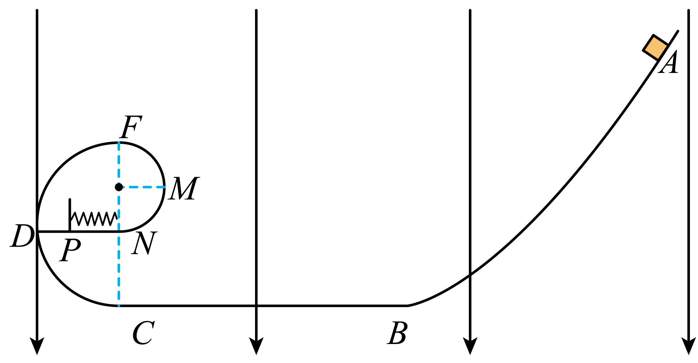

# Physics - 题目 2863

**ID**: b2578c0ef72748dba2479ad371b6de68
**年级**: Grade 12
**难度**: Medium-Hard
**题型**: Calculation

## 题目
如图所示，在竖直向下的匀强电场中有轨道 $ABCDFMNP$ ，其中 $BC$ 部分为水平轨道，与曲面 $AB$ 平滑连接。​​​​​​​‌ $CDF$ 和 $FMN$ 是竖直放置的半圆轨道，在最高点 $F$ 对接，与 $BC$ 在 $C$ 点相切。 $NP$ 为一与 $FMN$ 相切的水平平台， $P$ 处固定一轻弹簧。点 $D、N、P$ 在同一水平线上。水平轨道 $BC$ 粗糙，其余轨道均光滑，可视为质点的质量为 $m=0.02{\rm{k}}{\rm{g}}$ 的带正电的滑块从曲面 $AB$ 上某处由静止释放。已知匀强电场的场强 $E=2{\rm{N}}/{\rm{C}},BC$ 段长度 $L=1{\rm{m}}$ ， $CDF$ 的半径 $R=0.2{\rm{m}}$ ， $FMN$ 的半径 $r=0.1{\rm{m}}$ 。滑块带电量 $q=0.1{\rm{C}}$ ，滑块与 $BC$ 间的动摩擦因数 $μ=0.5$ ，重力加速度 $g=10{\rm{m}}/{\rm{s}}{^{2}}$ 。求：（1）若滑块恰好能通过 $F$ 点，求滑块释放点到水平轨道 $BC$ 的高度 $h{{}_{0}}$ ；（2）若滑块在整个运动过程中，始终不脱离轨道，且弹簧的形变始终在弹性限度内，求滑块释放点到水平轨道 $BC$ 的高度 $h$ 需要满足的条件。

## 解答

1. （1）滑块在 $F$ 点根据牛顿第二定律有 $mg+qE=m\frac {v{{}_{F}^{2}}}{R}$
2. 设滑块由 $h{{}_{0}}$ 处释放恰好通过 $F$ 点，对滑块从释放点至 $F$ 点这一过程由动能定理得 $\left ({mg+qE}\right )\left ({h{{}_{0}}-2R}\right )-μ\left ({mg+qE}\right )L=\frac {1}{2}mv{{}_{F}^{2}}$
3. 联立解得 $h{{}_{0}}=1{\rm{m}}$
4. （2）分类讨论
5. ①滑块第一次运动到 $D$ 点速度为零，对该过程由动能定理得 $\left ({mg+qE}\right )\left ({h{{}_{1}}-R}\right )-μ\left ({mg+qE}\right )L=0$
6. 解得 $h{{}_{1}}=0.7{\rm{m}}$ ，则当 $h⩽0.7{\rm{m}}$ 时，滑块不能过 $D$ 点，不脱离轨道。
7. ②滑块第一次进入圆轨道可以经过 $F$ 点，压缩弹簧被反弹，沿轨道 $PNMFDCBA$ 运动，再次返回后不过 $D$ 。滑块恰好可以经过 $F$ 点，由动能定理可得 $\left ({mg+qE}\right )\left ({h{{}_{2}}-2R}\right )-μ\left ({mg+qE}\right )L=\frac {1}{2}mv{{}_{F}^{2}}$
8. 根据牛顿第二定律 $mg+qE=m\frac {v{{}_{F}^{2}}}{R}$
9. 解得 $h{{}_{2}}=1{\rm{m}}$ ，则当 $h⩾1{\rm{m}}$ 时，滑块可以通过 $F$ 点。滑块再次返回刚好到 $D$ 点，有 $\left ({mg+qE}\right )\left ({h{{}_{3}}-R}\right )-μ\left ({mg+qE}\right )\cdot 3L=0$
10. 解得 $h{{}_{3}}=1.7{\rm{m}}$ ，则当 $h⩽1.7{\rm{m}}$ 时，滑块被弹簧反弹往复运动后不过 $D$ 点；综上，当 $1{\rm{m}}⩽h⩽1.7{\rm{m}}$ ，满足滑块始终不脱离轨道。
11. ③滑块第一次进入圆轨道可以经过 $F$ 点，压缩弹簧被反弹，第二次往复运动时满足滑块恰好可以经过 $F$ 点，由动能定理可得 $\left ({mg+qE}\right )\left ({h{{}_{4}}-2R}\right )-μ\left ({mg+qE}\right )\cdot 3L=\frac {1}{2}mv{{}_{F}^{2}}\,$
12. 解得 $h{{}_{4}}=2{\rm{m}}$ ，则当 $h⩾2{\rm{m}}$ 时，滑块可以两次通过 $F$ 点；滑块再次返回刚好到 $D$ 点，有 $\left ({mg+qE}\right )\left ({h{{}_{5}}-R}\right )-μ\left ({mg+qE}\right )\cdot 5L=0\,$
13. 解得 $h{{}_{5}}=2.7{\rm{m}}$ ，则当 $h⩽2.7{\rm{m}}$ 时，滑块被弹簧第二次反弹往复运动后不过 $D$ 点；综上 $2{\rm{m}}⩽h⩽2.7{\rm{m}}$ ，满足滑块始终不脱离轨道。
14. 以此类推，可得当 $h$ 满足 $k\,{\rm{m}}⩽h⩽\left ({0.7+k}\right ){\rm{m}}\left ({k=0,1,2,3\cdots }\right )$ ，滑块不脱离轨道。

## 知识点

**中文**:
  - 匀强电场
  - 应用动能定理求解多阶段、多过程问题

**English**:
  - Uniform Electric Field
  - Multi-stage/Multi-process Problems

---
