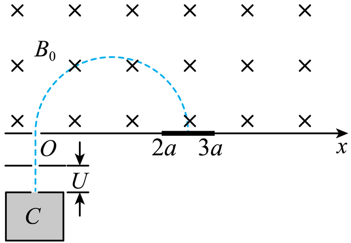

# Physics - 题目 610

**ID**: b2e73fa24a9c4e77be15fa3e547bd7f8
**年级**: Grade 12
**难度**: Medium-Hard
**题型**: Calculation

## 题目
如图所示，在 $x$ 轴的上方存在垂直纸面向里，磁感应强度大小为 $B{{}_{0}}$ 的匀强磁场。​​​​​​​‌位于 $x$ 轴下方的离子源 $C$ 发射质量为 $m$ ，电荷量为 $q$ 的一束负离子，其初速度大小范围 $0\sim \sqrt {3}v{{}_{0}}$ ，这束离子经电势差 $U=\frac {mv{{}_{0}^{2}}}{2q}$ 的电场加速后，从小孔 $O$ （坐标原点）垂直 $x$ 轴并垂直磁场射入磁场区域，最后打到 $x$ 轴上。在 $x$ 轴上 $2a\sim 3a$ 区间水平固定放置一探测板 $\left ({a=\frac {mv{{}_{0}}}{qB{{}_{0}}}}\right )$ ，假设每秒射入磁场的离子总数为 $N{{}_{0}}$ ，打到 $x$ 轴上的离子数均匀分布（离子重力不计）。(1)求离子束从小孔 $O$ 射入磁场后打到 $x$ 轴最远处位置（用含 $a$ 的物理量表示）；(2)调整磁感应强度的大小为 $B{{}_{1}}=\frac {4}{3}B{{}_{0}}$ ，可使速度最大的离子恰好打在探测板右端，求这种情况下每秒打在探测板上的离子数 $N$ ；(3)保持磁感应强度 $B{{}_{1}}$ 不变，若打在板上的离子 $80\%$ 被吸收， $20\%$ 被反向弹回，弹回速度大小为打板前速度大小的0.6倍，被吸收和被弹回的离子数在探测板上沿 $x$ 轴均匀分布，求探测板受到的作用力大小。

## 解答

1. （1）在加速电场中加速过程由动能定理得 $Uq=\frac {1}{2}mv{{}_{2}^{2}}-\frac {1}{2}mv{{}_{1}^{2}}$
2. 将 $U=\frac {mv{{}_{0}^{2}}}{2q}$ 、v_{1}=0、 $v{{}_{1}}=\sqrt {3}v{{}_{0}}$ 分别代入上式，得到离子进入磁场的最小和最大速度为：v_{min}=v_{0}、v_{max}=2v_{0}
3. 在磁场中洛伦兹力提供向心力： $qB{{}_{0}}v{{}_{2}}=\frac {mv{{}_{2}^{2}}}{r}$
4. 所以半径 $r=\frac {mv{{}_{2}}}{qB{{}_{0}}}$
5. 将最小速度和最大速度分别代入并跟 $a=\frac {mv{{}_{0}}}{qB{{}_{0}}}$ 进行对比得到最小半径和最大半径：r_{min}=a、r_{max}=2a
6. 所以打在x轴上的区间为2a～4a。即最远位置为4a。
7. （2）达到探测板最右端的粒子满足 $\frac {3a}{2}=\frac {mv{^{^{′}}}{{}_{2}}}{qB{{}_{1}}}$
8. 可得 $v{{}_{2}^{^{′}}}=2v{{}_{0}}$
9. 则速度最小的粒子到达的位置 $x=2\frac {mv{{}_{0}}}{B{{}_{1}}q}=1.5a$
10. 因打到 $x$ 轴上的离子数均匀分布，可知每秒打在探测板上的离子数 $N=\frac {N{{}_{0}}}{3a-1.5a}(3a-2a)=\frac {2}{3}N{{}_{0}}$
11. （3）若保持磁感应强度 $B{{}_{1}}=\frac {4}{3}B{{}_{0}}$ 不变，打在探测板的最左端的离子的运动半径等于a，对应离子的线速度等于 $\frac {4}{3}v{{}_{0}}$ 。
12. 打在探测板的最右端的离子的运动半径等于1.5a，对应离子的线速度等于2v_{0}。
13. 取时间t=1s，有N个离子打在探测板上，其中80%被吸收速度变为零，对这些离子探测板对它们的冲量使其动量变为零，由动量定理： $-F{{}_{1}}t=0-80\%Nm{\overline{v}}$
14. 将： ${\overline{v}}=\frac {\frac {4v{{}_{0}}}{3}+2v{{}_{0}}}{2}=\frac {5v{{}_{0}}}{3}，N=\frac {2}{3}N{{}_{0}}，t=1{\rm{s}}$
15. 代入得： $F{{}_{1}}=\frac {8}{9}N{{}_{0}}mv{{}_{0}}$
16. 同理：对20%被反向弹回的离子由动量定理得： $-F{{}_{2}}t=20\%Nm\left ({-0.6{\overline{v}}}\right )-20\%Nm\bar v$
17. 将： ${\overline{v}}=\frac {5v{{}_{0}}}{3}，N=\frac {2}{3}N{{}_{0}}，t=1{\rm{s}}$
18. 代入得 $F{{}_{2}}=\frac {16}{45}N{{}_{0}}mv{{}_{0}}$
19. 所以据牛顿第三定律探测板受到离子的冲击力为
20. $F^{′}=F{{}_{1}}+F{{}_{2}}=\frac {8}{9}N{{}_{0}}mv{{}_{0}}+\frac {16}{45}N{{}_{0}}mv{{}_{0}}=\frac {56}{45}N{{}_{0}}mv{{}_{0}}$

## 知识点

**中文**:
  - 质谱仪

**English**:
  - Mass Spectrometer

---
