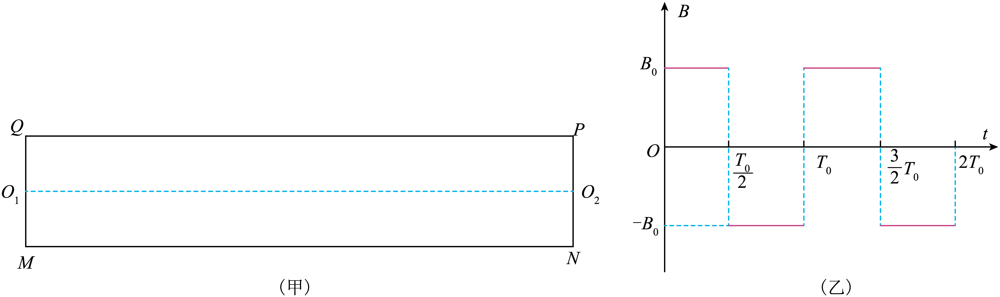

# Physics - 题目 335

**ID**: b2ef538247344f73b2487a0ea18fa972
**年级**: Grade 12
**难度**: Medium-Hard
**题型**: Calculation

## 题目
如图甲所示，矩形MNPQ位于竖直平面内，水平线 $O{{}_{1}}O{{}_{2}}$ 为矩形的一中心线，NP的长度为d，MN的长度为L，重力加速度为g。​​​​​​​‌某质量为m，电荷量为 $q\left ({q>0}\right )$ 的小球从 $O{{}_{1}}$ 点以初速度大小 $v{{}_{0}}$ 开始在矩形面内运动。（1）若小球初速度沿 $O{{}_{1}}O{{}_{2}}$ 方向向右，小球开始运动时，在矩形 $MNPQ$ 区域内加竖直向上的匀强电场，小球恰好从P点飞出矩形区域，求所加匀强电场场强的大小 $E{{}_{0}}$ ；（2）若小球初速度沿 $O{{}_{1}}O{{}_{2}}$ 方向向右，小球开始运动时，在矩形MNPQ区域内加竖直向上、场强大小为 $\frac {mg}{q}$ 的匀强电场，同时加上垂直于矩形区域向里的匀强磁场，小球恰好从PQ连线中点飞出矩形区域，求所加匀强磁场的磁感应强度大小B；（3）若小球初速度偏向右上方向，且与 $O{{}_{1}}O{{}_{2}}$ 成 $α=60{}^\circ $ ，小球开始运动时，在矩形MNPQ区域内加竖直向上、场强大小为 $\frac {mg}{q}$ 的匀强电场，同时在垂直于矩形区域方向加上按如图乙所示变化的匀强磁场，变化周期 $T{{}_{0}}=\frac {4πm}{3qB{{}_{0}}}$ （取垂直于矩形区域向外为正方向），小球恰能从 $O{{}_{2}}$ 点飞出矩形区域，求所加磁场磁感应强度大小 $B{{}_{0}}$ 应满足的条件和小球在矩形区域运动的时间。

## 解答

1. （1）小球在矩形 $MNPQ$ 区域内做类平抛运动，设运动的加速度为a，在矩形区域中运动时间 $t{{}_{0}}=\frac {L}{v{{}_{0}}}$ ，在竖直方向有 $\frac {d}{2}=\frac {1}{2}at{{}_{0}^{2}}$ ，由牛顿第二定律有 $qE{{}_{0}}-mg=ma$ ，解得 $E{{}_{0}}=\frac {m}{q}\left ({g+\frac {dv{{}_{0}^{2}}}{L{^{2}}}}\right )$
2. （2）小球受到的电场力 $F=qE=mg$ ，则小球受到的合力即洛伦兹力，在矩形区域中做匀速圆周运动，如图所示，设圆周运动半径为r，由几何关系有 $r{^{2}}={\left({\frac {L}{2}}\right)^{2}}+{\left({r-\frac {d}{2}}\right)^{2}}$
3. 
4. 由向心力公式有 $qv{{}_{0}}B=\frac {mv{{}_{0}^{2}}}{r}$ ，解得 $B=\frac {4dmv{{}_{0}}}{q\left ({d{^{2}}+L{^{2}}}\right )}$
5. （3）小球在矩形区域中做匀速圆周运动，设运动的轨道半径为 $r^{′}$ ，则有 $qv{{}_{0}}B{{}_{0}}=\frac {mv{{}_{0}^{2}}}{r^{′}}$
6. 
7. 为使小球不从MN、PQ边缘飞出，应满足 $r^{′}{\leqslant }d$ ，小球在矩形区域运动的周期 $T=\frac {2}{3}\cdot \frac {2πm}{qB{{}_{0}}}=T{{}_{0}}$ ，为使小球恰能从 $O{{}_{2}}$ 点飞出矩形区域，应满足的关系是 $L=k\sqrt {3}r^{′}{\left ({k=1，2，3\cdot \cdot \cdot \cdot \cdot \cdot }\right )}$ ，解得 $B{{}_{0}}=\frac {\sqrt {3}kmv{{}_{0}}}{qL}$ （其中k取 $k\geqslant \frac {\sqrt {3}L}{3d}$ 的整数），小球在矩形区域运动的时间 $t=\frac {kT{{}_{0}}}{2}$ ，解得 $t=\frac {2\sqrt {3}πL}{9v{{}_{0}}}$

## 知识点

**中文**:
  - 带电粒子在周期性变化的电磁场中的运动

**English**:
  - Motion in Periodically Varying EM Fields

---
