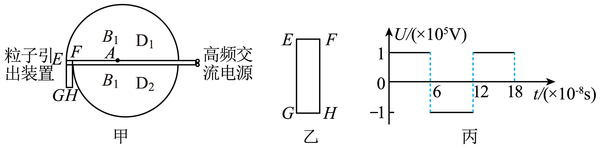

# Physics - 题目 416

**ID**: b7526a21e28b40bd85b7dd9ed2e89d60
**年级**: Grade 12
**难度**: Medium-Hard
**题型**: Calculation

## 题目
氦是宇宙中丰度第二高的元素，氦核是受控核聚变研究过程中的主要产物之一，如2个 ${{}_{2}^{3}}{\rm{H}}{\rm{e}}$ 聚变生成1个 ${{}_{2}^{4}}{\rm{H}}{\rm{e}}$ 和两个X，研究氦核对于核物理发展有很高的价值。​​​​​​​‌如图甲为一回旋加速器的示意图，其核心部分为两个D形盒，D形盒中有匀强磁场，方向垂直纸面向里，磁感应强度的大小为 $B{{}_{1}}=1{\rm{T}}$ ，两D形盒之间接高频交流电源，电压如图丙所示。两D形盒之间为匀强电场．两D形盒的距离为d=1cm，D形盒的半径为1.2m，在 ${\rm{D}}{{}_{1}}$ 盒的边缘放有位置可左右调节的粒子源A。粒子为氦核，初速度很小，可忽略不计．在 ${\rm{D}}{{}_{1}}$ 盒的左侧有一个粒子引出装置EFHG（局部图如图乙）。氦核比荷 $\frac {q}{m}=\frac {1}{2}\times 10{^{8}}{\rm{C}}{\rm{/}}{\rm{k}}{\rm{g}}$ ，取 ${\rm{π}}=3$ ，整个装置在真空中，不考虑粒子间的相互作用及相对论效应等因素。（1）已知 ${{}_{2}^{3}}{\rm{H}}{\rm{e}}$ 的质量为3. ${\rm 0150u，}{{}_{2}^{4}}{\rm{H}}{\rm{e}}$ 的质量为4.0026u，副产物X的质量为1.0079u，1u相当于931MeV的能量，试写出 ${{}_{2}^{3}}{\rm{H}}{\rm{e}}$ 生成 ${{}_{2}^{4}}{\rm{H}}{\rm{e}}$ 的核反应方程并计算反应中释放的核能（结果保留三位有效数字）；（2）在 $0\sim 6\times 10{^{-8}}{\rm{s}}$ 时间内，粒子源随时间均匀地放出N个粒子，t=0时刻的粒子恰好在电场中加速40次到达EF处被引出，粒子在电场中运动的时间不可忽略，只有每次通过电场时都一直加速的粒子才能到达引出装置并被引出，求被引出粒子的个数 $N^{′}$ ；（3）A到F的距离可调节，但粒子在磁场中运动的轨迹半径不能大于1.0m．只有每次通过电场时都一直加速的粒子才能到达引出装置，且粒子在最后两次从电场回到 ${\rm{D}}{{}_{1}}$ 下边界时的距离要不小于1cm才能顺利引出（取 $\sqrt {n}-\sqrt {n-1}=\frac {1}{2\sqrt {n}}$ ），求被引出的粒子能够获得的最大动能为多少？

## 解答

1. （1）根据质量数和电荷数守恒可知该核反应方程为
2. $2{{}_{2}^{3}}{\rm{H}}{\rm{e}}\to {{}_{2}^{4}}{\rm{H}}{\rm{e}}+2{{}_{1}^{1}}{\rm{H}}$
3. 释放的核能为
4. $\Delta E=\Delta m\cdot c{^{2}}=\left ({2\times 3.0150-4.0026-2\times 1.0079}\right )\times 931{\rm{M}}{\rm{e}}{\rm{V}}\approx 10.8{\rm{M}}{\rm{e}}{\rm{V}}$
5. （2）带电粒子在D形盒中运动的周期
6. $T=\frac {2πm}{qB{{}_{1}}}=1.2\times 10{^{-7}}{\rm{s}}$
7. 带电粒子在电场中加速时的加速度
8. $a=\frac {qU}{md}=5\times 10{^{14}}{\rm{m}}{\rm{/}}{\rm{s}}{^{{{2}}}}$
9. 根据回旋加速器的性质可知粒子通过电场时会一直加速，设加速总时间为t，则
10. $40d=\frac {1}{2}at{^{2}}$
11. 解得
12. $t=4\times 10{^{-8}}{\rm{s}}$
13. 所以在 $0\sim 6\times 10{^{-8}}{\rm{s}}$ 的时间内均匀地放出的N个粒子，只有 $0\sim 2\times 10{^{-8}}{\rm{s}}$ 内放出的粒子每次通过电场能够一直加速，可得
14. $N^{′}=\frac {1}{3}N$
15. （3）①粒子能够一直加速要求 $t{{}_{1}}<\frac {T}{2}$ ，有
16. $nd=\frac {1}{2}at{{}_{1}^{2}}<\frac {1}{2}a{\left({\frac {T}{2}}\right)^{2}}$
17. 解得
18. $n<90$
19. 即 $n{{}_{{\rm \max }}}=89$
20. ②最大半径不能大于1m，根据洛伦兹力提供向心力，有
21. $qvB{{}_{1}}=m\frac {v{^{2}}}{R}$
22. 根据动能定理有
23. $nqU=\frac {1}{2}mv{^{2}}$
24. 解得
25. $R=\frac {1}{B{{}_{1}}}\sqrt {\frac {2nmU}{q}}⩽1{\rm{m}}$ ，
26. 解得
27. $n⩽250$
28. 即 $n{{}_{{\rm \max }}}=250$
29. ③最后两次回到 $D{{}_{1}}$ 下边界的距离
30. $\Delta d=2\frac {1}{B{{}_{1}}}\sqrt {\frac {2mU}{q}}\left ({\sqrt {n}-\sqrt {n-1}}\right )=\frac {1}{B{{}_{1}}}\sqrt {\frac {2mU}{q}}\frac {1}{\sqrt {n}}⩾1\times 10{^{-2}}{\rm{m}}$
31. 解得
32. $n⩽40$
33. 即 $n{{}_{{\rm \max }}}=40$
34. 综合以上三种情况，n的量大取值为40，所以
35. $E{{}_{{\rm{k}}{\rm{m}}}}=40\times 2eU=8\times 10{^{6}}{\rm{e}}{\rm{V}}$

## 知识点

**中文**:
  - 带电粒子在周期性变化的电磁场中的运动

**English**:
  - Motion in Periodically Varying EM Fields

---
