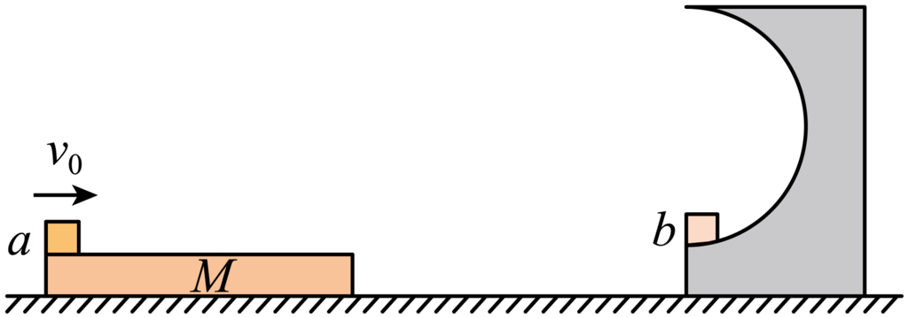

# Physics - 题目 10

**ID**: b8006f9f48ad456985f10fa548e41997
**年级**: Grade 12
**难度**: Medium-Hard
**题型**: Calculation

## 题目
如图，光滑水平面上静置一质量 $M=2{\rm{k}}{\rm{g}}$ 、长 $L{{}_{1}}=3.32{\rm{m}}$ 的长木板，在长木板右侧某位置固定一光滑绝缘的竖直半圆轨道，半径 $R=0.5{\rm{m}}$ ，半圆轨道下端与长木板上表面齐平，竖直直径右侧区域存在竖直方向的匀强电场，在半圆轨端静置一质量 $m{{}_{2}}=2{\rm{k}}{\rm{g}}$ 、电荷量 $q=+0.01{\rm{C}}$ 的小物块 $b$ 。​​​​​​​‌质量 $m{{}_{1}}=1{\rm{k}}{\rm{g}}$ 的小物块a从长木板左端以 $v{{}_{0}}=3{\rm{m}}{\rm{/}}{\rm{s}}$ 的水平速度冲上长木板，物块a与长木板的动摩擦因数 $μ=0.1$ 。长木板与半圆轨道相撞前已与物块a共速，碰撞后长木板瞬间停止。已知物块a、b间发生弹性碰撞且物块b电荷量不变，之后小物块b在半圆轨道内运动过程中对轨道各点的压力大小均相等。g取 $10{\rm{m}}{\rm{/}}{\rm{s}}{^{{\rm{2}}}}$ ，求：（1）匀强电场的场强大小和方向；（2）物块b在半圆轨道内运动的时间。

## 解答

1. （1）由题意，小物块b在半圆轨道内运动过程中对轨道各点的压力大小均相等，可知小物块在半圆轨道内做匀速圆周运动，向心力由半圆轨道对小物块的支持力提供，则可以确定电场力大小等于物块的重力大小，且方向相反，即 $Eq=m{{}_{2}}g$ ，解得 $E=\frac {m{{}_{2}}g}{q}=\frac {2\times 10}{0.01}{\rm{V}}{\rm{/}}{\rm{m}}=2000{\rm{V}}{\rm{/}}{\rm{m}}$ ，方向竖直向上；
2. （2）设小木块和长木板达到共速时速度为 $v{{}_{1}}$ ，则由动量守恒定律可得 $m{{}_{1}}v{{}_{0}}=(m{{}_{1}}+M)v{{}_{1}}$ ，解得 $v{{}_{1}}=1{\rm{m}}{\rm{/}}{\rm{s}}$ ，设此时小木块的对地位移为 $x{{}_{1}}$ ，长木版的对地位移为 $x{{}_{2}}$ ，小木块和长木板共速时距离右端的距离为 $s$ ，则对小木块和长木版分别由动能定理可得 $-{\rm μm}{{}_{1}}gx=\frac {1}{2}m{{}_{1}}v{{}_{1}^{2}}-\frac {1}{2}m{{}_{1}}v{{}_{0}^{2}}$ ， ${\rm μm}gx{{}_{2}}=\frac {1}{2}Mv{{}_{1}^{2}}$ ，解得 $x{{}_{1}}=4{\rm{m}}$ ， $x{{}_{2}}=1{\rm{m}}$ ，则可得 $s=L{{}_{1}}-(x{{}_{1}}-x{{}_{2}})=0.32{\rm{m}}$ ，与半圆形轨道碰撞后长木板瞬间停止，则此刻开始小木块做匀减速运动，直至与小物块 $a$ 与放在半圆轨道最低点的物块 $b$ 发生弹性碰撞，设小物块 $a$ 与物块 $b$ 发生碰撞前的速度为 $v{{}_{2}}$ ，碰撞后物块 $a$ 的速度为 $v^{′}{{{}_{2}}}$ ，物块 $b$ 的速度为 $v{{}_{3}}$ ，则由运动学公式可得 $v{{}_{1}^{2}}-v{{}_{2}^{2}}=2as$ ， $a=μg={\rm{1}}{\rm{m}}{\rm{/}}{\rm{s}}{^{{\rm{2}}}}$ ，解得 $v{{}_{2}}=0.6{\rm{m}}{\rm{/}}{\rm{s}}$ ，由动量守恒定律和机械能守恒可得 $m{{}_{1}}v{{}_{2}}=m{{}_{1}}v^{′}{{{}_{2}}}+m{{}_{2}}v{{}_{3}}$ ， $\frac {1}{2}m{{}_{1}}v{{}_{2}^{2}}=\frac {1}{2}m{{}_{1}}v^{′}{{{}_{2}^{2}}}+\frac {1}{2}m{{}_{2}}v{{}_{3}^{2}}$ ，解得 $v^{′}{{{}_{2}}}=-0.2{\rm{m}}{\rm{/}}{\rm{s}}$ ， $v{{}_{3}}=0.4{\rm{m}}{\rm{/}}{\rm{s}}$ ，设物块 $b$ 在半圆轨道内运动的时间为 $t$ ，则可知 $t=\frac {1}{2}\cdot \frac {2{\rm{π}}R}{v}{\rm{s}}=\frac {5{\rm{π}}}{4}{\rm{s}}$ 。

## 知识点

**中文**:
  - 动量与牛顿定律的综合考查
  - 动量和能量的综合应用

**English**:
  - Integration of Momentum and Newton's Laws
  - Integration of Momentum and Energy

---
