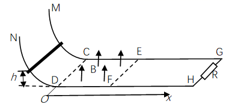

# Physics - 题目 2772

**ID**: bba8408723504424bea7fe99b7f215ed
**年级**: Grade 12
**难度**: Medium-Hard
**题型**: Calculation

## 题目
如图所示，CEG、DFH是两条足够长的、水平放置的平行金属导轨，导轨间距为L，在CDFE区域存在垂直于导轨平面向上的有界匀强磁场，磁感应强度大小为B，导轨的右端接有一阻值为R的电阻，左端与光滑弯曲轨道MC、ND平滑连接。​​​​​​​‌现将一阻值为R，质量为m的导体棒从弯曲轨道上h高处由静止释放，导体棒最终恰停在磁场的右边界EF处。金属导轨电阻不计，EF左侧导轨光滑，右侧导轨粗糙，与导体棒间动摩擦因数为μ。建立原点位于磁场左边界CD、方向沿导轨向右的坐标轴x，已知导体棒在有界磁场中运动的速度随位移均匀变化，即满足关系式： $v=v{{}_{0}}-\frac {B{^{2}}L{^{2}}}{2mR}x$ ，v_{0}为导体棒进入有界磁场的初速度。求：(1)有界磁场区域的宽度d；(2)导体棒运动到 $x=\frac {d}{2}$ 加速度a；(3)若导体棒从弯曲轨道上4h高处由静止释放，则导体棒最终的位置坐标x和这一过程中导体棒上产生的焦耳热Q。

## 解答

1. (1)导体棒在弯曲轨道上下滑，机械能守恒，有
2. $mgh=\frac {1}{2}mv{{}_{0}^{2}}$
3. $v{{}_{0}}=\sqrt {2gh}$
4. 导体棒由CD到EF，有
5. $0=v{{}_{0}}-\frac {B{^{2}}L{^{2}}}{2mR}d$
6. $d=\frac {2mR}{B{^{2}}L{^{2}}}\sqrt {2gh}$
7. (2)导体棒运动到
8. $x=\frac {d}{2}$ 处
9. 速度为 $v{{}_{1}}$ ，则
10. $v{{}_{1}}=v{{}_{0}}-\frac {B{^{2}}L{^{2}}}{2mR}\cdot \frac {d}{2}$
11. 联立上式，得
12. $v{{}_{1}}=\frac {v{{}_{0}}}{2}=\frac {\sqrt {2gh}}{2}$
13. 又
14. $F{{}_{安}}{\rm{=}}BIL$
15. $I=\frac {BLv{{}_{1}}}{2R}$
16. 导体棒的加速度
17. $a=\frac {F{{}_{安}}}{m}=\frac {B{^{2}}L{^{2}}}{4mR}\sqrt {2gh}$
18. 方向沿x轴负方向。
19. (3)导体棒在弯曲轨道上下滑，有
20. $mg\cdot 4h=\frac {1}{2}mv{{}_{0}}{^{\prime }}{^{2}}$
21. $v{{}_{0}}{^{\prime }}=2\sqrt {2gh}$
22. 导体棒运动到EF处，速度为 $v{{}_{2}}$ ，则
23. $v{{}_{2}}=v{{}_{0}}{^{\prime }}-\frac {B{^{2}}L{^{2}}}{2mR}d=\sqrt {2gh}$
24. 后在粗糙轨道上减速滑行，加速度为
25. $a{{}_{1}}=\frac {mgμ}{m}=gμ$
26. $v{{}_{2}^{2}}=2a{{}_{1}}(x-d)$
27. $x=\frac {v{{}_{2}^{2}}}{2a{{}_{1}}}+d=\frac {h}{μ}+\frac {2mR}{B{^{2}}L{^{2}}}\sqrt {2gh}$
28. 导体棒在有界磁场中运动，速度从 $v{{}_{0}}{^{\prime }}$ 减小到 $v{{}_{2}}$ ，克服安培力做功为
29. $W=\frac {1}{2}mv{{}_{0}}{^{\prime }}{^{2}}-\frac {1}{2}mv{{}_{2}^{2}}=3mgh$
30. 此过程中电阻R上产生的焦耳热为
31. $Q=\frac {I{^{2}}Rt}{I{^{2}}\cdot 2Rt}\cdot W=\frac {3}{2}mgh$

## 知识点

**中文**:
  - 单杆模型
  - 电磁感应现象中的功能问题

**English**:
  - Single Rod Model
  - Work-Energy Problems in EM Induction

---
