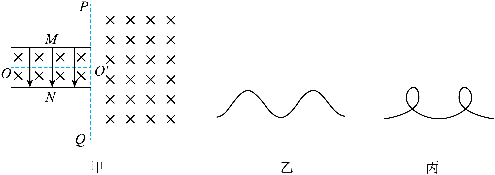

# Physics - 题目 946

**ID**: bc10fb92b1544793a3e443ac4988c6d0
**年级**: Grade 12
**难度**: Medium-Hard
**题型**: Calculation

## 题目
质谱仪是用于测量带电粒子比荷的仪器，其结构可看作是PQ左侧的速度选择器和右侧的匀强磁场组成（如图甲）。​​​​​​​‌左侧两极板间有匀强电场E和匀强磁场B，方向如图所示，电场强度E=8×10^{3}V/m，磁感应强度均为B=0.1 T，两板的长度L可调，距离d足够大，OO′是电磁场的中心轴线。（sin37°=0.6）（1）有一束离子束刚好能沿着OO′直线穿过电磁场区域后进入PQ右侧磁场，返回PQ时在O′点上方1.6 m处，则离子带正电还是负电？离子运动速度大小是多少？离子比荷是多大？（2）当L=1.6π米时，发现上述离子速度在一定范围内变化时，都能从O′点离开电磁场区，且用时不变，求这个时间t。（3）改变上述离子进入电磁场的速度，离子在电磁场中运动的轨迹会不同，有的轨迹如图乙，有的轨迹如图丙，当离子以1.4×10^{5}m/s的速度从O点进入电磁区域，将从O′点上方0.6m处进入PQ右侧磁场区，求这个离子在PQ右侧运动的时间。

## 解答

1. （1）由左手定则，粒子带正电，根据 $qE=qv{{}_{0}}B$ ，解得 $v{{}_{0}}=\frac {E}{B}=8\times 10{^{4}}{\rm{m}}/{\rm{s}}$ ，粒子在磁场中由洛伦兹力提供向心力可得 $qv{{}_{0}}B=m\frac {v{{}_{0}^{2}}}{R}$ ，其中 $R=0.8{\rm{m}}$ ，解得 $\frac {q}{m}=10{^{6}}{\rm{C}}/{\rm{k}}{\rm{g}}$ 。
2. （2）设离子进出电磁场区过程，沿电场方向的速度变化量为Δv_{y}，所用时间为t，由动量定理得 $qEt=m{\rm{Δ}}v{{}_{y}}$ ， $qBL=m{\rm{Δ}}v{{}_{y}}$ ，解得 $t=\frac {BL}{E}=2{\rm{π}}\times 10{^{-5}}{\rm{s}}$ 。
3. （3）设离子进入PQ右侧磁场区时的速度大小为v_{1}，由动能定理得 $-qEy=\frac {1}{2}mv{{}_{1}^{2}}-\frac {1}{2}mv^{′}{{{}_{0}^{2}}}$ ，解得 $v{{}_{1}}=10{^{5}}{\rm{m}}/{\rm{s}}$ ，设离子进入PQ右侧磁场区时速度沿OO′直线的分速度大小为v_{x}，由动量定理得 $-qBy=mv{{}_{x}}-mv^{′}{{{}_{0}}}$ ，解得 $v{{}_{x}}=8\times 10{^{4}}{\rm{m}}/{\rm{s}}$ ，设离子进入PQ右侧时速度与水平方向夹角为θ，则有 ${\cos}θ=\frac {v{{}_{x}}}{v{{}_{1}}}$ ，解得 $θ=37{}\degree $ ，结合图乙和图丙可知，离子进入PQ右侧时速度与水平方向夹角为37°斜向上或37°斜向下，离子进入PQ右侧后将做匀速圆周运动，洛伦兹力提供向心力，则 $qv{{}_{1}}B=m\frac {v{{}_{1}^{2}}}{r}$ ， $T=\frac {2{\rm{π}}r}{v{{}_{1}}}=\frac {2{\rm{π}}m}{qB}=2\mathrm{π}\times 10{^{-5}}{\rm{s}}$ ，由几何关系得 $t{{}_{1}}=\frac {180{}\degree -2\times 37{}\degree }{360{}\degree }T=\frac {53}{90}{\rm{π}}\times 10{^{-5}}{\rm{s}}$ ， $t{{}_{2}}=\frac {180{}\degree +2\times 37{}\degree }{360{}\degree }T=\frac {127}{90}\mathrm{π}\times 10{^{-5}}{\rm{s}}$ ，这个离子在PQ右侧运动的时间为 $t{{}_{1}}=\frac {53}{90}{\rm{π}}\times 10{^{-5}}{\rm{s}}$ 或 $t{{}_{2}}=\frac {127}{90}{\rm{π}}\times 10{^{-5}}{\rm{s}}$ 。

## 知识点

**中文**:
  - 质谱仪

**English**:
  - Mass Spectrometer

---
