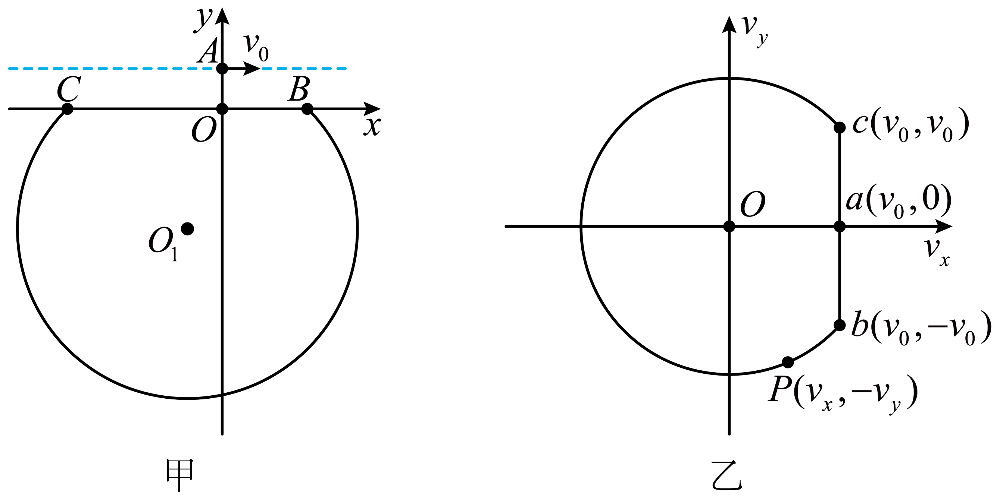

# Physics - 题目 584

**ID**: bc2f7b0ab49f48e8bb5507540da99460
**年级**: Grade 12
**难度**: Medium-Hard
**题型**: Calculation

## 题目
如图甲所示，平面直角坐标系 $xOy$ 中， $0⩽y⩽L$ 的范围内有场强大小和方向均未知的匀强电场，一质量为 $m$ 、电荷量为 $+q$ 的带电粒子（可视为点电荷与质点）从点 $A\left ({0，L}\right )$ 处飞出，其在之后一段过程内的速度可用如图乙所示的图像中动点 $P\left ({v{{}_{x}}，v{{}_{y}}}\right )$ 表示，其中 $v{{}_{x}}、v{{}_{y}}$ 分别为粒子在图甲中沿 $x$ 轴和 $y$ 轴方向的速度分量。​​​​​​​‌甲图中粒子在A点出发时，乙图中的P点位于 $a\left ({v{{}_{0}}，0}\right )$ ，粒子在电场力作用下由A运动到B的过程中，乙图的 $P$ 点由 $a$ 沿线段 $ab$ 运动到 $b\left ({v{{}_{0}}，-v{{}_{0}}}\right )$ ；随后粒子从 $B$ 点离开电场，立刻沿切线进入 $x$ 轴下方的一条固定光滑圆弧轨道并沿轨道运动至 $C$ 点，该过程中图乙的 $P$ 点沿以 $O$ 为圆心的圆弧从 $b$ 移动至 $c\left ({v{{}_{0}}，v{{}_{0}}}\right )$ ；之后粒子离开轨道返回电场， $P$ 点沿线段 $ca$ 回到 $a$ 点，后续的运动过程不再在图乙中表示，已知任意相等时间内 $P$ 点沿图乙中闭合曲线通过的曲线长度都相等，不计重力，图甲中 $O{{}_{1}}$ 为圆弧轨道的圆心，坐标未知。（1）求电场强度 $E$ 的大小和方向；（2）求图甲中 $x$ 轴下方圆弧轨道的半径大小；（3）若粒子在后续运动中与轨道的碰撞均满足∶“沿轨道切线方向速度在碰撞前后保持不变，沿轨道半径方向的速度在碰撞前后等大反向”，求图甲中粒子从A点出发到第一次返回A点所需的时间。

## 解答

1. （1）粒子从A运动到B的过程中，其速度在图乙中从a沿线段ab变化到b，该过程中v_{x}保持不变始终为v_{0}，则电场力方向与x轴相互垂直，又因为v_{y}从0变为-v_{0}，则电场力方向沿y轴负方向。由上可知粒子在AB间作类平抛运动，如图1所示：
2. 
3. 对B点速度正交分解并结合图乙的b点可知 $L=\frac {v{{}_{y}^{2}}}{2a}=\frac {v{{}_{0}^{2}}}{2a}$ ，又因为 $a=\frac {qE}{m}$ ，解得 $E=\frac {mv{{}_{0}^{2}}}{2qL}$ 。
4. （2）因为P点沿图乙中闭合曲线，通过的曲线长度就是粒子在对应过程中的速度变化量 $Δv$ ，且已知任意相等时间内P点沿图乙中闭合曲线通过的曲线长度都相等，即 $\frac {Δv}{Δt}$ 为定值，粒子在圆弧轨道内做匀速圆周运动的向心加速度与其在AB间作类平抛运动的加速度大小相等，即 $\frac {v{{}_{B}^{2}}}{R}=\frac {qE}{m}$ ，其中R为圆弧轨道的半径，由图乙可知 $v{{}_{B}}=\sqrt {v{{}_{x}^{2}}+v{{}_{y}^{2}}}=\sqrt {2}v{{}_{0}}$ ，解得R=4L。
5. （3）由乙图可知，粒子从C点回到电场后，在电场中的运动可分解为x轴方向上的匀速直线运动（速度大小为v_{0}）和y轴方向上的匀变速直线运动（初速度v_{0}沿正方向，加速度 $a=\frac {qE}{m}$ ，沿负方向），其在电场中运动的最大高度 $h{{}_{{\rm{m}}}}=\frac {v{{}_{0}^{2}}}{2a}=L$ ，恰好不离开电场，重新离开电场的位置（F点）到C点的距离 $Δx{{}_{CF}}=v{{}_{0}}t^{′}$ ，且 $t^{′}=2\times \frac {v{{}_{0}}}{a}$ ，解得 $Δx{{}_{CF}}=4L$ ，根据对称性，从F点再次离开时的速度大小为 $v{{}_{F}}=\sqrt {v{{}_{0}^{2}}+v{{}_{0}^{2}}}=\sqrt {2}v{{}_{0}}$ ，与x轴正方向成 $θ{\rm =45°}$ ，此后粒子做匀速直线运动如图2所示，
6. 
7. 过F点作 $v{{}_{F}}$ 的延长线交圆弧轨道于G点，根据圆的对称性可知∠O_{1}BC=∠O_{1}CB=45°，易知四边形FGO_{1}C为菱形，即∠FGO_{1}=45°，根据题意，粒子在G点与轨道发生弹性碰撞后的运动轨迹与圆弧轨道的交点H满足∠O_{1}GH=∠FGO_{1}=45°，同理可知粒子还会与圆弧轨道在I点相撞最后从J点返回电场，且 $l{{}_{GH}}=l{{}_{HI}}=\sqrt {2}R=4\sqrt {2}L$ ， $l{{}_{FG}}=l{{}_{IJ}}=R=4L$ ， $v{{}_{Jx}}=v{{}_{Jy}}=v{{}_{0}}$ ， $v{{}_{J}}$ 与x轴正方向成45°角，根据对称性 $Δx{{}_{CJ}}=Δx{{}_{BF}}=\sqrt {2}R-Δx{{}_{CF}}=4\left ({\sqrt {2}-1}\right )L{\rm ，\mathit{J}}$ 点横坐标为 $x{{}_{J}}=x{{}_{C}}+Δx{{}_{CJ}}=-2L$ ，其中 $x{{}_{C}}=-\left ({\sqrt {2}R-x{{}_{B}}}\right )=-\left ({4\sqrt {2}-2}\right )L$ ，曲线AB与JA对称，粒子从J返回电场后做类斜抛运动恰好回到A点，粒子从A点出发再回到A点的轨迹可分为三部分：4段对称的抛物线、1段圆弧、4段直线段。其总时间为 $t=4\times t{{}_{AB}}+t{{}_{BC}}+2\left ({t{{}_{FG}}+t{{}_{GH}}}\right )=4\times \frac {x{{}_{B}}}{v{{}_{0}}}+\frac {\frac {3}{4}\times 2\mathrm{π}R}{\sqrt {2}v{{}_{0}}}+2\times \left ({\frac {R}{\sqrt {2}v{{}_{0}}}+\frac {\sqrt {2}R}{\sqrt {2}v{{}_{0}}}}\right )=\left ({16+4\sqrt {2}+3\sqrt {2}\mathrm{π}}\right )\frac {L}{v{{}_{0}}}$ 。

## 知识点

**中文**:
  - 运动的合成与分解

**English**:
  - Composition and Resolution of Motion

---
