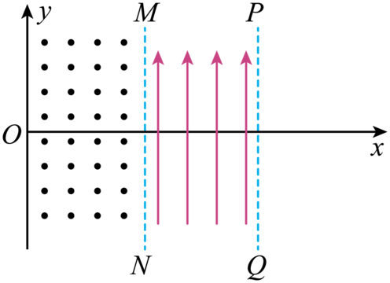

# Physics - 题目 1975

**ID**: bcd1a48903bb4d8988768513f2ee7191
**年级**: Grade 12
**难度**: Medium-Hard
**题型**: Calculation

## 题目
在如图所示的直角坐标系xOy中，虚线MN、PQ为垂直于xOy平面的界面，两界面均与y轴平行，y轴与MN之间存在垂直于xOy平面向外的匀强磁场，磁感应强度大小为B；MN、PQ之间存在沿y轴正方向的匀强电场；PQ右侧存在匀强磁场和匀强电场（图中均未画出），方向均沿x轴正方向，磁场的磁感应强度大小也为B。​​​​​​​‌某时刻一带负电的粒子自坐标原点O沿x轴正方向射出，第一次经过MN时的坐标为（L， $\frac {\sqrt {3}}{3}L$ ），先后两次经过PQ时的坐标均为（2L， $\frac {\sqrt {3}}{3}L$ ）。已知粒子的质量为m、电荷量为 $-q$ ，不计粒子的重力。求：(1)粒子的初速度大小；(2)MN、PQ间电场的电场强度大小；(3)PQ右侧电场的电场强度大小。

## 解答

1. （1）粒子第一次在磁场中运动时，由几何关系有 $R{{}_{{{1}}}^{2}}=L{^{2}}+{\left({R{{}_{1}}-\frac {\sqrt {3}}{3}L}\right)^{2}}$ ，由洛伦兹力提供向心力有 $qv{{}_{0}}B=\frac {mv{{}_{0}^{2}}}{R{{}_{1}}}$ ，联立解得粒子的初速度大小 $v{{}_{0}}=\frac {2\sqrt {3}qBL}{3m}$ 。
2. （2）粒子第一次经过MN时的坐标为（L， $\frac {\sqrt {3}}{3}L$ ），根据几何关系可知粒子经过MN时速度方向与x轴正方向的夹角为60°。粒子在MN、PQ间运动时，经过PQ时的坐标为（2L， $\frac {\sqrt {3}}{3}L$ ），则有 $L=v{{}_{0}}{\cos}60{}\degree \cdot t{{}_{1}}$ ， $0=v{{}_{0}}\sin 60{}\degree -a{{}_{1}}\cdot \frac {t{{}_{1}}}{2}$ ，又 $qE{{}_{1}}=ma{{}_{1}}$ ，联立解得MN、PQ间电场的电场强度大小 $E{{}_{1}}=\frac {2\sqrt {3}qLB{^{2}}}{3m}$ 。
3. （3）粒子在PQ右侧运动时，有 $0=v{{}_{0}}{\cos}60{}\degree -a{{}_{2}}\cdot \frac {t{{}_{2}}}{2}$ ，又 $qE{{}_{2}}=ma{{}_{2}}$ ， $qBv{{}_{0}}\sin 60{}\degree =\frac {m{\left({v{{}_{0}}\sin 60{}\degree }\right)^{2}}}{R{{}_{2}}}$ ，且 $t{{}_{2}}=\frac {n\cdot 2{\rm{π}}R{{}_{2}}}{v{{}_{0}}\sin 60{}\degree }(n=1,2,3,\cdots )$ ，联立解得，PQ右侧电场的电场强度大小 $E{{}_{2}}=\frac {\sqrt {3}qLB{^{2}}}{3{\rm{π}}nm}(n=1\cdot 2,3,\cdots )$ 。

## 知识点

**中文**:
  - 带电粒子在磁场中做圆周运动的多解问题

**English**:
  - Multi-solution Problems of Circular Motion in Magnetic Fields

---
