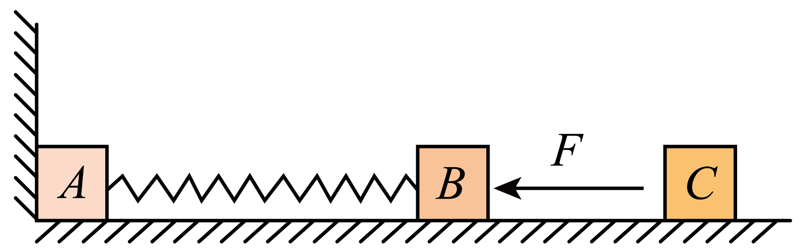

# Physics - 题目 369

**ID**: bd39346088ee4d3586d0b41eaa74b4fe
**年级**: Grade 12
**难度**: Medium-Hard
**题型**: Calculation

## 题目
如图所示，A、B两物块用轻弹簧连接，放在光滑的水平面上，A与竖直墙面接触，现用 $F=20{\rm{N}}$ 向左的水平推力使B处于图示位置时静止。​​​​​​​‌在物块B的右侧 $20{\rm{c}}{\rm{m}}$ 处静止放置一物块C，且物块B、C相碰后会粘在一起。物块A、B、C的质量均为 $1{\rm{k}}{\rm{g}}$ ，弹簧的劲度系数为 $100{\rm{N}}/{\rm{m}}$ ，弹簧的弹性势能表达式为 $E{{}_{{\rm{p}}}}=\frac {1}{2}kx{^{2}}$ （ $x$ 为弹簧相对原长的形变量）。三物块均可视为质点，瞬间撤去推力后，求：(1)物块B、C碰撞后瞬间的速度大小；(2)物块A的最大速度的大小；(3)物块A离开墙壁后弹簧的最大伸长量。

## 解答

1. （1）由胡克定律
2. $F=kx$
3. 解得开始时弹簧的压缩量
4. $x=0.2{\rm{m}}$
5. 即物块B刚要与物块C相碰时弹簧恢复原长，由动能定理可得
6. $W{{}_{弹}}=\frac {1}{2}kx{^{2}}=\frac {1}{2}m{{}_{{\rm{B}}}}v{{}_{1}^{2}}$
7. 解得
8. $v{{}_{1}}=2{\rm{m}}/{\rm{s}}$
9. 由动量守恒可得
10. $m{{}_{{\rm{B}}}}v{{}_{1}}=\left ({m{{}_{{\rm{B}}}}+m{{}_{{\rm{C}}}}}\right )v{{}_{2}}$
11. 解得
12. $v{{}_{2}}=1{\rm{m}}/{\rm{s}}$
13. （2）当弹簧恢复到原长时A物块速度最大，设为 $v{{}_{4}}$ ，由动量守恒可得
14. $\left ({m{{}_{{\rm{B}}}}+m{{}_{{\rm{C}}}}}\right )v{{}_{2}}=\left ({m{{}_{{\rm{B}}}}+m{{}_{{\rm{C}}}}}\right )v{{}_{3}}+m{{}_{{\rm{A}}}}v{{}_{4}}$
15. 由机械能守恒可得
16. $\frac {1}{2}\left ({m{{}_{{\rm{B}}}}+m{{}_{{\rm{C}}}}}\right )v{{}_{2}^{2}}=\frac {1}{2}\left ({m{{}_{{\rm{B}}}}+m{{}_{{\rm{C}}}}}\right )v{{}_{3}^{2}}+\frac {1}{2}m{{}_{{\rm{A}}}}v{{}_{4}^{2}}$
17. 联立解得
18. $v{{}_{4}}=\frac {4}{3}{\rm{m}}/{\rm{s}}$
19. （3）当物块A离开墙壁后，A、B、C第一次共速时弹簧的伸长量最大，由动量守恒有
20. $\left ({m{{}_{{\rm{B}}}}+m{{}_{{\rm{C}}}}}\right )v{{}_{2}}=\left ({m{{}_{{\rm{A}}}}+m{{}_{{\rm{B}}}}+m{{}_{{\rm{C}}}}}\right )v{{}_{5}}$
21. 解得
22. $v{{}_{5}}=\frac {2}{3}{\rm{m}}/{\rm{s}}$
23. 由能量守恒有
24. $\frac {1}{2}\left ({m{{}_{{\rm{B}}}}+m{{}_{{\rm{C}}}}}\right )v{{}_{2}^{2}}-\frac {1}{2}\left ({m{{}_{{\rm{A}}}}+m{{}_{{\rm{B}}}}+m{{}_{{\rm{C}}}}}\right )v{{}_{5}^{2}}=\frac {1}{2}kx{{}_{1}^{2}}$
25. 解得
26. $x{{}_{1}}=\frac {\sqrt {6}}{30}{\rm{m}}$

## 知识点

**中文**:
  - 动量守恒与弹簧相结合

**English**:
  - Momentum Conservation with Springs

---
