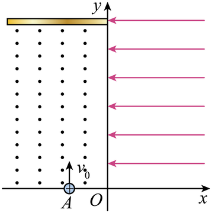

# Physics - 题目 1523

**ID**: c09cbbbe8f924ae8bc8cba95b59ba494
**年级**: Grade 12
**难度**: Medium-Hard
**题型**: Calculation

## 题目
如图所示，xOy平面内第一象限有沿 $-x$ 方向的匀强电场，第二象限有垂直于纸面向外的匀强磁场，且在 $y=3\sqrt {3}a$ 处有一无限大平行 $x$ 轴的挡板，质量为 $m$ 、带电量为 $+q$ 的粒子从A点 $(-a,0)$ ，以 $+y$ 方向的速度 $v{{}_{0}}$ 射入磁场，当粒子进入电场时其速度与 $+y$ 方向的夹角为60°，然后粒子又射出电场重新进入磁场垂直打在挡板上，不计重力。​​​​​​​‌（1）求磁感应强度的大小 $B$ ；（2）求电场强度的大小 $E$ ；（3）若粒子从A点以与 $+x$ 方向成30°角的速度 $v{{}_{0}}$ 射入磁场，向下移动挡板的位置，仍然使粒子打在相同位置，求移动后挡板位置的 $y$ 坐标。

## 解答

1. （1）根据题意，作出粒子运动轨迹如图所示，由几何关系有 $r=r{\cos}θ+a$
2. 解得 $r=2a$
3. 由牛顿第二定律有 $qv{{}_{0}}B=m\frac {v{{}_{0}}{^{2}}}{r}$
4. 解得 $B=\frac {mv{{}_{0}}}{2qa}$
5. 
6. （2）由对称性可知，粒子射出电场时，速度大小仍为 $v{{}_{0}}$ ，方向与 $y$ 轴的夹角为60°，由几何关系可得粒子在电场中沿 $y$ 方向的距离 $Δy=3\sqrt {3}a-2r\sin 60{}\degree =\sqrt {3}a$
7. 则粒子在电场中的运动时间为 $t=\frac {Δy}{v{{}_{0}}{\cos}θ}=\frac {2\sqrt {3}a}{v{{}_{0}}}$
8. 沿电场方向上，由牛顿第二定律有 $qE=ma$
9. 由运动学公式有 $2v{{}_{0}}\sin 60{}\degree =at$
10. 解得 $E=\frac {mv{{}_{0}}{^{2}}}{2qa}$ 。
11. （3）粒子的运动轨迹如图所示，由几何关系可知，挡板移动后的位置坐标为下列值时，粒子会打在相同位置上
12. ${y}_{1}=2(r-r\cos 30°)=(4-2\sqrt{3})a$
13. $y{{}_{2}}=y{{}_{1}}+2r{\cos}30{}\degree =4a$
14. ${y}_{3}={y}_{2}+2(r-r\cos 30°)=(8-2\sqrt{3})a$
15. 

## 知识点

**中文**:
  - 带电粒子在组合场中的运动

**English**:
  - Motion in Combined Fields

---
