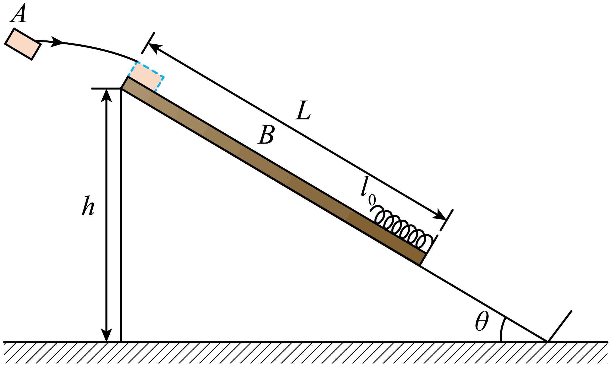

# Physics - 题目 855

**ID**: c0b15f1210514369aae6d65a716eaf3c
**年级**: Grade 12
**难度**: Medium-Hard
**题型**: Calculation

## 题目
如图所示，倾角 $θ=30{}\degree $ 、高度 $h=1.5{\rm{m}}$ 的斜面体固定在水平地面上，质量 $m=1{\rm{k}}{\rm{g}}$ 、总长度 $L=2.0{\rm{m}}$ 的薄木板B置于斜面顶端，其下端连接一根原长 $l{{}_{0}}=0.2{\rm{m}}$ 的轻弹簧。​​​​​​​‌质量 $M=3{\rm{k}}{\rm{g}}$ 的小物块A以水平初速度 $v{{}_{0}}=2\sqrt {3}{\rm{m}}/{\rm{s}}$ 抛出，恰好从斜面顶端沿平行于斜面方向落到木板上，木板下滑到斜面底端碰到挡板时立刻停下并被固定，物块A最后恰没能脱离弹簧。已知A、B之间的动摩擦因数 $μ{{}_{1}}=\frac {\sqrt {3}}{2}$ ，木板B与斜面的摩擦因数为 $μ{{}_{2}}=\frac {\sqrt {3}}{3}$ ，最大静摩擦力等于滑动摩擦力，重力加速度 $g=10{\rm{m}}/{\rm{s}}{^{2}}$ ，不计空气阻力。求：(1)物块A刚落到木板B上时，物块A的速度大小v；(2)物块A与薄木板B共速时，物块A到薄木板B上端的距离。(3)弹簧的最大压缩量。

## 解答

1. （1）由题知，物块A落到木板时的速度大小为 $v=\frac {v{{}_{0}}}{{\cos}30{^{\circ }}}=\frac {2\sqrt {3}}{\frac {\sqrt {3}}{2}}{\rm{m}}/{\rm{s}}=4{\rm{m}}/{\rm{s}}$
2. （2）物块A在木板B上滑行时，对物块A分析，根据牛顿第二定律有 $μ{{}_{1}}Mg{\cos}30{^{\circ }}-Mg\sin 30{^{\circ }}=Ma{{}_{A}}$ ，解得 $a{{}_{A}}=2.5{\rm{m}}/{\rm{s}}{^{2}}$ ，方向沿斜面向上，即物块A向下做匀减速直线运动；对木板B分析，根据牛顿第二定律有 $mg\sin 30{^{\circ }}+μ{{}_{1}}Mg{\cos}30{^{\circ }}-μ{{}_{2}}\left ({m+M}\right )g{\cos}30{^{\circ }}=ma{{}_{B}}$ ，解得 $a{{}_{B}}=7.5{\rm{m}}/{\rm{s}}{^{2}}$ ，方向沿斜面向下，即木板B向下做匀加速直线运动；设经时间t两者共速，则有 $v{{}_{共}}=v-a{{}_{A}}t=a{{}_{B}}t$ ，解得 $v{{}_{共}}=3{\rm{m}}/{\rm{s}}$ ， $t=0.4{\rm{s}}$ ，物块A向下运动的位移为 $x{{}_{A}}=vt-\frac {1}{2}a{{}_{A}}t{^{2}}=1.4{\rm{m}}$ ，木板B向下运动的位移为 $x{{}_{B}}=\frac {1}{2}a{{}_{B}}t{^{2}}=0.6{\rm{m}}{\rm{<}}\frac {h}{\sin 30{^{\circ }}}-L=1{\rm{m}}$ ，所以当物块A与木板B共速时，木板B还没有下到最底端，物块A到木板B上端的距离 $Δx=x{{}_{A}}-x{{}_{B}}=0.8{\rm{m}}$
3. （3）因 $Δx=0.8{\rm{m}}{\rm{<}}L-l{{}_{0}}=1.8{\rm{m}}$ ，说明物块A与木板B共速时，物块A还没有压缩弹簧且木板B还没有到达底端。两者共速后，对物块A分析，有 $μ{{}_{1}}Mg{\cos}30{^{\circ }}>Mg\sin 30{^{\circ }}$  ，物块A相对木板B静止向下运动；对整体分析，有 $\left ({m+M}\right )g\sin 30{^{\circ }}=μ{{}_{2}}\left ({m+M}\right )g{\cos}30{^{\circ }}$ ，整体一起向下匀速，直到木板B下端与底端挡板碰撞，木板B立即停下，物块A以 $v{{}_{共}}=3{\rm{m}}/{\rm{s}}$ 向下运动，直到弹簧压缩量达到最大，设弹簧的最大压缩量为 $x{{}_{{\rm{m}}}}$ ，对物块A运动分析，下滑的位移为 $x^{′}{{{}_{A}}}=L-{\rm{Δ}}x-\left ({l{{}_{0}}-x{{}_{{\rm{m}}}}}\right )=1+x{{}_{{\rm{m}}}}$ ，根据动能定理有 $mg\sin 30{^{\circ }}\cdot x^{′}{{{}_{A}}}-μ{{}_{1}}mg{\cos}30{^{\circ }}\cdot x^{′}{{{}_{A}}}-W{{}_{弹}}=0-\frac {1}{2}mv{{}_{共}^{2}}$ ，由题意知，物块A最后恰没能脱离弹簧，说明物块A刚好回到弹簧的原长点位置，速度零，则从压缩量最大位置到原长点，根据动能定理有 $W{{}_{弹}}-mg\sin 30{^{\circ }}\cdot x{{}_{{\rm{m}}}}-μ{{}_{1}}mg{\cos}30{^{\circ }}\cdot x{{}_{{\rm{m}}}}=0$ ，联立可得 $x{{}_{{\rm{m}}}}=\frac {2}{15}{\rm{m}}$

## 知识点

**中文**:
  - 匀变速直线运动的速度—位移公式及其应用
  - 受力分析
  - 斜面模型与等时圆模型
  - 平抛运动与斜面、圆轨道相结合问题
  - 弹簧问题中机械能守恒定律的应用

**English**:
  - Velocity-Displacement Formula and Applications
  - Force Analysis
  - Inclined Plane Model and Isochronous Circle Model
  - Horizontal Projectile on Inclined Planes and Circular Tracks
  - Spring Problems

---
