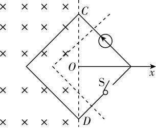

# Physics - 题目 474

**ID**: c1d5fa5fe5844bb4b40733d252eb0ff2
**年级**: Grade 12
**难度**: Medium-Hard
**题型**: Calculation

## 题目
（12分）如图所示，接有恒流源的正方形线框边长为 $\sqrt{2}L$ 、质量为 $m$ 、电阻为 $R$ ，放在光滑水平地面上，线框部分处于垂直地面向下、磁感应强度为 $B$ 的匀强磁场中。​​​​​​​‌以磁场边界 $CD$ 上一点为坐标原点，水平向右建立 $Ox$ 轴，线框中心和一条对角线始终位于 $Ox$ 轴上。开关 $\mathrm{S}$ 断开，线框保持静止，不计空气阻力。（1） 线框中心位于 $x=0$ ，闭合开关 $\mathrm{S}$ 后，线框中电流大小为 $I$ ，求① 闭合开关 $\mathrm{S}$ 瞬间，线框受到的安培力大小；② 线框中心运动至 $x=\frac{L}{2}$ 过程中，安培力做功及冲量；③ 线框中心运动至 $x=\frac{L}{2}$ 时，恒流源提供的电压；（2） 线框中心分别位于 $x=0$ 和 $x=\frac{L}{2}$ ，闭合开关 $\mathrm{S}$ 后，线框中电流大小为 $I$ ，线框中心分别运动到 $x=L$ 所需时间分别为 ${t}_{1}$ 和 ${t}_{2}$ ，求 ${t}_{1}-{t}_{2}$ 。

## 解答

1. ① 闭合开关 $\mathrm{S}$ 瞬间，线框在磁场中的有效长度为 $l=2L$ （1分）
2. 所以线框受到的安培力大小为
3. ${F}_{安1}=BIl=2BIL$ （1分）
4. ② 线框中心运动到 $x$ 时，安培力大小为
5. ${F}_{安}=2BI(L-x)$ （1分）
6. 则初始时和线框中心运动至 $x=\frac{L}{2}$ 时的安培力分别为
7. ${F}_{安1}=2BIL$ 、 ${F}_{安2}=BIL$ ，
8. 则线框中心运动至 $x=\frac{L}{2}$ 过程中，安培力做功为
9. ${W}_{安}={\overline{F}}_{安}\cdot \mathrm{\Delta }x=\frac{{F}_{安1}+{F}_{安2}}{2}\cdot \frac{L}{2}=\frac{3BI{L}^{2}}{4}$ （1分）
10. 由动能定理得 ${W}_{安}=\frac{1}{2}m{v}^{2}$ （1分）
11. 解得 $v=\sqrt{\frac{3BI}{2m}}L$ ，
12. 则安培力的冲量大小为
13. ${I}_{冲}=mv=\sqrt{\frac{3IBm}{2}}L$ ，方向沿 $x$ 轴正方向（1分）
14. ③ 由能量守恒定律得
15. $UI\mathrm{\Delta }t=BILv\mathrm{\Delta }t+{I}^{2}R\mathrm{\Delta }t$ （1分）
16. 解得恒流源提供的电压为
17. $U=B{L}^{2}\sqrt{\frac{3BI}{2m}}+IR$ （1分）
18. （2） 线框中心运动到 $x$ 时，安培力为 ${F}_{安}=2BI(L-x)$ ,类比简谐运动，则回复力为
19. ${F}_{回}={F}_{安}=2BI(L-x)=-2BIx\prime =-kx\prime $ （1分）
20. 根据简谐运动周期公式
21. $T=2\mathrm{\pi }\sqrt{\frac{m}{k}}=2\mathrm{\pi }\sqrt{\frac{m}{2IB}}$ （1分）
22. 由题意可知，两次简谐运动周期相同，两次都从最大位移处运动到平衡位置，时间均相同，则
23. ${t}_{1}={t}_{2}=\frac{T}{4}=\frac{\mathrm{\pi }}{2}\sqrt{\frac{m}{2IB}}$ （1分）
24. 故 ${t}_{1}-{t}_{2}=0$ （1分）

## 知识点

**中文**:
  - 安培力作用下的运动问题
  - 振幅、周期、频率、相位和波长及其计算

**English**:
  - Motion under Ampere Force
  - Calculation of Amplitude, Period, Frequency, Phase, and Wavelength

---
