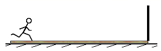

# Physics - 题目 2300

**ID**: c46060ecf22542d5b839320595b4f0cc
**年级**: Grade 12
**难度**: Medium-Hard
**题型**: Calculation

## 题目
如图所示，长12m质量为50kg的木板右端有一立柱，木板置于水平地面上，木板与地面间的动摩擦因数为0.1，质量为50kg的人立于木板左端，木板与人均静止，当人以4m/ s^{2}的加速度匀加速向右奔跑至板的右端时，立刻抱住立柱，（取g=10m/s^{2}）试求：(1)人在奔跑过程中受到的摩擦力的大小；(2)人在奔跑过程中木板的加速度；(3)人从开始奔跑至到达木板右端所经历的时间。​​​​​​​‌

## 解答

1. (1)设人的质量为m，加速度为a_{1}，木板的质量为M，加速度为a_{2}，人对木板的摩擦力为f。则对人有
2. f=ma_{1}=200N
3. 方向向右。
4. (2)对木板
5. $f-μ(M+m)g=Ma{{}_{2}}$
6. 带入数据解得
7. a_{2}=2m/s^{2}
8. 方向向左；
9. (3)设人从左端到右端的时间为t，由运动公式
10. $L=\frac {1}{2}a{{}_{1}}t{^{2}}+\frac {1}{2}a{{}_{2}}t{^{2}}$
11. 带入数据解得
12. t=2s

## 知识点

**中文**:
  - 匀变速直线运动基本公式的灵活应用
  - 板块模型

**English**:
  - Flexible Application of Basic UVRM Formulas
  - Plate Model

---
