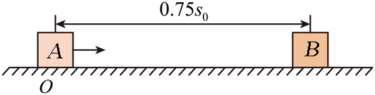

# Physics - 题目 1188

**ID**: c470142bea7d426d83fc25750205f19b
**年级**: Grade 12
**难度**: Medium-Hard
**题型**: Calculation

## 题目
为研究碰撞过程中的规律，某实验小组设计了如下实验：如图所示，一质量为m的物块A在粗糙水平面上向右运动，经过O点时的速度大小为 $v{{}_{0}}$ （未知），最终停在O点右侧 $s{{}_{0}}$ 处。​​​​​​​‌现将质量也为m的物块B放在距离O点右侧 $0.75s{{}_{0}}$ 处，让物块A从O点出发也以速度大小 $v{{}_{0}}$ 向右运动，并与物块B发生碰撞，物块A、B碰撞时间极短。已知物块A与水平面间的动摩擦因数为 $μ$ ，物块B与水平面间的动摩擦因数为 $2μ$ ，重力加速度为g，求：（1）速度大小 $v{{}_{0}}$ ；（2）若物块A与B发生弹性碰撞，求碰后瞬间物块A、B的速度大小分别多大；（3）设物块A与B碰前瞬间的速度为v，碰后瞬间物块A、B的速度分别为 $v{{}_{1}}$ 、 $v{{}_{2}}$ ，在物理学上通常定义碰撞恢复系数为 $e=\frac {v{{}_{2}}-v{{}_{1}}}{v}$ ；若要求物块A、B至少发生两次碰撞，求恢复系数e的取值范围。

## 解答

1. （1）对物块A受力分析，则有 ${\rm }{\rm μm}g=ma{{}_{1}}{\rm }$ ，解得 $a{{}_{1}}=μ{\rm{g}}$ ，根据运动学公式有 $-2a{{}_{1}}s{{}_{0}}=0-v{{}_{0}^{2}}$ ，解得 $v{{}_{0}}=\sqrt {2μgs{{}_{0}}}$ 。
2. （2）设物块A与B碰前瞬间的速度为v，根据运动学公式可得 $v{^{2}}-v{{}_{0}^{2}}=-2a{{}_{1}}\cdot 0.75s{{}_{0}}$ ，解得 $v=\sqrt {\frac {1}{2}μgs{{}_{0}}}$ ，设碰后瞬间物块A、B的速度分别为 $v{{}_{A}}$ 、 $v{{}_{B}}$ ，根据动量守恒定律与机械能守恒定律可得 $mv=mv{{}_{A}}+mv{{}_{B}}$ ， $\frac {1}{2}mv{^{2}}=\frac {1}{2}mv{{}_{A}^{2}}+\frac {1}{2}mv{{}_{B}^{2}}$ ，联立解得 $v{{}_{A}}=0$ ， $v{{}_{B}}=\sqrt {\frac {1}{2}μgs{{}_{0}}}$ 。
3. （3）对物块B受力分析，则有 $2{\rm μm}g=ma{{}_{2}}$ ，解得 $a{{}_{2}}=2μg$ ，设碰撞恢复系数为 $e{{}_{1}}$ 时，物块A、B恰好发生两次碰撞 $e{{}_{1}}=\frac {v{{}_{2}}-v{{}_{1}}}{v}$ ，根据动量守恒定律可得 $mv=mv{{}_{1}}+mv{{}_{2}}$ ，物块A、B恰好发生第二次碰撞时满足 $\frac {v{{}_{1}^{2}}}{2a{{}_{1}}}=\frac {v{{}_{2}^{2}}}{2a{{}_{2}}}$ ，联立解得 $e{{}_{1}}=3-2\sqrt {2}$ ，恢复系数e的取值范围为 $0<e⩽3-2\sqrt {2}$ 。

## 知识点

**中文**:
  - 动量守恒中的多次碰撞问题

**English**:
  - Multiple Collisions in Momentum Conservation

---
