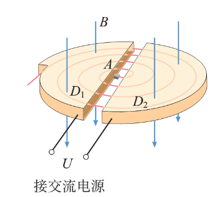

# Physics - 题目 875

**ID**: c8f7222f3c9c47ecb75fedfae54df1e1
**年级**: Grade 12
**难度**: Medium-Hard
**题型**: Calculation

## 题目
在研究原子核的内部结构时，需要用能量很高的粒子去轰击原子核。​​​​​​​‌粒子加速器可以用人工方法使带电粒子获得很大速度和能量。图甲是回旋加速器的结构示意图，D_{1}和D_{2}是两个中空的半径为R的半圆型金属盒，两盒之间留有间距为d的窄缝，它们之间有一定的电势差。两个金属盒处于与盒面垂直的匀强磁场中，磁感应强度为B。D_{1}盒的中央A处的粒子源可以产生质量为m、电荷量为+q的粒子。粒子在两盒之间被电场加速，之后进入磁场后做匀速圆周运动。经过若干次加速后，将粒子从金属盒边缘引出。设粒子在交变电场中运动时电压大小为U，不考虑粒子离开A处时的速度、粒子重力、粒子间的相互作用及相对论效应。(1)求粒子被引出时的动能E_{k}；(2)求粒子被电场加速的次数n；(3)随着粒子在电场中的不断加速，粒子在磁场中的运动速率一次比一次增大，然而粒子每次在金属盒中的运动时间却相同，粒子在交变电场中加速的总时间也可以忽略。已知10MeV以上的回旋加速器中磁感应强度的数量级为1T，金属盒的直径在1m以上，窄缝之间距离约为0.1cm。请你结合上述参数，通过推导和估算加以分析。

## 解答

1. (1)粒子在磁场中做匀速圆周运动时，洛伦兹力充当向心力，被引出时的速度为 $v$ ，根据牛顿第二定律有
2. $qvB=m\frac {v{^{2}}}{R}$
3. 解得
4. $v=\frac {qBR}{m}$
5. 粒子被引出时的动能
6. $E{{}_{{\rm{k}}}}=\frac {1}{2}mv{{}^{2}}=\frac {q{^{2}}B{^{2}}R{^{2}}}{2m}$
7. (2)粒子在电场中被加速 $n$ 次，根据动能定理有
8. $nqU=E{{}_{{\rm{k}}}}$
9. 解得
10. $n=\frac {qB{^{2}}R{^{2}}}{2mU}$
11. (3)粒子在加速器中运动的时间可以看成两部分时间之和：在金属盒内旋转 $\frac {n}{2}$ 圈的时间 $t{{}_{1}}$ 和通过金属盒间隙 $n$ 次所需的时间 $t{{}_{2}}$ ，粒子在磁场中做匀速圆周运动时，洛伦兹力充当向心力，则有
12. $qvB=m\frac {v{^{2}}}{r}$
13. 运动周期
14. $T=\frac {2{\rm{π}}r}{v}{\rm{=}}\frac {2{\rm{π}}m}{Bq}$
15. 由此可知粒子运动周期与粒子速度无关，每次在金属盒中的运动时间相同，粒子在磁场中运动时间
16. $t{{}_{1}}=\frac {n}{2}T=\frac {{\rm{π}}BR{^{2}}}{2U}$
17. 粒子在电场中运动时，根据匀变速直线运动规律
18. $nd=\frac {v{~}}{2}t{{}_{2}}$
19. 可得
20. $t{{}_{2}}{\rm{=}}\frac {BRd}{U}$
21. 粒子在磁场中运动时间与在电场中运动时间之比
22. $\frac {t{{}_{1}}}{t{{}_{2}}}{\rm{=}}\frac {{\rm{π}}R}{2d}\approx 8\times 10{^{2}}$
23. 由此可知粒子在电场中的加速时间可以忽略。

## 知识点

**中文**:
  - 回旋加速器

**English**:
  - Cyclotron

---
