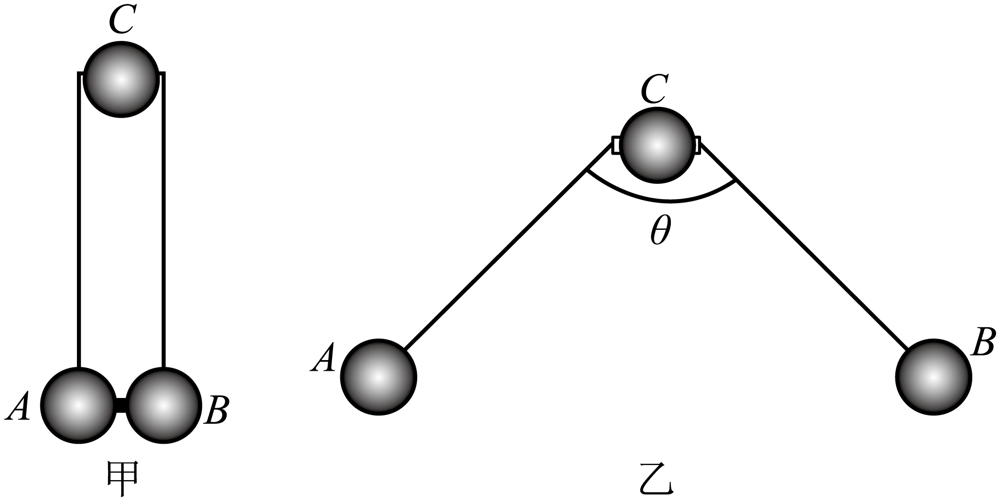

# Physics - 题目 519

**ID**: c91853dceb2f4ea194ebff3379aa15c7
**年级**: Grade 12
**难度**: Medium-Hard
**题型**: Calculation

## 题目
如图甲所示，在光滑水平面上有A、B、C三个小球，A、B两球分别用水平轻杆通过光滑铰链与C球连接，两球间夹有劲度系数足够大、长度可忽略的压缩轻弹簧，弹簧与球不拴接。​​​​​​​‌固定住C球，释放弹簧，A、B两球瞬间脱离弹簧并被弹出，已知此过程中弹簧释放的弹性势能E_{p}=8 J，A、B两球的质量均为m=0.5 kg，C球的质量M=1 kg，杆长L=0.5 m，弹簧在弹性限度内。（1）求A、B两球与弹簧分离瞬间杆中弹力大小；（2）若C球不固定，求释放弹簧后C球的最大速度v；（3）若C球不固定，求从A、B两球与弹簧分离时到两杆间夹角第一次为θ=90°的过程中（如图乙），杆对B球所做的功W。

## 解答

1. （1）由对称性可知，与弹簧分离瞬间两球速度大小相等，设为v_{0}，由系统机械能守恒定律得 $E{{}_{{\rm{p}}}}=2\times \frac {1}{2}mv{{}_{0}^{2}}$ ，解得 $v{{}_{0}}=4{\rm{m}}{\rm{/}}{\rm{s}}$ ，对A球，由牛顿第二定律得 $F=m\frac {v{{}_{0}^{2}}}{L}=0.5\times \frac {4{^{2}}}{0.5}{\rm{N}}{\rm{=}}16{\rm{N}}$ ，球与弹簧分离瞬间杆中弹力大小为16 N;
2. （2）如图所示
3. 
4. 设两杆夹角为θ时，C球的速度为v_{C}，将A、B两球的速度正交分解，根据对称性可知 $v{{}_{Ay}}=v{{}_{By}}=v{{}_{y}}$ ， $v{{}_{Ax}}=v{{}_{Bx}}=v{{}_{x}}$ ，由y轴方向动量守恒得 $0=Mv{{}_{C}}-2mv{{}_{y}}$ ，系统机械能守恒得 $E=\frac {1}{2}Mv{{}_{C}^{2}}+2\times \frac {1}{2}m\left ({v{{}_{x}^{2}}+v{{}_{y}^{2}}}\right ){\rm ，\mathit{BC}}$ 两球沿杆方向的分速度相同，则 $v{{}_{C}}{\rm{c}}{\rm{o}}{\rm{s}}\frac {θ}{2}=v{{}_{x}}{\rm{s}}{\rm{i}}{\rm{n}}\frac {θ}{2}-v{{}_{y}}{\rm{c}}{\rm{o}}{\rm{s}}\frac {θ}{2}$ ，联立可得： $v{{}_{C}}=\sqrt {\frac {8{\rm{s}}{\rm{i}}{\rm{n}}{^{2}}\frac {θ}{2}}{1+{\rm{c}}{\rm{o}}{\rm{s}}{^{2}}\frac {θ}{2}}}$ ，故当θ=180°时，C球的速度最大，且最大值为 $v{{}_{C}}=2\sqrt {2}{\rm{m}}{\rm{/}}{\rm{s}}$ ；
5. （3）球与弹簧分离后到两杆间夹角第一次为θ=90°时，由以上可求得： $v{{}_{y}}=v{{}_{C}}=\frac {2\sqrt {6}}{3}{\rm{m}}{\rm{/}}{\rm{s}}$  ，
6. $v{{}_{x}}=2v{{}_{C}}=\frac {4\sqrt {6}}{3}{\rm{m}}{\rm{/}}{\rm{s}}$ ，解得 $v{{}_{B}}=\frac {2\sqrt {30}}{3}{\rm{m}}{\rm{/}}{\rm{s}}$ ， 对B球应用动能定理得 $W=\frac {1}{2}mv{{}_{B}^{2}}-\frac {1}{2}mv{{}_{0}^{2}}=-\frac {2}{3}{\rm{J}}$ 。

## 知识点

**中文**:
  - 动量守恒与弹簧相结合

**English**:
  - Momentum Conservation with Springs

---
