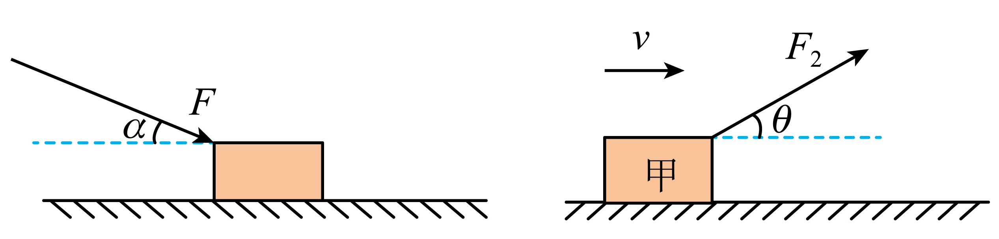

# Physics - 题目 681

**ID**: cb0f4abf598849a9a3046e125b1d90e8
**年级**: Grade 12
**难度**: Medium-Hard
**题型**: Calculation

## 题目
小明和小语到机场去为朋友送行，看到有一些旅客斜向下推着旅行箱走，也有一些旅客斜向上拉着旅行箱走。​​​​​​​‌为使质量为25kg的行李箱在水平面上做匀速直线运动，可用与水平方向成30°角的力 $F{{}_{1}}=100{\rm{N}}$ 斜向下推行李箱如左图，重力加速度 $g$ 取10m/s^{2}。（1）求行李箱与粗糙水平面之间的动摩擦因数 $μ$ ；（2）若现用斜向上的拉力 $F{{}_{2}}$ 作用在行李箱上，如右图所示，求能使旅行箱匀速运动的 $F{{}_{2}}$ 的最小值及此时 $F{{}_{2}}$ 与水平地面间的夹角 $θ$ 的正切值。

## 解答

1. （1）对行李箱受力分析可知 $F{{}_{1}}\sin α+mg=F{{}_{{\rm{N}}1}}$ ， $f{{}_{1}}=F{{}_{1}}{\cos}α$
2. 且有 $f{{}_{1}}=μF{{}_{{\rm{N}}1}}$
3. 解得 $μ=\frac {\sqrt {3}}{6}$
4. （2）对右图旅行箱受力分析可知 $F{{}_{2}}\sin θ+F{{}_{{\rm{N}}2}}=mg$ ， $f{{}_{2}}=F{{}_{2}}{\cos}θ$
5. 且有 $f{{}_{2}}=μF{{}_{{\rm{N}}2}}$
6. 整理可得 $F{{}_{2}}=\frac {{\rm μm}g}{μ\sin θ+{\cos}θ}$
7. 由数学知识化简得 $F{{}_{2}}=\frac {{\rm μm}g}{μ\sin θ+{\cos}θ}=\frac {{\rm μm}g}{\sqrt {1+μ{^{2}}}\left ({\frac {μ}{\sqrt {1+μ{^{2}}}}\sin θ+\frac {1}{\sqrt {1+μ{^{2}}}}{\cos}θ}\right )}$
8. 令 ${\cos}φ=\frac {μ}{\sqrt {1+μ{^{2}}}}$ ， $\sin φ=\frac {1}{\sqrt {1+μ{^{2}}}}$
9. 原式可得 $F{{}_{2}}=\frac {{\rm μm}g}{\sqrt {1+μ{^{2}}}\left ({{\cos}φ\sin θ+\sin φ{\cos}θ}\right )}=\frac {{\rm μm}g}{\sqrt {1+μ{^{2}}}\sin \left ({θ+φ}\right )}$
10. 当 $θ+φ=\frac {π}{2}$ 时， $F{{}_{2}}$ 的最小值 ${\rm{F}}{{}_{2{\rm \min }}}=\frac {{\rm μm}g}{\sqrt {1+{\rm{μ}}{^{2}}}}=\frac {250\sqrt {13}}{13}{\rm{N}}$
11. 此时 ${\tan}θ=\frac {1}{{\tan}φ}=\frac {\sqrt {3}}{6}$

## 知识点

**中文**:
  - 三角函数求解力
  - 用正交分解法分析问题

**English**:
  - Solving Forces using Trigonometry
  - Problem Analysis using Orthogonal Decomposition

---
