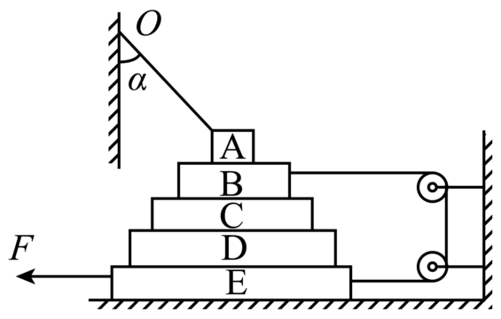

# Physics - 题目 1944

**ID**: cc8b27f9c68c4b49baca83d283ac9e40
**年级**: Grade 12
**难度**: Medium-Hard
**题型**: Calculation

## 题目
如图所示，A、B、C、D、E五个长方体滑块叠放在粗糙水平面上，A物块的质量 $m{{}_{1}}=2{\rm{k}}{\rm{g}}{\rm ，B}$ 、C、D、E的质量均为 $m{{}_{2}}=1{\rm{k}}{\rm{g}}{\rm ，A}$ 物块用轻绳OA与竖直墙面相连，OA处于拉紧状态，OA绳与竖直方向的夹与角 $α=37{}\degree {\rm ，BE}$ 间用轻绳通过光滑滑轮相连，与B、E相连的绳水平，AB间、BC间、CD间、DE间、E与水平面间的动摩擦因数分别为 $μ{{}_{1}}=0.5$ 、 $μ{{}_{2}}=0.4$ 、 $μ{{}_{3}}=0.3$ 、 $μ{{}_{4}}=0.2$ 、 $μ{{}_{5}}=0.1$ 。​​​​​​​‌现用一水平拉力 $F$ 将滑块E缓慢拉动，最大静摩擦力大小等于滑动摩擦力大小，（ $g=10{\rm{m}}{\rm{/}}{\rm{s}}{^{2}}$ ， $\sin 37\mathrm{°}=0.6$ ， ${\cos}37\mathrm{°}=0.8$ ）。求：（1）OA绳的拉力大小 $F{{}_{{\rm{T}}1}}$ ；（2）滑块 $E$ 与水平面间的摩擦力大小 $F{{}_{{\rm{f}}{{5}}}}$ ；（3）拉力 $F$ 的大小。

## 解答

1. （1）由 ${\rm{B}}$ 与 ${\rm{E}}$ 之间由绳连接，当 $E$ 向左发生滑动时必定拖着 ${\rm{B}}$ 向右滑动，且 ${\rm{B}}$ 仅在水平方向上移动，所以 ${\rm{A}}$ 静止不动， ${\rm{A}}$ 与 ${\rm{B}}$ 之间存在滑动摩擦。
2. 对 ${\rm{A}}$ 进行受力分析如图，除重力 $m{{}_{1}}g$ 和绳子的张力 $F{{}_{{\rm{T}}{{1}}}}$ 外，还受到来自 ${\rm{B}}$ 的支持力 $F{{}_{{\rm{N}}{{1}}}}$ 和滑动摩擦力 $F{{}_{{\rm{f}}{{1}}}}$ ，在水平方向上受力平衡
3. $F{{}_{{\rm{f}}{{1}}}}-F{{}_{{\rm{T}}1}}\sin α=0$
4. 竖直方向上受力平衡 $F{{}_{{\rm{T}}1}}{\cos}α+F{{}_{{\rm{N}}1}}-m{{}_{1}}g=0$
5. 以及由滑动摩擦力规律 $F{{}_{{\rm{f}}1}}=μ{{}_{1}}F{{}_{{\rm{N}}{{1}}}}$
6. 解得 $F{{}_{{\rm{T}}{{1}}}}=\frac {μ{{}_{1}}m{{}_{1}}g}{μ{{}_{1}}{\cos}α+\sin α}=10{\rm{N}}$
7. （2）由上一问求得 ${\rm{A}}$ 对 ${\rm{B}}$ 的压力
8. $F{{}_{{\rm{N}}{{1}}}}=m{{}_{1}}g-F{{}_{{\rm{T}}1}}{\cos}α=12{\rm{N}}$  ${\rm{A}}{\rm{B}}{\rm{C}}{\rm{D}}{\rm{E}}$ 均在竖直方向上受力平衡，设 ${\rm{B}}$ 对 ${\rm{C}}$ 的压力大小为 $F{{}_{{\rm{N}}2}}$ ， ${\rm{C}}$ 对 ${\rm{D}}$ 的压力大小为 $F{{}_{{\rm{N}}3}}$ ， ${\rm{D}}$ 对 ${\rm{E}}$ 的压力大小为 $F{{}_{{\rm{N}}{{4}}}}$ ， ${\rm{E}}$ 对地面的压力大小为 $F{{}_{{\rm{N}}{{5}}}}$ ，分别对 ${\rm{B}}{\rm{C}}{\rm{D}}{\rm{E}}$ 在竖直方向上受力平衡应有 $F{{}_{{\rm{N}}{{1}}}}+m{{}_{2}}g-F{{}_{{\rm{N}}2}}=0$
9. 即 $F{{}_{{\rm{N}}2}}=F{{}_{{\rm{N}}{{1}}}}+m{{}_{2}}g=22{\rm{N}}$
10. 由 $F{{}_{{\rm{N}}2}}+m{{}_{2}}g-F{{}_{{\rm{N}}3}}=0$
11. 即 $F{{}_{{\rm{N}}3}}=F{{}_{{\rm{N}}2}}+m{{}_{2}}g=32{\rm{N}}$
12. 由 $F{{}_{{\rm{N}}{{3}}}}+m{{}_{2}}g-F{{}_{{\rm{N}}{{4}}}}=0$
13. 即 $F{{}_{{\rm{N}}4}}=F{{}_{{\rm{N}}3}}+m{{}_{2}}g=42{\rm{N}}$
14. 由 $F{{}_{{\rm{N}}{{4}}}}+m{{}_{2}}g-F{{}_{{\rm{N}}5}}=0$
15. 即 $F{{}_{{\rm{N}}{{5}}}}=F{{}_{{\rm{N}}4}}+m{{}_{2}}g=52{\rm{N}}$
16. （3）设 $BE$ 间绳子张力为 $F{{}_{{\rm{T}}2}}$ ，画出 ${\rm{B}}{\rm{C}}{\rm{D}}{\rm{E}}$ 的完整受力分析图
17. 
18. （其中 $F{{}_{{\rm{f}}{{2}}}}$ 与 $F{{}_{{\rm{f}}{{4}}}}$ 的方向可以如此得到：假设 $BC$ 之间光滑，则 ${\rm{B}}$ 有相对于 ${\rm{C}}$ 向右运动的趋势，则 ${\rm{B}}$ 对 ${\rm{C}}$ 的摩擦力方向向右，同理亦可得 ${\rm{D}}$ 对 ${\rm{E}}$ 的摩擦力方向向右）
19. 其中，由 $CD$ 的水平方向受力平衡可以得到 $F{{}_{{\rm{f}}2}}=F{{}_{{\rm{f}}3}}=F{{}_{{\rm{f}}4}}$
20. 而 $BC$ 、 $CD$ 、 $DE$ 间的最大静摩擦分别为 $F{{}_{{\rm{f}}{{2}}{\rm{m}}{\rm{a}}{\rm{x}}}}=μ{{}_{2}}F{{}_{{\rm{N}}2}}=8.8{\rm{N}}$ ， $F{{}_{{\rm{f}}{{3}}{\rm{m}}{\rm{a}}{\rm{x}}}}=μ{{}_{3}}F{{}_{{\rm{N}}{{3}}}}=9.6{\rm{N}}$ ， $F{{}_{{\rm{f}}{{4}}{\rm{m}}{\rm{a}}{\rm{x}}}}=μ{{}_{4}}F{{}_{{\rm{N}}{{4}}}}=8.4{\rm{N}}$
21. 可以看出 $DE$ 间最大静摩擦力最小，在 $BC$ 、 $CD$ 、 $DE$ 之间， $DE$ 最先发生滑动，即 $F{{}_{{\rm{f}}2}}=F{{}_{{\rm{f}}{{3}}}}=F{{}_{{\rm{f}}{{4}}}}=F{{}_{{\rm{f}}{{4}}{\rm{m}}{\rm{a}}{\rm{x}}}}=8.4{\rm{N}}$
22. 由 $B$ 水平方向受力平衡得 $F{{}_{{\rm{f}}{{1}}}}+F{{}_{{\rm{f}}2}}-F{{}_{{\rm{T}}2}}=0$
23. 由 ${\rm{E}}$ 水平方向受力平衡得 $F-F{{}_{{\rm{f}}{{4}}}}-F{{}_{{\rm{T}}2}}-F{{}_{{\rm{f}}{{5}}}}=0$
24. 且由第一问得 $F{{}_{{\rm{f}}{\rm{l}}}}=F{{}_{{\rm{T}}{{1}}}}\sin α=6{\rm{N}}$
25. 解得 $F=F{{}_{{\rm{f}}{{4}}}}+F{{}_{{\rm{f}}{{1}}}}+F{{}_{{\rm{f}}2}}+F{{}_{{\rm{f}}{{5}}}}=28{\rm{N}}$

## 知识点

**中文**:
  - 在共点力平衡中整体法与隔离法的应用
  - 正交分解法与三角形定则在平衡问题中的应用

**English**:
  - Whole and Isolation Methods in Equilibrium
  - Orthogonal Decomposition and Triangle Rule in Equilibrium

---
