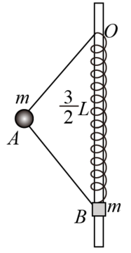

# Physics - 题目 1089

**ID**: cd662d5ce3f74125a8b4e087e4658123
**年级**: Grade 12
**难度**: Medium-Hard
**题型**: Calculation

## 题目
一转动装置如图所示，两根轻杆OA和AB与一小球以及一小环通过铰链连接，两轻杆长度相同，球和环的质量均为m，O端通过铰链固定在竖直的轻质转轴上，套在转轴上的轻质弹簧连接在O与小环之间，原长为L，装置静止时，弹簧长为 $\frac {3}{2}{\rm \mathit{L}}$ ，转动该装置并缓慢增大转速，小环缓慢上升。​​​​​​​‌弹簧始终在弹性限度内，忽略一切摩擦和空气阻力，重力加速度为g，求：（1）弹簧的劲度系数k；（2）AB杆中弹力为零时，装置转动的角速度 $ω{{}_{0}}$ 。

## 解答

1. （1）如图所示，装置静止时，设OA、AB杆中的弹力分别为F_{1}、T_{1}，OA杆与转轴的夹角为θ_{1}，
2. 
3. 小环受到弹簧的弹力 $F{{}_{弹1}}=k\frac {L}{2}$
4. 此时小环受力平衡，有 $F{{}_{弹1}}=mg+T{{}_{1}}{\cos}θ{{}_{1}}$
5. 小球受力平衡，有 $F{{}_{1}}{\cos}θ{{}_{1}}+T{{}_{1}}{\cos}θ{{}_{1}}=mg$ ， $F{{}_{1}}\sin θ{{}_{1}}=T{{}_{1}}\sin θ{{}_{1}}$
6. 联立解得弹簧的劲度系数 $k=\frac {3mg}{L}$
7. （2）设AB杆中弹力为零时，OA杆中的弹力为F_{2}，OA杆与转轴的夹角为 $θ{{}_{2}}$ ，弹簧长度为x，轻杆长度为l，
8. 小环受到弹簧的弹力 $F{{}_{弹2}}=k(x-L)$
9. 小环受力平衡，有 $F{{}_{弹2}}=mg$
10. 解得AB杆中弹力为零时，弹簧的长度 $x=\frac {4}{3}L$
11. 则 ${\cos}θ{{}_{2}}=\frac {x}{2l}$
12. 对小球竖直方向有 $F{{}_{2}}{\cos}θ{{}_{2}}=mg$
13. 对小球，根据牛顿第二定律有 $F{{}_{2}}\sin θ{{}_{2}}=mω{{}_{0}^{2}}l\sin θ{{}_{2}}$
14. 解得AB杆中弹力为零时，装置转动的角速度 $ω{{}_{0}}=\sqrt {\frac {3g}{2L}}$

## 知识点

**中文**:
  - 弹力的大小与胡克定律
  - 水平面内匀速圆周问题

**English**:
  - Magnitude of Elastic Force and Hooke's Law
  - Uniform Circular Motion in Horizontal Plane

---
